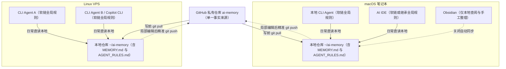

随着日常开发和个人事务越来越重度依赖 AI，我手头的 AI 工具链不知不觉演变成了一个“多端多 Agent”的组合：主力 macOS 笔记本上同时装着 AI IDE 和本地 CLI，远端 Linux VPS 上跑着另一套编程 CLI，偶尔还会按场景切换不同厂商的模型或客户端。

用了一段时间后，一个非常消耗精力的问题浮出水面：**每个 AI 工具的记忆都是孤岛**。

前一天刚在 A 工具里交代过自己的技术栈、终端习惯、项目背景和排坑结论，第二天换到 B 工具，或者切到另一台 Linux 机器上干活，一切又得从零开始自我介绍。即便某些客户端自带“记忆”功能，也大多锁死在自家云端黑盒里——导出困难、无法跨工具共享、增删不透明，换个模型或工具链就全部作废。

这篇文章记录我从零探索**跨设备、跨 AI Agent 个人长期记忆同步方案**的完整过程：理清问题、对比主流方案、复盘放弃 MCP 与自动同步插件的原因，最后给出最终落地的极简架构、完整规则模板与新机自举清单。

---

## 一、先理清现状：多端多 Agent 的记忆为什么天然割裂？

动手搭方案之前，我先盘点了一下日常接触的各类 AI 交互入口，发现它们的上下文隔离比想象中更彻底：

- **网页端 / 手机 App**：会话和记忆存在各家云端，与本地终端完全隔离。
- **本地编程 CLI**（如 `agy`、Claude Code、Codex CLI、GitHub Copilot CLI）：各自读取自己配置目录下的规则文件和局部缓存，彼此互不感知。
- **AI IDE 与本地 CLI**：哪怕是同一家厂商的产品，IDE 和 CLI 的本地配置目录也往往各自独立，默认不互通。
- **多台设备之间**：macOS 笔记本和无头（Headless）Linux VPS 上的本地状态同样各自为政。

理清现状后，我对理想中的“个人长期记忆库”定下了五条硬指标：

1. **跨 Agent 无绑定**：不锁死在某一家模型厂商或客户端里，今天用这个 CLI，明天换另一个 IDE，记忆无缝衔接。
2. **跨平台行为一致**：在 macOS 桌面端和纯命令行 Linux VPS 上用同一套机制，不依赖图形界面或特定 App。
3. **透明可控、人类可读**：AI 记住了什么、改了什么，随时可以用编辑器或 `git diff` 一眼看清，也能手工修正。
4. **低维护成本**：不养额外的常驻数据库、向量引擎或同步守护进程，避免为了省事反而多出一套需要运维的基础设施。
5. **严格的隐私边界**：个人记忆属于私密资产，必须与公开代码仓库（如 dotfiles、博客）彻底隔离，且绝不存放密码、API Key 或私钥。

---

## 二、方案横向调研：为什么放弃了“看起来很高级”的方案？

明确需求后，我对比了社区里常见的几类记忆方案，从托管 SaaS、向量/图谱服务，到本地 MCP 与原生 Markdown，逐一做了评估：

| 方案 | 核心机制 | 优点 | 放弃 / 未作为主方案的原因 |
| --- | --- | --- | --- |
| **Mem0（OpenMemory）** | 向量检索 + 记忆抽取服务 / MCP | 自动提炼事实、生态热度高 | 需引入额外服务或托管，黑盒抽取容易堆积噪音，多机自建维护成本偏高 |
| **Supermemory（SM）** | 云端记忆托管 + API / MCP | 接入便捷、支持多来源索引 | 个人隐私数据强依赖第三方云托管，不符合私有可控原则 |
| **Zep** | 时序知识图谱 + 记忆服务 | 适合复杂多轮对话与企业级 Agent 编排 | 对单人个人记忆而言架构过重（杀鸡用牛刀） |
| **Fulcra** | 个人上下文与生活数据聚合 | 偏个人数据整合 | 生态小众，与本地编程 CLI 工作流贴合度不高 |
| **Basic Memory（MCP）** | 本地 Markdown + SQLite 索引 + MCP Server | 纯 Markdown 格式优雅，Obsidian 友好 | 多机同步下 SQLite 索引易失步（desync），且每台机器/每个 CLI 都要配 MCP |
| **原生 `MEMORY.md` 模式** | 纯本地 Markdown 文件 + 索引约定 | 零依赖、大模型原生最擅长读写 | 单机视角，原生未解决多设备、多 Agent 共享与并发写冲突 |
| **私有 Git + 纯 Markdown（最终方案）** | 私有 Git 仓库 + 结构化 Markdown + 统一规则软链 | 零额外服务、天然版本回溯、全平台通用 | 需要自己设计一套轻量级的读写防冲突规范 |

在收敛到最终方案之前，我其实重点试过两个“差点拍板但最终主动砍掉”的组件，复盘下来非常有价值。

### 1. 为什么弃用 `basic-memory` MCP 及其 SQLite 索引？

最初我很喜欢 Basic Memory 的设计理念：底层是标准 Markdown，支持 `- [fact]` 观察条目和 `[[WikiLink]]` 双链，打开 Obsidian 就能直接浏览。

但真正用起来很快发现问题：**个人长期记忆库的体量其实非常小**。把个人背景、交互偏好、活跃项目、设备环境等整理完，总共也就二三十篇精炼的 Markdown 文件，加起来不过几十 KB。

在这个规模下，专门跑一个 MCP Server 再维护一份本地 SQLite 索引，反而成了冗余累赘：

- **接入成本翻倍**：每新增一台 VPS 或换一个 CLI 工具，都要重新装运行时、配置 MCP，而不同客户端的 MCP 配置格式还不统一。
- **跨机同步易失步（desync）**：多台设备通过 Git 拉取 Markdown 更新后，本地 SQLite 索引不一定及时重建，反而会导致 Agent 读到过期记忆。
- **能力重叠**：现代编程 Agent 本身就有极强的文件读取和正则检索能力，先读一份几十行的总索引 `MEMORY.md`，再按需直读 1~2 篇主题文件，速度和准确率完全不输套一层 MCP。

### 2. 为什么关闭 Obsidian Git 自动同步插件？

另一个直觉想法是：既然用 Git 同步 Markdown，顺手在 Mac 和手机端装个 Obsidian Git 插件，每隔几分钟自动 `commit & push` 不就省事了？

实测后我果断把所有设备的 Obsidian Git 自动同步全关了，原因有三点：

- **双头提交制造冲突**：Agent 正在写记忆准备推送，后台插件刚好触发一次定时提交，极易撞车。
- **依赖特定设备开机**：如果把同步逻辑寄托在桌面 App 上，一旦切到无头 Linux VPS 工作，两边机制立刻割裂。
- **提交历史变脏**：自动定时提交会塞满无意义的 `vault backup` 记录，破坏了 Git 清晰审计每次记忆变更的价值。

想通这两点后，架构瞬间清爽了：**砍掉 MCP、砍掉 SQLite、砍掉自动同步插件，把所有读写与同步职责收口到标准 Git 命令和 Agent 行为规则里。**

---

## 三、最终架构：私有 Git + 纯 Markdown + 单源规则软链

最终落地的方案非常克制，核心由四部分组成：

1. **单一事实来源（存储层）**：一个 GitHub 私有仓库（如 `<your-username>/ai-memory`），在每台设备的固定路径 `~/ai-memory` 检出。
2. **结构化纯文本（数据层）**：沿用 Basic Memory 风格的轻量 Markdown 约定——YAML Frontmatter + 带语义标签的观察条目 + 文末双链，兼顾大模型解析与 Obsidian 人工查阅。
3. **单源全局规则（控制层）**：仓库根目录放一份 `AGENT_RULES.md`，所有本地 CLI / IDE 的全局指令文件统一软链指向它。
4. **通用自举 Prompt（接入层）**：仓库 `README.md` 固化一段标准接入指令，新设备或新 Agent 复制粘贴即可自动完成初始化。

整体协作链路如下：



### 1. 目录结构设计

为了避免记忆文件越积越乱，仓库采用“总索引 + 核心档案 + 领域/主题分目录”的扁平结构：

```text
~/ai-memory/
├── MEMORY.md           # 个人记忆总索引（入口目录，控制在几十行以内）
├── AGENT_RULES.md      # 所有 Agent 共享的统一全局规则
├── README.md           # 仓库说明 + 新设备/新 Agent 通用自举 Prompt
├── .gitattributes      # 配置 *.md merge=union 兜底偶发追加冲突
├── profile.md          # 个人长期背景与技术栈
├── preferences.md      # 交互语言、Git 规范、工具偏好等
├── areas/              # 长期持续推进的领域（如 blog.md、dotfiles.md）
└── topics/             # 相对独立的主题（如设备环境、网络方案、工具选型）
```

### 2. 笔记格式约定

每篇记忆文件保持统一且轻量的格式，方便人类在 Obsidian 里快速扫读，也方便大模型精准定位修改：

```markdown
---
title: 示例主题笔记
type: note
tags:
  - ai
  - workflow
---

# 示例主题笔记

## Observations
- [fact] 长期稳定的客观事实（如设备型号、软件栈现状）
- [decision] 已拍板的重要技术或架构决策
- [preference] 明确表达的长期工作流偏好
- [status] 阶段性状态进展（带日期便于判断时效）
- [todo] 明确的长期跟进事项

## Relations
- relates_to [[preferences]]
```

---

## 四、核心配置与工程细节解析

把这套思路落到每天顺手用且不翻车的程度，关键在下面四份核心配置与约束。

### 1. 统一全局规则模板：`AGENT_RULES.md`

这是整套架构的“大脑”。直接把它放在仓库根目录，用清晰可执行的条款约束每个 Agent 何时读、何时写、怎么防冲突以及隐私红线在哪里（以下为脱敏后的完整可用模板）：

```markdown
# 全局协作与个人记忆规则

## 1. 基础交互偏好
- 默认使用中文回复；仅在必要时将英文作为次要语言。
- Git 提交信息（commit message）统一使用英文。

## 2. 跨会话个人记忆（`~/ai-memory`）
- 个人长期记忆库位于 `~/ai-memory`（私有 Git 仓库，纯 Markdown 格式），全部内容使用中文维护。
- **读取策略（直接读本地，不阻塞）**：
  - 当会话涉及个人背景、交互偏好、设备环境、长期项目等上下文时，直接读取本地 `~/ai-memory/MEMORY.md`、`profile.md`、`preferences.md`，再按需查阅对应主题文件。
  - 日常读取无需每次新会话执行 `git pull`；仅在明确要求或准备写入记忆前拉取。
- **何时写入与更新**（严格控制频次，避免噪音堆积）：
  1. 明确要求记录或更新某条记忆；
  2. 纠正了 AI 的长期行为习惯或明确表达新的长期偏好；
  3. 拍板了重要长期方案决策，或关键个人/项目状态发生实质变化。
- **写入与同步闭环（防冲突规范）**：
  1. **写前拉取**：先执行 `git -C ~/ai-memory pull --no-rebase --autostash` 获取远端最新状态。
  2. **乐观锁局部编辑**：重新读取目标文件最新内容，仅使用局部精确匹配编辑（edit），严禁对已有文件整文件覆写；遵循统一中文格式（保留 YAML frontmatter 与 `- [fact]`/`- [decision]`/`- [preference]`/`- [status]`/`- [todo]` 观察条目，文末维护 `## Relations` 双链）；若新增或删除记忆文件，同步更新 `~/ai-memory/MEMORY.md` 索引。
  3. **写后精准提交并推送**：只 `git add` 本次实际修改或新增的具体文件路径（严禁使用 `git add -A` 或 `git add .`），用英文 commit message 提交并 `git -C ~/ai-memory push`；若推送因远端更新被拒，再执行一次 `git -C ~/ai-memory pull --no-rebase --autostash` 后重新推送。
- **冲突与矛盾处理**：
  - 若在记忆文件中读到冲突标记残留或明显矛盾的条目，不要擅自静默删除，应主动提示确认并按指示纠正。
- **禁止写入**：
  - 一次性排障流水账、临时试错过程、密码、API Key、Token 或私钥。

## 3. 隐私边界
- `~/ai-memory` 为私有个人记忆库，严禁将其中的个人隐私信息带入任何公开仓库（如 `~/dotfiles`、公开博客仓库等）。
```

规则里有三个专门为多端协作设计的防冲突点：

- **读不拉、写前拉**：避免每次新开对话都因为拉 Git 卡住等待；只有触发低频写入时才走网络同步。
- **局部编辑 + 精准 `git add`**：避免不同 Agent 顺手把未跟踪的临时文件或整篇重排后的无关行一起提交上去。
- **`.gitattributes` 兜底**：在仓库根目录加一行配置：
  ```text
  *.md merge=union
  ```
  当两台设备恰好同时向同一个文件末尾追加不同观察条目时，Git 的 `union` 合并驱动会自动保留双方新增行而不是直接报冲突中断；万一出现语义矛盾，由上面的规则兜底提示人工裁决。

### 2. 单源规则接入：软链接 vs 继承合并

不同 AI 工具加载全局规则的路径各不相同，常见的几个路径包括：

- Antigravity CLI / Gemini 系列：`~/.gemini/GEMINI.md`
- Claude Code：`~/.claude/CLAUDE.md`
- GitHub Copilot CLI：`~/.copilot/copilot-instructions.md`
- Codex CLI：`~/.codex/AGENTS.md`

如果每个路径各复制一份，改一次规则就得同步四五处，很快就会漂移。

- **情况 A（推荐）：原文件不存在或没有专属内容**，直接软链指向 `~/ai-memory/AGENT_RULES.md`：
  ```bash
  mkdir -p ~/.gemini ~/.copilot
  ln -s ~/ai-memory/AGENT_RULES.md ~/.gemini/GEMINI.md
  ln -s ~/ai-memory/AGENT_RULES.md ~/.copilot/copilot-instructions.md
  ```
- **情况 B：该 Agent 已有专属全局规则**，不要粗暴覆盖，改用“继承全局 + 保留专属差异”的方式：在原文件最顶部加一句“优先读取并严格遵守 `~/ai-memory/AGENT_RULES.md`”，下面继续保留该工具自己的专属配置。

### 3. 权限隔离与多 Git 账号防护

很多人的主力开发机同时挂着公司内部 Git 账号。为了既保护个人隐私、又不把个人 GitHub 身份污染到工作仓库，需要做好两层隔离：

- **目录最小权限**：仓库设为 GitHub Private，每台机器克隆后执行 `chmod 700 ~/ai-memory`，仅当前系统用户可访问。
- **局部 Git 身份配置**：严禁修改全局 `~/.gitconfig`，只在 `~/ai-memory` 仓库内单独指定提交身份：
  ```bash
  git -C ~/ai-memory config user.name "<your-github-name>"
  git -C ~/ai-memory config user.email "<your-noreply-email>"
  ```
  如果本机 `~/.ssh/config` 配了多组 GitHub SSH Host 别名（区分工作号和个人号），也只调整 `~/ai-memory` 自己的 `remote.origin.url` 或局部 `core.sshCommand`。

### 4. 新设备 / 新 Agent 一键自举 Prompt（放进 `README.md`）

为了避免每次换电脑、开新 VPS 或尝鲜新 CLI 时都要翻笔记重配一遍，我把初始化步骤写成了一段标准自举 Prompt 存进仓库的 `README.md`。装好新 Agent 后直接复制发给它，就能自动跑完全套接入：

```text
请帮我将当前 Agent 接入我的个人记忆库（GitHub 私有仓库 `<your-username>/ai-memory`），严格按以下步骤执行，每一步完成后再继续：

1. 检查并获取记忆库 `~/ai-memory`：
   - 若 `~/ai-memory` 不存在：执行 `git clone git@github.com:<your-username>/ai-memory.git ~/ai-memory`（若 SSH 失败可回退尝试 `gh repo clone <your-username>/ai-memory ~/ai-memory`）。若因缺少 GitHub 鉴权失败，立即停止并提示我先配置 SSH Key 或 `gh auth login`，严禁向我索要密码或 Token。
   - 若 `~/ai-memory` 已存在：执行 `git -C ~/ai-memory pull --no-rebase --autostash` 拉取最新内容。

2. 权限加固：
   - 执行 `chmod 700 ~/ai-memory`（仅当前用户可访问）。

3. 多 Git 账号隔离（重要）：
   - 严禁修改机器的全局 `~/.gitconfig`。
   - 仅在 `~/ai-memory` 仓库内写入局部身份配置：
     - `git -C ~/ai-memory config user.name "<your-github-name>"`
     - `git -C ~/ai-memory config user.email "<your-noreply-email>"`
   - 若本机 `~/.ssh/config` 存在多组 GitHub SSH Host 别名，确保只调整 `~/ai-memory` 仓库自身的 `remote.origin.url` 或局部 `core.sshCommand`。

4. 接入统一全局规则 `~/ai-memory/AGENT_RULES.md`：
   - 识别当前 Agent 类型与操作系统，定位当前 Agent 的全局规则文件路径。
   - 修改前先备份原全局规则文件（如有）。
   - 若原全局规则不存在、为空或仅包含旧版记忆规则：直接创建软链接指向 `~/ai-memory/AGENT_RULES.md`。
   - 若原全局规则已包含当前 Agent 的专属规则：保留专属规则，采用「继承全局（优先读取并严格遵守 `~/ai-memory/AGENT_RULES.md`）+ 保留专属差异」的方式非侵入式合并。
   - 无需安装 `basic-memory` 或其他记忆 MCP。

5. 合并当前 Agent 已有历史记忆（如有）：
   - 检查当前 Agent 是否已有自带的本地历史记忆文件。
   - 若存在，筛选其中长期有效且非敏感的事实/偏好/决策，去重后按 `~/ai-memory/AGENT_RULES.md` 规定的格式合入对应主题文件并同步更新 `~/ai-memory/MEMORY.md`（禁止导入一次性排障流水账、密码、API Key、Token 或私钥）。
   - 若有合入改动，仅 `git add` 改动文件，用英文 commit message 提交并推送到远端。

6. 验收汇报：
   - 读取 `~/ai-memory/MEMORY.md` 确认可读，向我简要汇报：仓库状态、权限检查、规则接入路径（软链或继承）、是否合并了历史记忆。
```

---

## 五、跨设备与跨 CLI 实测体验

这套方案落地后，我在两套差异很大的环境里跑了真实验证：

1. **macOS 本地环境**：主力终端 CLI 与 IDE 均接入 `~/ai-memory/AGENT_RULES.md`。日常写代码、查硬件配置、写博客草稿时，Agent 会自动按需翻阅 `MEMORY.md` 与相关主题文件；遇到新添设备或长期习惯调整时，口头说一句“补充到记忆里”，Agent 就会走完拉取、局部更新、提交并推送的全流程。
2. **Linux VPS（Debian 13）环境**：在无头服务器上同时安装了两款不同的编程 CLI（`agy` CLI 与 GitHub Copilot CLI），分别把 `~/.gemini/GEMINI.md` 和 `~/.copilot/copilot-instructions.md` 软链到 `~/ai-memory/AGENT_RULES.md`。两边实测都能无缝读取同一份记忆库；配合 CLI 的远程控制模式（如 `agy remote-control` 或 Copilot CLI 的 `/remote`），甚至在手机或浏览器里远程连上 VPS 干活时，也能完整继承所有个人上下文。

更省心的一点在于：**整个链路里没有任何后台常驻进程、没有向量库占内存、也没有 MCP 版本兼容隐患**。即便以后换了一套全新的 AI Agent，只要它能读本地文件、能跑 `git` 命令，一分钟内就能完整接管全部长期记忆。

---

## 六、快速操作清单

如果你想从零复刻一套，或者给新设备接入现有记忆库，按下面清单走即可：

### 1. 首次从零搭建
1. 在 GitHub 新建一个 **Private** 仓库 `ai-memory`，克隆到本机 `~/ai-memory` 并执行 `chmod 700 ~/ai-memory`。
2. 在仓库根目录创建 `MEMORY.md`、`AGENT_RULES.md`、`README.md`、`profile.md`、`preferences.md` 以及 `.gitattributes`（写入 `*.md merge=union`）。
3. 单独设置仓库局部的 `git config user.name` 与 `user.email`，提交并推送到远端。
4. 将本机各 CLI / IDE 的全局规则文件软链到 `~/ai-memory/AGENT_RULES.md`（已有专属规则的改用顶部继承方式）。
5. 如使用 Obsidian 浏览，将其作为普通本地仓库打开即可，**关闭**所有自动定时 Git 同步插件。

### 2. 新设备 / 新 Agent 接入
1. 配好该机器的 GitHub SSH Key（或完成 `gh auth login`）。
2. 在新装好的 Agent 里直接粘贴 `README.md` 中的**通用自举 Prompt**。
3. 确认汇报中的三项结果：`~/ai-memory` 权限为 `700`、全局规则已软链或继承、Agent 已能正常读取 `MEMORY.md`。

---

## 七、总结

回顾这次折腾，最大的收获其实是**做减法**。

折腾个人效率系统时，很容易被“向量检索”“知识图谱”“MCP 生态”这些听起来很现代的概念吸引，不知不觉把一个几十 KB 的文本同步问题做成了一套需要持续运维的复杂系统。

对于单人跨设备、跨 AI Agent 的长期记忆来说，数据规模本身很小，真正稀缺的是**结构清晰、低噪音、可审计、不绑定厂商**。把复杂度压回最基础的工具组合——**私有 Git 仓库 + 结构化 Markdown + 单源规则软链 + 乐观锁写入闭环**——反而换来了最高的稳定性和最长的生命周期。

> 参考：[Basic Memory GitHub 仓库（本地 Markdown 观察条目与双链格式设计灵感）](https://github.com/basicmachines-co/basic-memory)、[Git 官方文档：gitattributes（`merge=union` 合并驱动机制说明）](https://git-scm.com/docs/gitattributes)、[Claude Code 官方文档：Memory（本地 Markdown 分层记忆与 `CLAUDE.md` 加载机制）](https://code.claude.com/docs/en/memory)、[GitHub Docs：Adding custom instructions for GitHub Copilot CLI（Copilot CLI 自定义指令与全局规则机制说明）](https://docs.github.com/en/copilot/how-tos/adding-custom-instructions-for-github-copilot-cli)。
