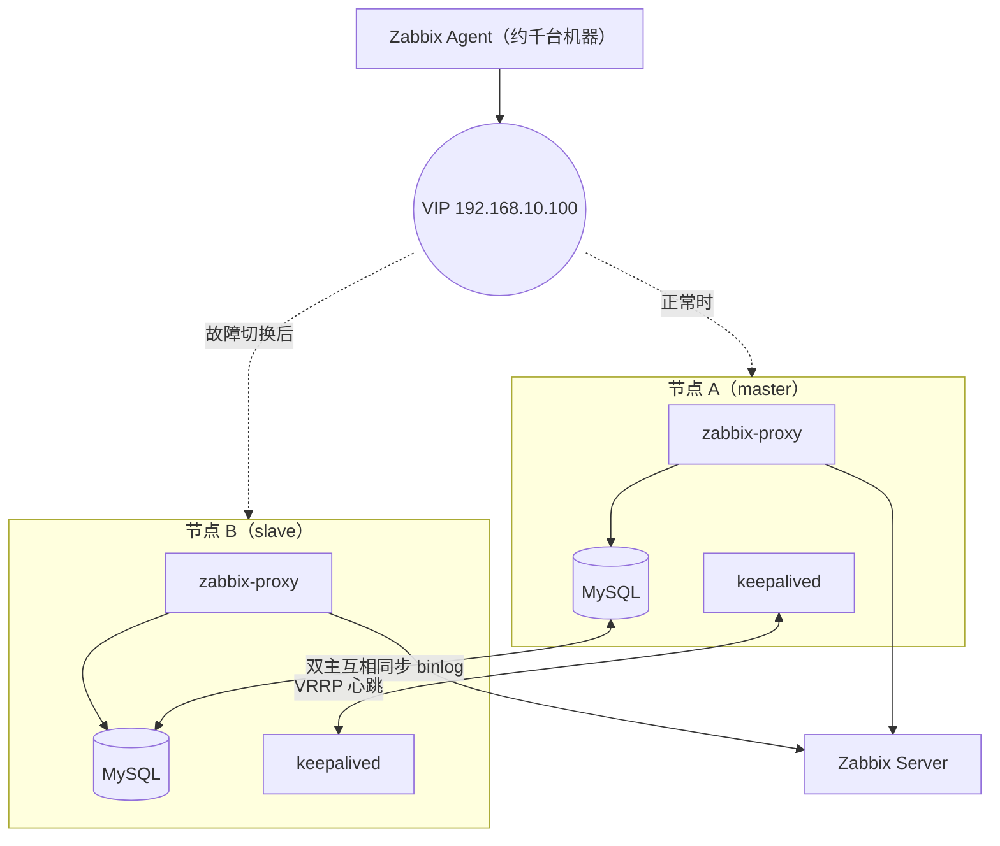
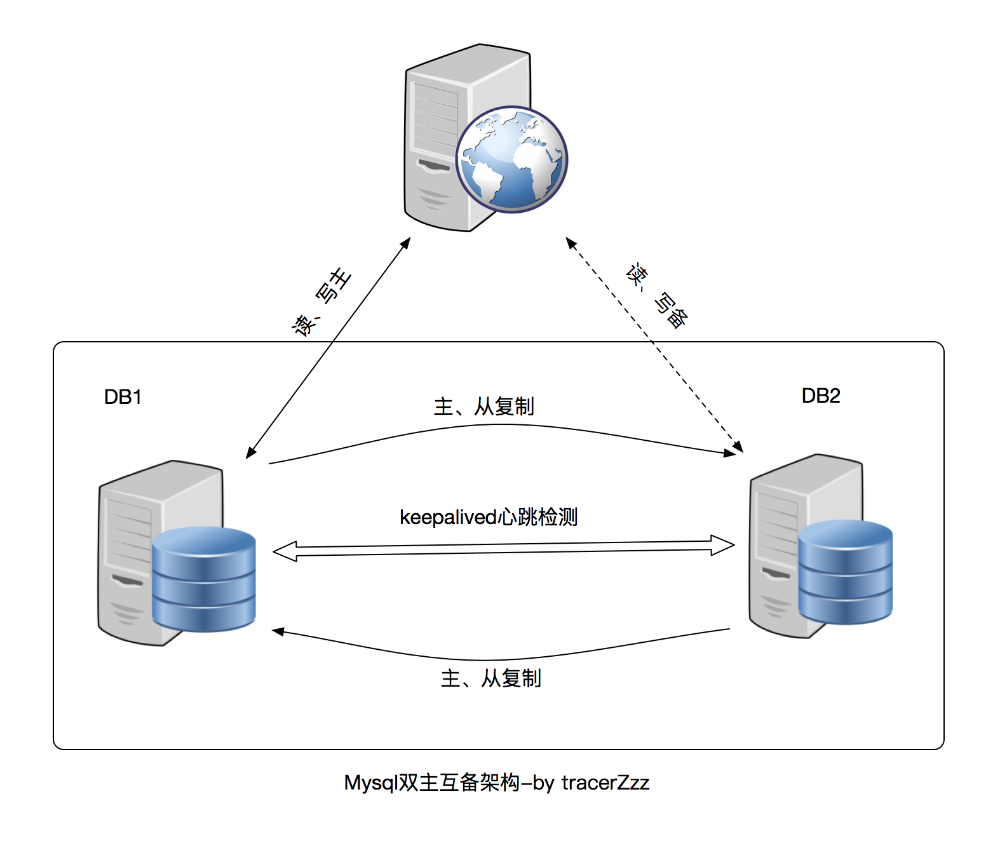
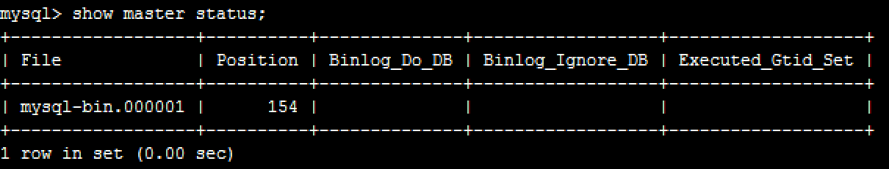
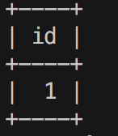
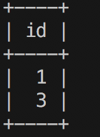

> **关于这篇文章**：搭建步骤写于 2018 年，基于当时的 CentOS 7、MySQL 5.7、Zabbix 3.4。2026 年 10 月补充了背景和架构图，新增了「故障切换演练」「双主模式容易踩的坑」「现在回头看」三节，并对文中的 IP 和密码做了脱敏处理。

### 背景

2018 年我在中国电信云计算 CDN 部门，参与搭建天翼高清业务的监控系统，覆盖内容中心和各省中心约一千台机器。监控采用 Zabbix 的 server - proxy - agent 三层架构：agent 把数据上报给所在区域的 proxy，proxy 汇总后再发给 server。

proxy 是中间这一层的单点：一台 proxy 挂了，它下面整片机器的监控数据就断了。所以需要给 proxy 做高可用，方案是：

- 两台机器各跑一套 zabbix-proxy 和 MySQL；
- 两个 MySQL **双主互备**，任意一台写入的数据都会同步到另一台；
- Keepalived 维护一个**虚拟 IP（VIP）**，agent 和 server 都只认这个 VIP，主机故障时 VIP 自动漂移到备机。



软件版本：CentOS 7、MySQL 5.7、Zabbix 3.4（2018 年）。下面先讲两个核心组件，再按步骤搭建。

### Mysql双主模式

mysql双主模式也叫做主主同步或者双主互备，即两台数据库server互为主备。双主模式是在普通的master-slave主备模式下进一步拓展而来的，普通的master-slave主备模式即一主一备，slave主机拉取master主机的Binary log，然后将二进制文件解析为sql语句并完全顺序的执行sql语句所记录的所有操作，从而使slave的数据和master保持一致；双主互备是两台机器互相以对方为master，定时拉取对方的Binary log。双主互备中两台主机都可以进行读写操作，而在普通主备，只有master可以进行写操作，slave只能进行读取操作；




------


### Keepalived

[Keepalived](http://www.keepalived.org/doc/)是一款高可用软件。keepalived可以让服务器集群共享一个虚拟ip，也就是我们说的vip，同一时间只有一个服务器占有这个虚拟ip，若该服务器不可用或者该服务器的权重小于其他机器，则虚拟IP漂移至另一台服务器并对外提供服务；

### 准备工作

#### 机器准备（centos7系统）

两台 server：`192.168.10.11`（**master**）、`192.168.10.12`（**slave**），一个 VIP：`192.168.10.100`（文中 IP 和密码均为示例）

> 由于基于vrrp协议，两台server和vip必须处于同一网段

#### 安装mysql 并初始化密码

首先登陆master

```bash
yum install mysql-server
mysql -h localhost -u root -p
```

发现需要输入密码,于是去日志文件里找默认密码

```bash
vim /var/log/mysql.log
```

找到下面一行

`[Note] A temporary password is generated for root@localhost: <临时密码>`

`<临时密码>`是初始化的密码，再次使用`mysql -h localhost -u root -p`登陆

使用以下命令重置root密码

```sql
ALTER USER 'root'@'localhost' IDENTIFIED BY '<your-password>';		
```

登陆slave执行相同的操作

### 下载zabbix-proxy，导入表结构

```bash
yum install zabbix-proxy-mysql
```

然后根据[zabbix文档](https://www.zabbix.com/documentation/3.4/manual/installation/install_from_packages/rhel_centos)提示创建数据库表结构

```bash
mysql -h localhost -u root -p
```

```sql
create database zabbix_proxy character set utf8 collate utf8_bin;
```
为zabbix_proxy库创建zabbix用户并授权，然后退出（避免使用root登陆特定的数据库）

```sql
grant all privileges on zabbix_proxy.* to zabbix@localhost identified by '<zabbix-db-password>';  
quit
```

执行zabbix_proxy自带的sql生成zabbix_proxy表结构

```bash
zcat /usr/share/doc/zabbix-proxy-mysql-3.4.1/schema.sql.gz |mysql -uroot -p zabbix_proxy
```

这个过程需要耐心等待一会，然后登陆数据库查看表数量 一共140个，如果数量不对，需要drop掉zabbix_proxy重新再生成一次。

最后在slave机器上也执行以上操作。确保两台机器的数据库表结构一致；

### 修改/etc/my.cnf文件，配置同步

```bash
vim /etc/my.cnf
```

在[mysqld]下追加

```ini
log-bin = mysql-bin    #开启binlog日志

binlog_format = mixed  #基于混合模式,mysql Replication 有三种模式，基于语句，基于行，基于混合模式

server-id = 1          #server-id master要和slave区分开，master为1 ，slave为2 

relay-log = relay-bin  # 开启中继日志

relay-log-index = slave-relay-bin.index #中继日志的索引文件

auto-increment-increment = 2 #主键自增的幅度，这个要和机器的数量一致

auto-increment-offset = 1  #从几开始自增，master从1开始自增，每次增加2,即master生成的主键永远为奇数

replicate-wild-do-table=zabbix_proxy.% #需要同步的表，这里是zabbix_proxy下的所有的表,用通配符%表示

slave_skip_errors = 1062,1032,1060  #同步时跳过的错误编号，1062，1032，1060

```

重启mysql`sudo systemctl restart mysqld`

重新登陆mysql,为slave机器授予replication权限

```sql
grant replication slave on *.* to 'repl_user'@'192.168.10.12' identified by '<your-password>';
```

查看master当前binlog状态信息

```sql
show master status;
```



在slaver机器上指定数据库master为192.168.10.11，并指定日志文件名字和位置，这样slaver就知道从哪里开始进行同步了。

```sql
change master to master_host='192.168.10.11',master_user='repl_user',master_password='<your-password>',master_log_file='mysql-bin.000001',  master_log_pos=154;
```

开启slaver

```sql
start slave
```

接下来在slave机器上进行同样的操作，给maser授予复制权限，然后查看slave机器的binlog状态信息（每个机器的不一定一样，这里和maser的状态一样）

```sql
grant replication slave on *.* to 'repl_user'@'192.168.10.11' identified by '<your-password>';
```


在master机器上指定数据库master为192.168.10.12,并指定日志文件名字和位置

```sql
change master to master_host='192.168.10.12',master_user='repl_user',master_password='<your-password>',master_log_file='mysql-bin.000001',  master_log_pos=154;
```

开启slaver

```sql
start slave
```

### 防火墙设置

开启3306端口

```bash
sudo firewall-cmd --zone=public --add-port=3306/tcp --permanent

sudo firewall-cmd --reload
```

### 验证数据库同步

在两台机器上分别查看slave状态

```sql
show slave status\G;
```


必须确保两个参数 Slave_IO_Running，Slave_SQL_Running为Yes

都为yes后创建一个表，测试同步数据

```sql
DROP TABLE IF EXISTS `test`;
CREATE TABLE `test` (
  `id` int(11) NOT NULL AUTO_INCREMENT,
  PRIMARY KEY (`id`)
) ENGINE=InnoDB DEFAULT CHARSET=utf8;
insert test values();
select * from test;
```

在master机器上执行上面的操作,返回结构，



在slave上也执行查询语句`select * from test;`,返回同样的结果。再在master上执行`insert test values();`返回结果如下



可以看到master上的所有自增主键都是奇数，接着在slave机器上执行`insert test values();`语句，结果为123，slave为偶数，从2开始，说明我们的自增配置已经生效，并且也进行了数据同步；

### 下载安装keepalived

`yum install keepalived`下载keepalived，keepalived只有一个配置文件，默认位于/etc/keepalived/keepalived.conf

在配置之前先查看本地机器的网卡设置，使用`ip a`命令,得知当前ip使用的是网卡**eth0**,这个要根据`ip a`命令执行结果得到。**网卡名称将在接下来的keepalived配置文件和防火墙设置中用到**。

```bash
vim /etc/keepalived/keepalived.conf
```

```nginx
! Configuration File for keepalived
global_defs {
   router_id mysql-1
}
#group 
vrrp_sync_group VG1 {
      group {
              HA_1
               }
            }

vrrp_script check_mysql {
script /etc/keepalived/bin/check.sh
interval 2   #执行间隔
weight 20    #权重
}
vrrp_instance HA_1 {
    state BACKUP  #两个节点最好都设置成BACKUP模式，避免因为意外情况下（比如脑裂）相互抢占导致往两个节点写入相同数据而引发冲突；
    interface eth0  #网卡
    virtual_router_id 51 #两台机器要一致
    priority 100         #初始权重，master机器配置为100，slave配置为90
    nopreempt            #不抢占，当slave机器正常工作时，master恢复正常后不抢占slave的vip
    advert_int 1         #检查间隔，两台机器一致
    authentication { 
        auth_type PASS
        auth_pass 1111   #两台一致
    }
    virtual_ipaddress {
    	192.168.10.100  #vip
    }
	
    track_script {
        check_mysql
    }
}
```

#### keepalived的配置文件说明

vrrp_sync_group的应用场景为：如果路由有2个网段，一个内网，一个外网，每个网段开启一个VRRP实例，假设VRRP配置为检查内网，那么当外网出现问题 时，VRRPD会认为自己是健康的，则不会发送Master和Backup的切换，从而导致问题，Sync Group可以把两个实例都放入Sync Group，这样的话，Group 里任何一个实例出现问题都会发生切换。在这里其实并没有用到group，因为我们只设置了一个实例。

vrrp_instance配置了检测脚本，vip等信息。两台机器的配置基本一致，除了priority参数（master设置为100，slave设置为90）。当master机器keepalivde启动后，将会去执行check.sh，每两秒执行一次，如果执行结果返回零，将在初始权重上加上20，maste的权重将达到120，同理，slave的权重为110（90+20）。这时，vip将漂移到master机器上。如果master上的check.sh执行结果返回1,那么master的权重将不会加20，那么master的权重为100，小于110，此时vip将漂移到slave机器上。keepalived就是这样根据权重的大小进行vip漂移的。另外，需要注意的是，**检测脚本的权重一定要大于两台机器的初始权重**，20>(100-90),因为只有这样，检测脚本检测到服务异常时才能影响到权重的总和。

vrrp_script配置了检测脚本和被检测的服务的权重，以及检测频率等。这里的关键是check.sh的实现。这个脚本这里主要是用来检测mysql是否正常服务，而正常服务的检测可以很简单，也可以很复杂，比如简单的检测mysqld服务是否正常启动，复杂的可以用mysql命令登陆数据库，执行sql语句，查看mysql的状态，进行判断。这里我们只是简单的检测了mysqld服务是否正常启动；

```bash
#!/bin/bash
killall -0 mysqld zabbix_proxy
```

试了了killall命令，如果没有该命令需要安装`sudo yum install psmisc -y`,`-0` 是检测服务正常运行的信号量，如果正常运行返回0，不正常返回1，支持传入多个服务；

同时需要注意的是记得为该脚本授权`chmod +x /etc/keepalived/bin/check.sh`;

`sudo vim check.sh`

```bash
#!/bin/bash
sudo killall -0 mysqld zabbix-proxy
```

#### Keepalived防火墙设置

keepalived需要执行下面两条语句，对防火墙进行操作，才能确保两台keepalived能够进行选举,如果没有进行防火墙设置，则会出现两台机器都绑定了vip（脑裂）,原因就是两台机器没法进行通信，无法找到真正的master;

```bash
sudo firewall-cmd --direct --permanent --add-rule ipv4 filter INPUT 0 --in-interface eth0 --destination 224.0.0.18 --protocol vrrp -j ACCEPT
sudo firewall-cmd --direct --permanent --add-rule ipv4 filter OUT 0 --out-interface eth0 --destination 224.0.0.18 --protocol vrrp -j ACCEPT
sudo firewall-cmd --reload
```

### 启动 zabbix-proxy

#### 修改配置文件

`vim /etc/zabbix/zabbix_proxy.conf`

```ini
ProxyMode=1
Server=<zabbix-server-ip>
Hostname=192.168.10.100  #vip
LogFile=/var/log/zabbix/zabbix_proxy.log
LogFileSize=0
PidFile=/var/run/zabbix/zabbix_proxy.pid
SocketDir=/var/run/zabbix
DBHost=localhost
DBName=zabbix_proxy
DBUser=zabbix
DBPassword=<zabbix-db-password>
HeartbeatFrequency=10
ConfigFrequency=60
DataSenderFrequency=5
StartPollers=50
StartPollersUnreachable=10
StartTrappers=10
StartPingers=10
SNMPTrapperFile=/var/log/snmptrap/snmptrap.log
CacheSize=8G
StartDBSyncers=10
HistoryCacheSize=2G
HistoryIndexCacheSize=2G
Timeout=30
#DebugLevel=4
#ExternalScripts=/usr/lib/zabbix/externalscripts
#LogSlowQueries=3000

```

```bash
#开启端口
sudo firewall-cmd --zone=public --add-port=10051/tcp --permanent
sudo firewall-cmd --reload
#启动zabbix-proxy
systemctl start zabbix-proxy
```

#### 开机自动启动

```bash
systemctl enable zabbix-proxy
systemctl enable mysqld
```

### 测试方法

1.查看vip绑定情况 ip a

2.通过连接vip的mysql，

```bash
mysql -h 192.168.10.100 -uroot -p
```

```sql
show variables like "%hostname%";
```

查看返回的hostaname,就知道了当前连接是哪台机器


### 故障切换演练

搭完一定要演练，不然真出故障时才发现切不过去。演练按这个顺序做：

1. **确认初始状态**：在两台机器上执行 `ip a`，VIP 应该只绑在 master 上；通过 VIP 连 MySQL，执行 `show variables like 'hostname'`，确认连的是 master。
2. **停 master 的 MySQL**：`systemctl stop mysqld`。检测脚本返回非 0，master 权重降到 100，低于 slave 的 110，VIP 应在几秒内漂到 slave。再通过 VIP 查一次 hostname 确认。
3. **验证数据不丢**：切换前后各写几条测试数据，恢复 master 后检查两边的 `show slave status`，两个线程都是 Yes，数据一致。
4. **验证不抢占**：恢复 master 后，因为配置了 `nopreempt`，VIP 应该留在 slave 上，不会来回漂。
5. **模拟网络隔离**：用防火墙临时屏蔽 VRRP 报文，观察是否出现两台机器同时持有 VIP（脑裂），确认告警能发出来。

### 双主模式容易踩的坑

**1. 两边同时写，主键冲突。** 用 `auto-increment-increment = 2` 和不同的 `auto-increment-offset`，让一台只生成奇数主键、另一台只生成偶数主键。但这只解决自增主键，唯一索引冲突、同一行被两边同时修改的问题依然存在。所以双主虽然两边都能写，**实际使用时最好只往 VIP 所在的那台写**，另一台只做热备。

**2. `slave_skip_errors` 会掩盖数据不一致。** 文中为了让同步不中断，跳过了 1062（主键重复）、1032（记录不存在）等错误。这在监控数据这种可以容忍少量丢失的场景能用，但它的代价是两边数据悄悄地不一致，**业务数据库千万不要这样配**。

**3. 检测脚本太简单。** `killall -0` 只能判断进程还在，进程活着但 MySQL 卡死、复制线程已经停了，它都发现不了。更稳妥的检测是真正登录执行一条查询，并检查 `Slave_IO_Running` 和 `Slave_SQL_Running`。

**4. 脑裂。** 两台机器之间 VRRP 报文不通时，都会认为对方挂了，各自绑上 VIP。防火墙放行 VRRP（协议号 112，组播地址 224.0.0.18）是最基本的；两边都设为 `BACKUP` 加 `nopreempt` 可以减少来回抢占；条件允许的话再加一条独立的心跳链路。

**5. 复制延迟。** 主库写入压力大、大事务、单线程回放都会导致从库跟不上。切换发生时，延迟期间的数据就可能丢失。MySQL 5.7 起可以开启基于组提交的并行复制（`slave_parallel_type = LOGICAL_CLOCK`）缓解。

### 现在回头看

这套方案在 2018 年是很典型的做法，简单、好理解。放到现在，我会做几处改进：

- 用 **GTID** 代替手动指定 binlog 文件名和位置，切换和重建复制都简单很多；
- 更严格的一致性需求，考虑 **MySQL Group Replication** 或者 Orchestrator 这类自动故障转移工具，而不是靠 Keepalived 判断数据库状态；
- 如果在云上，直接用托管数据库的高可用版本，大多数云环境也不支持 VRRP 组播漂移 VIP。
