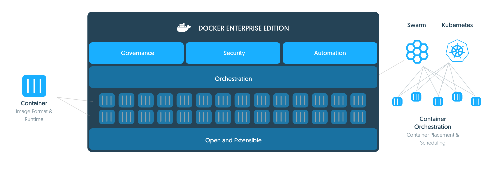
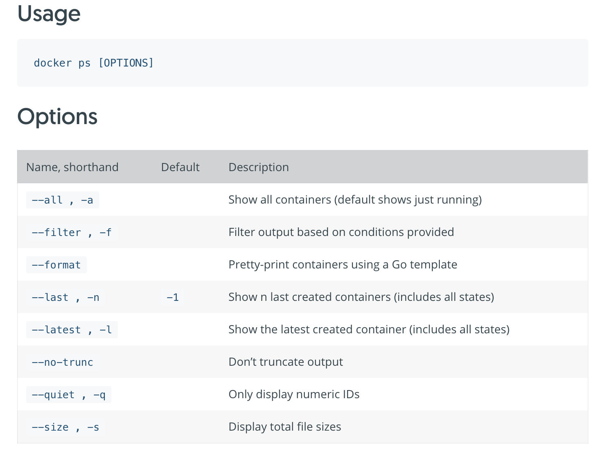
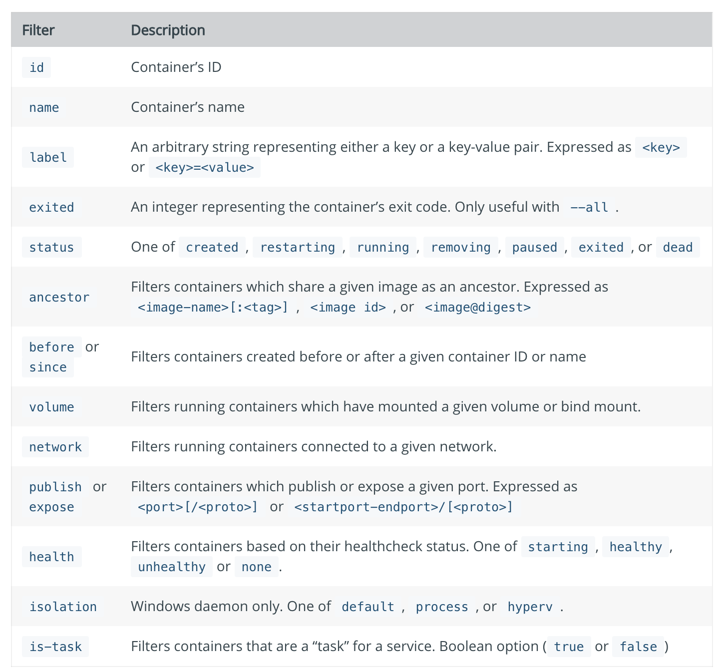

### 前言

docker在实际的开发、学习以及线上部署中已经频繁被用到，这里总结了一些常用的docker命令，以及docker使用过程中遇到的一些坑，记录爬坑的过程。以便再次遇到相同问题的时候查阅。



### 删除所有容器

```bash
docker rm $(docker ps -aq)
```

#### 条件查询容器



### 根据状态查询容器

#### 查询条件如下：



例如：

```bash
docker ps -f "status=created"
```

### 快速删除退出的容器

```bash
docker rm $(docker ps -q -f "status=exited")
```

### nginx镜像的日志

```dockerfile
# forward request and error logs to docker log collector
RUN ln -sf /dev/stdout /var/log/nginx/access.log \
	&& ln -sf /dev/stderr /var/log/nginx/error.log
```

官方dockerfile中有以上的命令，即将日志输出到标准输出和标准错误输出

在宿主机可以使用docker logs命令查看日志

```bash
docker logs -f containerId
```

#### 镜像占用硬件状态

```bash
docker stats containerId
```

