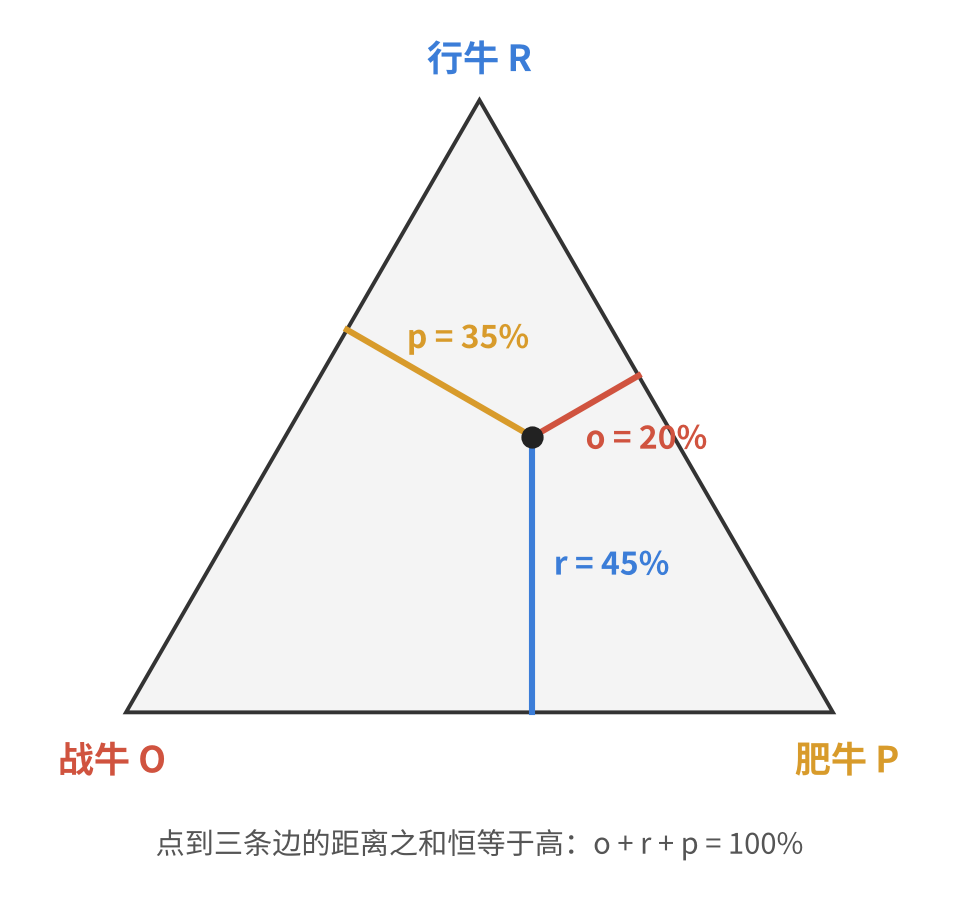

前段时间玩《饥荒联机版》，想驯一头牛。驯牛要十几二十天，期间牛会根据你怎么对待它，慢慢偏向战牛、行牛或肥牛三种形态之一，三种都不偏就是普通牛。

我先去查了 wiki 上的驯牛规则。读完之后，脑子里隐约有个三角形。这篇就是顺着这个三角形想下去的过程，后半部分是按游戏代码算出来的驯普通牛方法。

## 一、wiki 上的规则

驯化期间，牛身上记着三个数，叫驯势点数，下文分别用三个字母表示：

- **O**：战牛（Ornery）驯势点数，骑在牛上打架时涨；
- **R**：行牛（Rider）驯势点数，骑着牛时涨；
- **P**：肥牛（Pudgy）驯势点数，牛吃得饱时涨。

驯化度到 100% 后再喂一次，形态就锁定了。判定只看三项的**占比**：

- 哪一项占到总数的一半，就是哪种牛；
- 都不到一半，就是普通牛。

下文用小写字母表示占比：

$$
o = \frac{O}{O+R+P},\quad r = \frac{R}{O+R+P},\quad p = \frac{P}{O+R+P},\qquad o + r + p = 1
$$

比如 $O = 1,\ R = 2,\ P = 1$，占比就是 $o = 25\%,\ r = 50\%,\ p = 25\%$。行牛刚好占一半，这头牛驯完是行牛。

## 二、从三角形到三元相图

读完规则，我第一反应是"有点像三角形"：三个东西互相拉扯，像三角形的三个角。但具体哪里像，一开始说不上来。

后来反复琢磨，抓住的是 $o + r + p = 1$ 这一点。三个数加起来恒为 100%，这和正三角形的一个性质对得上：**正三角形内任意一点，到三条边的距离之和恒等于三角形的高。**（这叫维维亚尼定理，证明很简单：把这个点和三个顶点连起来，大三角形被分成三个小三角形，三块面积加起来等于总面积，底边又都一样长，所以三个高加起来就是大三角形的高。）

把高当作 100%，三角形里的每个点就对应一组 $(o, r, p)$。约定每个占比是这个点到对应顶点**对边**的距离：越靠近"战牛"那个角，离它对边越远，$o$ 越大。



按这个思路一查，原来这东西早就有名字，叫**三元相图**（ternary diagram），化学、材料、土壤分类里常用来表示三种成分的配比。

接下来把 wiki 里那个关键的 50% 放进图里。$o = 50\%$ 意味着点到对边的距离是高的一半，所有这样的点连成一条和对边平行、正好在半高处的线。这条线经过另外两条边的中点，也就是三角形的中位线。

三个角各有一条这样的中位线，各自切下一个角上的小三角，那里是战牛、行牛、肥牛。三条中位线围出来的，是中间一个倒着的小三角：**普通牛区**。这个小三角的中心，正好是大三角形的中心，也就是 $o = r = p = \frac{1}{3}$ 那个点。


到这里，游戏里的一条规则就完整变成了一幅几何图。我觉得这个过程挺有意思：wiki 上写的是一句话，搬到数学里，变成了正三角形、垂线和中位线。

## 三、四块一样大，但均衡很难

三条中位线把大三角形分成了四个全等的小三角，**四种牛的区域面积一模一样**，各占四分之一。如果在三角形里随手撒一个点，落进普通牛区的机会和落进任何一个角一样大。

可是放到生活里，这种均衡并不多见。最像的是时间分配：一天就 24 小时，工作、家庭、自己三块加起来恒等于 100%，和 $o + r + p = 1$ 是一回事。

- 某一块占到一半以上，生活就偏向一个角：工作占满的人，围着家转的人，只顾自己的人。
- 三块都不过半，才是常说的"平衡"。

图上平衡区占了四分之一，看起来不小，可现实里能长期待在中间的人并不多。我觉得原因和驯牛是一样的：

- **状态是攒出来的，不是选出来的。** 牛驯完是什么形态，是二十天里每一次骑、每一次喂、每一次打攒出来的；生活偏向哪里，也是每一天的时间一点点攒出来的，没有哪一天专门决定它。
- **不刻意就会偏。** 驯牛时不管它，牛会被你习惯的玩法拉向某个角，爱跑图的得到行牛，爱打架的得到战牛。时间也一样，不主动安排，就会被最急的那件事拉走。

所以四种牛里，普通牛看起来最普通，其实是最需要用心的那一种：三头都得照顾到。

## 四、驯普通牛：按代码算

下面的数值都来自游戏脚本（`tuning.lua`、`prefabs/beefalo.lua`、`components/hunger.lua`、`components/domesticatable.lua`），换算成一天（8 分钟，480 秒）：

| 驯势 | 怎么涨 | 涨多少 | 一天最多 |
| --- | --- | --- | --- |
| 战牛 O | 骑在牛上时，你攻击一次，或牛挨打一次 | 每次 +0.004 | 看打多少下 |
| 行牛 R | 骑在牛上 | 每秒 +1/2400 | 0.2（骑满全天） |
| 肥牛 P | 饥饿值高于一半时消化食物 | 每消化 1 点饥饿 +1/2400 | 0.125（全天都高于一半） |

几点说明：

- **战牛只算骑着的时候。** 不骑时牛挨打，不涨战牛点数。
- **肥牛涨得比行牛慢。** `tuning.lua` 里两者系数相同，都是 `1/(total_day_time*5)`。但行牛乘的是骑行秒数；肥牛在 `beefalo.lua` 里乘的是饥饿值的变化量：

  ```lua
  if data.oldpercent > 0.5 then
      inst.components.domesticatable:DeltaTendency(TENDENCY.PUDGY, TUNING.BEEFALO_PUDGY_WELLFED * -data.delta)
  end
  ```

  `hunger.lua` 里 `delta = self.current - old`，是饥饿值的绝对点数。牛的饥饿上限 375，每天固定掉 300，所以肥牛一天最多 $300/2400 = 0.125$。灰机 wiki 上写的是"每天 20%"，和代码对不上。
- **"一半"包含等于。** 代码里是 `maxtendencyval * 2 < tendencysum` 才算普通牛，所以恰好占一半也会偏过去。另外总点数不足 0.1 时也是普通牛，不过驯满一次远超这个数。
- **驯势每天会衰减 1/45（约 0.022）。** 这个衰减一直在跑，不只是没人照顾的时候。

### 普通牛 = 三个点数能拼成一个三角形

"没有哪一项达到总数一半"，等价于"每一项都小于另外两项之和"：

$$
O < R + P,\qquad R < O + P,\qquad P < O + R
$$

这正好是三角形不等式。所以普通牛还有一个很形象的判定：**把 O、R、P 当成三根木棍的长度，能拼成一个三角形，就是普通牛。**

反过来，如果某一项为 0，比如完全不喂到半饱以上（$P = 0$），剩下两根木棍无论多长都拼不出三角形。在相图上，这对应战牛和行牛之间的那条边：普通牛区在这条边上只剩一个中点，而按代码，恰好相等也会偏过去，连这一个点都不算。所以**三项都得有**，少一项就没有容错。

### 每天打多少下

骑多久、喂多少一般是自己先定好的，打架次数最好调。把三角形不等式换成战斗点数的范围：

$$
|R - P| < O < R + P
$$

这个窗口宽 $2\min(R, P)$，中点是 $\max(R, P)$。换算成每天的战斗次数（除以 0.004）：

| 每天怎么养 | R/天 | P/天 | 每天战斗次数 | 最稳的次数 |
| --- | --- | --- | --- | --- |
| 骑满全天，饥饿值全天高于一半 | 0.2 | 0.125 | 约 19～81 | 50 |
| 骑 5 分钟，饥饿值全天高于一半 | 0.125 | 0.125 | 约 0～62 | 31 |
| 骑满全天，饥饿值只有半天高于一半 | 0.2 | 0.0625 | 约 35～65 | 50 |
| 骑满全天，从不喂到一半以上 | 0.2 | 0 | 无解 | — |

第一种情况画在图上，就是一条从"行牛—肥牛"边出发、往战牛角走的线：打得太少还在行牛区，打得太多进了战牛区，中间那段是普通牛。


第二种是我最推荐的：**每天骑 5 分钟**（300 秒 × 1/2400 = 0.125，正好等于全天饱食的肥牛点数），让 $R = P$，再在骑行时打 31 下左右，三项就落在三角形正中心。这时窗口是 0～62 次，下限直接降到 0。在 R 和 P 总量差不多的方案里，这是最宽的。哪天多打少打十几下，都不会出事。

算上每天约 0.022 的衰减，下限会抬高、上限会压低，各收窄约 6 下：第一种大约 24～76 次，第二种大约 6～57 次。

窗口宽度只取决于 R 和 P 中较小的那个。想要更大的容错，就补短板：肥牛少了就多喂，行牛少了就多骑。每多让 100 点饥饿在半线以上被消化（约一份蒸树枝），P 多 1/24，战斗次数的窗口两边各宽约 10 下。

### 怎么让饥饿值全天高于一半

饥饿上限 375，一半是 187.5，每天掉 300，也就是每三分之一天（160 秒）掉 100。

我的做法是：**早上把牛喂到 300，之后每三分之一天补 100。** 饥饿值会在 200 到 300 之间来回，全天都高于 187.5，一天正好喂 300，大约三份蒸树枝。

喂食时有两个边界值得注意：

- **喂完超过 300（80%）会放屁。** 这只是提醒快饱了，没有惩罚。
- **饥饿值满 375 时再喂会吐。** 代价是驯化度 −1%、顺从度 −30%，同时肥牛点数 +0.02。想要普通牛，要避开这一下。

每次喂食还能 +10% 顺从度，顺带解决骑行时被甩下来的问题。

### 其他

- **驯化度**：牛被骑着、或饥饿值大于 0 时，每 10 秒 +1/960，20 天驯满；每天刷一次毛再 +1/60，能缩到 15 天。上面的每日窗口和总天数无关，15 天、20 天都一样用。
- **骑行时间**：没驯完的牛，骑不了多久就会把你甩下来，重新骑上去就行，行牛点数只看骑在牛上的秒数。
- **舔盐块**：把牛留在舔盐块旁，驯化度和驯势都会暂停衰减，适合中途有几天顾不上的时候。

> 关于这篇文章：游戏数值来自 GitHub 上的游戏脚本镜像 [CN-DST-DEVELOPER/scripts](https://github.com/CN-DST-DEVELOPER/scripts)，规则描述参考了[灰机 wiki 的皮弗娄牛页面](https://dontstarve.huijiwiki.com/wiki/皮弗娄牛)和 [wiki.gg 的 Beefalo/DST 页面](https://dontstarve.wiki.gg/wiki/Beefalo/DST)，查阅于 2026 年 10 月。游戏更新后数值可能会变。
