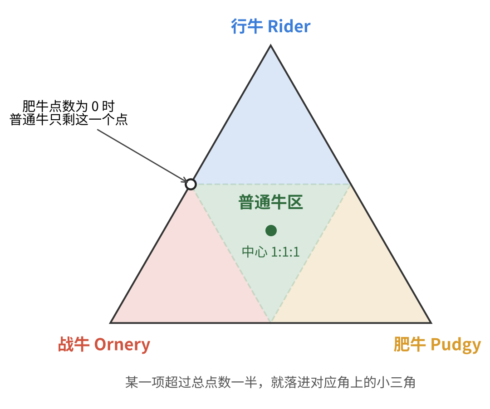
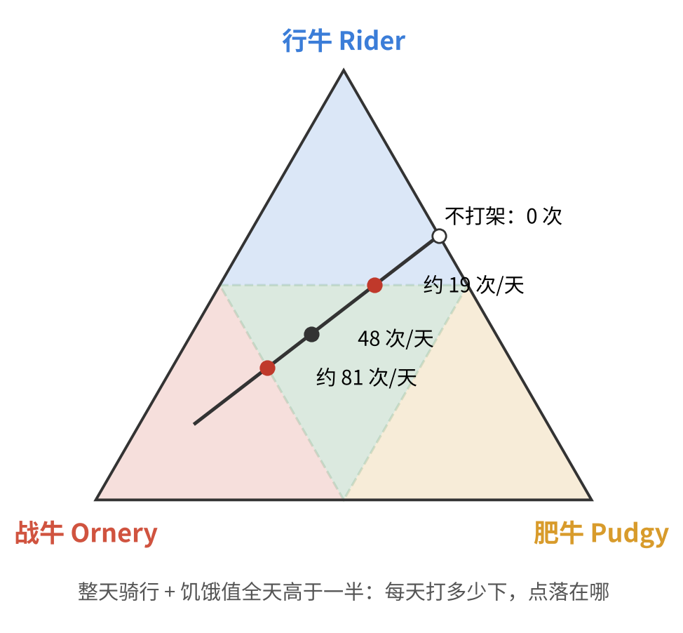

前段时间玩《饥荒联机版》，想驯一头普通牛。驯牛要二十天左右，中途会根据你怎么对待它，慢慢偏向战牛、行牛或肥牛三种形态之一。我想要的恰好是"哪种都不偏"的那一种，这反而不好控制。

我直接拿"饥荒驯牛三元相图"去问了 Google 的 AI 模式，来回聊了八轮。这篇把过程整理一下。比起最后的答案，过程里我几次觉得 AI 说得不对、追问下去的地方更有意思。事后我又对着 wiki 核了一遍数值，发现它还有几处我当时没看出来的错。

## 一、规则：超过一半就定型

驯化期间，牛会在三种驯势（Tendency）上积累点数：

| 形态 | 怎么涨点 | 驯成后的特点 |
| --- | --- | --- |
| 战牛 Ornery | 骑在牛上时，你每攻击一次、或牛每挨一次打，+0.004 | 攻击 50，上牛前得先喂 |
| 行牛 Rider | 每骑 1 秒 +1/2400（骑满一整天约 +0.2） | 速度 8，攻击 25 |
| 肥牛 Pudgy | 饥饿值高于一半时，每消化 1 点饥饿 +1/2400（全天约 +0.125） | 速度 6.5，攻击 20，回理智 +6.25/分 |
| 普通牛 Default | 以上都不满足 | 速度 7，攻击 34，和野牛一样 |

驯化度到 100% 后，下一次喂食时会锁定形态。判定规则只有一条：**哪一项点数超过三项总和的一半，就是哪种牛；都没超过，就是普通牛。** "超过一半"等价于"大于另外两项之和"：

$$
\text{战牛}\iff W > R + P,\quad \text{行牛}\iff R > W + P,\quad \text{肥牛}\iff P > W + R
$$

三个数、只看比例、和固定为 1，这正好是三元相图的设定。把三种驯势各放在三角形的一个角上，任意一组点数都对应三角形里的一个点。"某一项超过一半"的区域，是靠近那个角的小三角；三个小三角切掉之后，中间剩下的倒三角就是普通牛区。

普通牛区正好占整个三角形的四分之一。

## 二、别站在刀刃上

我问的第一个具体问题是："喂食时间和攻击次数什么比例，能保证最后是普通牛？"

AI 的思路是先不管肥牛，让肥牛点数为 0，然后让战牛和行牛 1:1。它给了一个很具体的换算：1 次战斗约等于骑行 10 秒，所以每骑 1 分钟就打 6 下。

问题在图上一眼就能看出来。肥牛为 0，意味着点落在战牛和行牛之间那条边上。这条边上，普通牛区只剩**中点这一个点**：战牛多一下就是战牛，行牛多一秒就是行牛。要靠手动数数，在二十天里把两个数卡得一模一样，几乎不可能。

所以我换了个目标：**瞄准三角形的正中心，三种驯势 1:1:1。** 中心离三条边界最远，每一项都可以从三分之一一直涨到二分之一才会出事，容错空间最大。驯牛这件事真正要防的不是"差一点"，而是"某一项失控"，站在中心就是给每一项都留出最大余量。

AI 对这个方向是认可的。它接着按"每天 4 分钟骑行、4 分钟高饱食、24 次战斗"排了一份日程。

## 三、为什么不拉满

我又追问：既然比例才重要，为什么是 4 分钟，而不是每天骑满 8 分钟、饱食过半 8 分钟、战斗 48 次？

AI 给的第一条理由是"牛被骑的时候饥饿速度翻倍"。这和我玩的感觉对不上，我就直接问了一句：骑行消耗饥饿值高于不骑行，是真的吗？

它马上改口，说这是"记忆混乱"，骑不骑消耗是一样的。wiki 上的数据也是：牛的饥饿上限 375，每天固定掉 300，没有骑乘加速一说。

它退而给出第二条理由：喂满 375 后，掉到一半（187.5）只要 6 分钟左右，所以"高饱食"撑不满一整天。这个算术没错，但前提是"一天只喂一次"。

## 四、喂食节奏：每天 300，每三分之一天 100

我提出的方案是：**先喂到 300，之后每三分之一天补 100。**

AI 第一反应是这会"过饱"，再喂就会呕吐，而且呕吐会扣行牛点数。它在推算中途还自己算出了矛盾（"这里跌破了！不对！"），最后得出一个"清晨喂到 290、每 3 分钟补 90"的方案。

我提醒它：牛每天消耗 300。它才重新算了一遍，承认我的方案成立。

道理很简单：一天 300，三分之一天就是 100。从 300 开始，每过三分之一天掉到 200，补 100 回到 300，饥饿值始终在 200 到 300 之间，全天都高于 187.5 这条线。

对照 wiki，AI 关于"过饱"的说法也不对：

- 喂完后饥饿值**超过** 80%（300）时牛会放屁，这只是个提示，没有惩罚。
- 只有在牛**已经 100% 饱**的时候再喂，它才会吐。吐的代价是 1% 驯化度和 30% 顺从度，同时反而会让肥牛点数 +0.02，跟行牛点数没关系。

所以"喂到 300、每三分之一天补 100"是一个既不放屁也不吐、全天都在攒肥牛点数的节奏。

## 五、用真实数值重算一遍

聊天时 AI 一直用的是同一个数：三种驯势都是"每 10 秒或每次 +0.004"。我当时没怀疑，事后对 wiki 才发现只有战牛是这样：

| 驯势 | AI 说的 | wiki | 每天最多 |
| --- | --- | --- | --- |
| 战牛 | 每次攻击或挨打 +0.004 | 同上，但**只算骑在牛上时** | 看打多少下 |
| 行牛 | 每骑 10 秒 +0.004 | 每骑 1 秒 +1/2400，折合每 10 秒约 +0.0042 | 0.2 |
| 肥牛 | 饱食过半时每 10 秒 +0.004 | 饱食过半时每消化 1 点饥饿 +1/2400，折合每 10 秒约 +0.0026 | 0.125 |

差别不在小数点后几位，而在于：**骑满一天和饱满一天，攒的点数并不一样**，行牛是肥牛的 1.6 倍。

这会推翻 AI 后面一个很关键的结论。我当时问的是："如果行牛和肥牛连续 20 天都拉满，最多能战斗多少次，还能是普通牛？"AI 的回答是：行牛、肥牛都是 3.84，所以战斗次数在 0 到 1919 之间都行，"完全不战斗也是普通牛"。

按 wiki 的数值重算，20 天下来 $R = 0.2 \times 20 = 4$，$P = 0.125 \times 20 = 2.5$。普通牛要求三个不等式都不成立：

$$
R < W + P \Rightarrow W > 1.5,\qquad W < R + P \Rightarrow W < 6.5
$$

换算成战斗次数，是**大约 375 到 1625 次之间**，平均每天约 19 到 81 次。完全不打架的话，$R = 4 > P = 2.5$，最后是一头行牛。

wiki 还提到，每种驯势每天会自然衰减约 0.022（1/45）。三项都按同样的量往下掉，粗算下来区间会收窄到大约 490 到 1510 次。每天 48 次仍然稳稳落在中间。

## 六、省食物？肥牛点数就是容错

最后我问的是：想尽量少喂，怎么确保普通牛？

AI 给的方案是"彻底抛弃肥牛点数"，只喂几根树枝维持顺从度，然后让骑行和战斗 1:1 对冲。这又绕回了第二节的那条刀刃。

把三个不等式换个写法，其实能看得更清楚。前两个不等式合起来就是：

$$
|R - W| < P
$$

也就是说，**行牛和战牛允许差多少，正好由肥牛点数决定。** 肥牛点数是容错的预算，而它只能靠喂食换来：饥饿值高于一半时每消化 2400 点饥饿，才攒 1 点。粗算一下，每多消化 100 点（大约一份蒸树枝），$|R - W|$ 能容忍的差距就宽约 0.042，相当于战斗次数在两边各多出约 10 下的余量。

所以"少喂"和"稳"本身是一对取舍。真想省，可以少骑：行牛点数小了，需要用来对冲的战斗和饱食也跟着少；但不能把肥牛这一项归零，否则就只剩一个点能站。

## 七、几点体会

这次对话里，AI 帮我最大的忙是把问题摆清楚：三种驯势、判定规则、各形态的属性，第一轮就给全了，而且后来核对，形态属性这部分都是对的。

但具体的数值和推论，它说错的地方不少，而且每一处都说得很笃定：

- 骑乘时饥饿翻倍（被我问一句就撤回了）；
- 喂过 300 就会吐、吐了扣行牛点数；
- 三种驯势用同一个涨点速度；
- 据此推出"不打架也是普通牛"；
- 建议让蜜蜂叮停在原地的牛来刷战斗点数，而 wiki 写明不骑在牛上时挨打不算；
- 最后的省食方案又回到了"两项 1:1"的刀刃上。

我当时能挑出来的，都是和游戏手感对不上的地方，比如"每天 300"这种玩久了自然记得的数。剩下几处是事后翻 wiki 才发现的。有一点很明显：每次我质疑，它都先夸一句"非常聪明""一针见血"，然后顺着我改。这让它在我对的时候显得很配合，但如果我错了，它大概也会顺着我错下去。

把规则画成三元相图，倒是从头到尾都管用。它不依赖具体数值：不管涨点速度是多少，"站在中间、别站在边上"这个结论都不会变。

> 关于这篇文章：和 AI 的对话发生在 2026 年 10 月 5 日，文中游戏数值以 [Don't Starve Wiki（wiki.gg）的 Beefalo/DST 页面](https://dontstarve.wiki.gg/wiki/Beefalo/DST)为准，查阅于 2026 年 10 月。游戏更新后数值可能会变。
