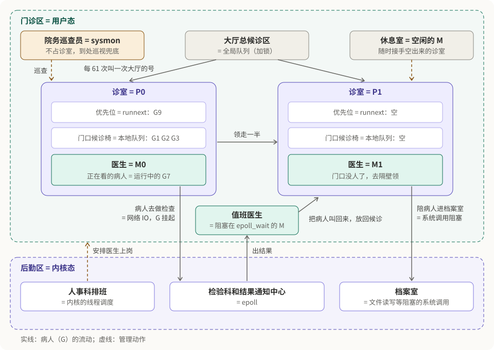
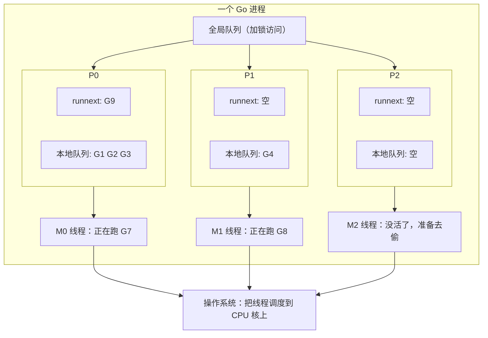
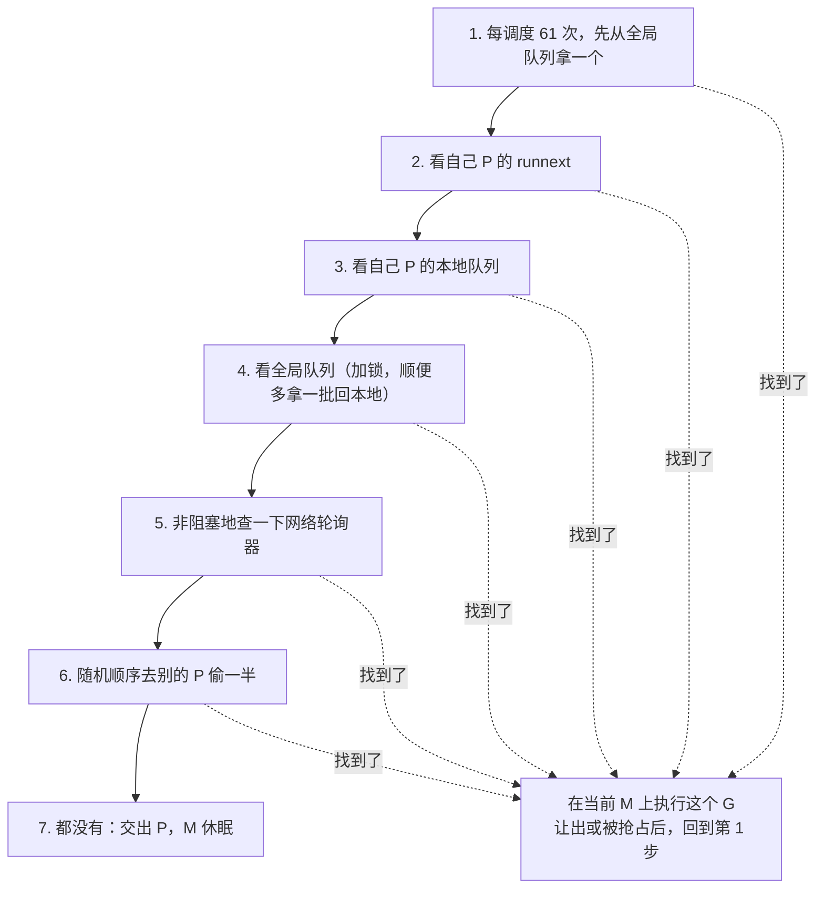
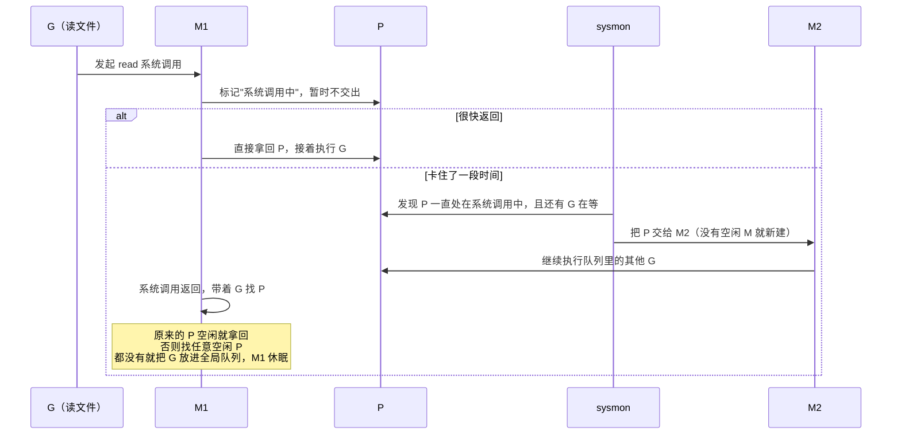
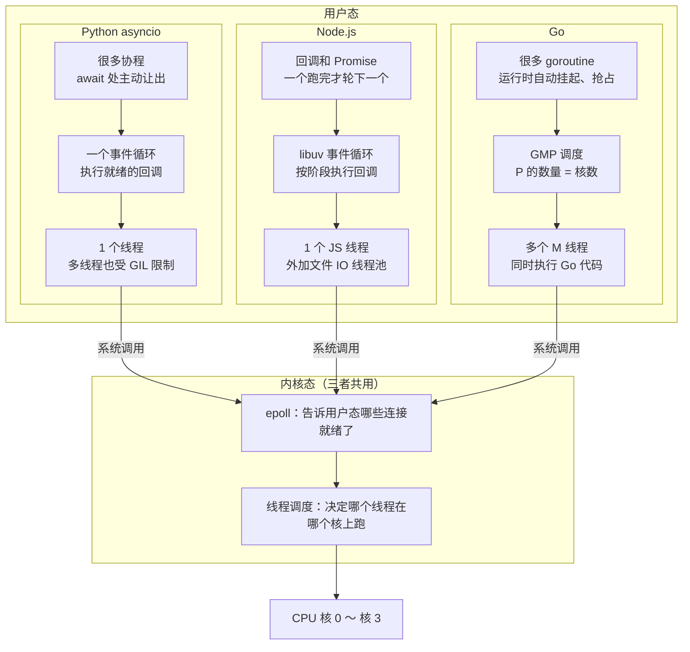

我之前在[用 Python 协程把成本数据产出提速十倍](/posts/python-asyncio-concurrent-queries/)那篇里，用"医院看病"讲过 Python 的异步：一个医生、一个诊室、病人去做检查时医生先看下一位。这次就沿着这个类比往下走：**Go 相当于把这家诊所扩建成了一家多诊室的医院**。

> 说明：文中涉及的运行时细节，我对照了 Go 1.24 的运行时源码（`runtime/proc.go` 等）；两个示例程序是在 Go 1.24 上实际跑过的。不同版本的实现细节可能有出入。

## 一、整体印象：一个进程，多个线程

先把最重要的结构定下来：**一个 Go 程序只有一个进程，G、M、P 全部都在这一个进程里**。

- **G** 是 goroutine，数量可以有几十万个；
- **M** 是操作系统线程，一个进程里有多个；
- **P** 是逻辑处理器，只是这个进程内存里的一个数据结构，数量默认等于 CPU 核数；
- **全局队列**是调度器里的一个队列，所有线程都可能访问它，所以要加锁。

P 之间、M 之间要协作，靠的是直接读写同一个进程里的共享内存，配合锁和原子操作，不涉及进程间通信，也没有主进程、子进程之分。

## 二、用户态和内核态

要理解 goroutine 为什么"轻"，得先回到操作系统。

CPU 有权限等级，内核跑在最高权限，普通程序跑在最低权限。程序不能直接操作硬件、不能碰别的进程的内存，凡是读写文件、收发网络包、创建线程这类事情，都要通过**系统调用**请内核来做。进入内核的方式有三种：

- **系统调用**：程序主动请求，比如 `read`、`write`、`epoll_wait`；
- **异常**：程序执行出了状况，比如访问的内存页还没准备好（缺页）；
- **中断**：硬件发起的，比如网卡收到数据、时钟定时响一下。操作系统就是靠时钟中断定期打断线程，实现线程的抢占式调度。

进出内核要保存寄存器、切换栈、做权限检查，还会让 CPU 缓存变"冷"。更贵的是**线程切换**：要由内核的调度器决定换谁，保存和恢复完整的线程上下文。

| | 线程切换 | goroutine 切换 |
| --- | --- | --- |
| 谁来调度 | 内核 | Go 运行时，在用户态完成 |
| 要不要进内核 | 要 | 不要 |
| 保存的内容 | 完整的线程上下文 | 少量寄存器（程序计数器、栈指针等） |
| 大致开销 | 微秒级 | 百纳秒级 |
| 栈 | Linux 默认按 8MB 预留 | 初始 2KB，按需增长 |

放到医院里：

- **用户态是门诊区**：诊室、候诊椅、大厅，医生和病人在这里自由活动；
- **内核态是后勤区**：药房、档案室、检验科、收发室、人事科。医生不能自己进去，只能到窗口填单子，由院方办理；
- **线程切换**是人事科给医生换岗：交接、换衣服，要经过人事科；
- **goroutine 切换**是同一个医生换下一个病人：放下这份病历夹，拿起下一份，在诊室里自己就能完成。

Go 调度器很多设计的出发点，就是**尽量少让医生去后勤窗口干等**。

## 三、G、M、P 三个角色

| Go | 医院 | 说明 |
| --- | --- | --- |
| G（goroutine） | 病人，手里拿着自己的病历夹 | 病历夹里记着看到哪一步了，就是 G 的栈和上下文 |
| M（machine，操作系统线程） | 医生 | 真正执行代码的永远是线程 |
| P（processor，逻辑处理器） | 诊室 | 医生必须进了诊室才能看病 |
| P 的本地队列 | 诊室门口的候诊椅 | 最多 256 把椅子，只有本诊室叫号，基本不用加锁 |
| P 的 `runnext` | 门口的"优先位" | 只能坐一个人，下一个就看他 |
| 全局队列 | 大厅总候诊区 | 归护士站管，谁来领人都得排队（加锁） |

整家医院运转起来是这样的，每个地方都标上了对应的 Go 模块，后面几节会逐个展开：



几个要点：

- **P 的数量默认等于 CPU 核数**（`GOMAXPROCS`）。4 核就是 4 间诊室，同一时刻最多 4 个医生在看病，正好把 4 个核用满。
- **P 不绑定某个具体的核**。P 更像一张"允许执行 Go 代码的通行证"，线程拿到 P 才能跑 goroutine；至于这个线程跑在哪个核上，是操作系统决定的。
- **M 可以比 P 多**。有的医生被拉去后勤窗口等着了（阻塞在系统调用里），诊室会交给别的医生，所以医生总数会超过诊室数。
- **P 自己不"做"任何事**。它只是存着队列和一些缓存，真正执行代码的是 M。准确的说法是"M 拿着 P 去找 G"。



## 四、新建的 G 放在哪

`go f()` 创建的 G，放进**当前这个 P** 里：

1. 先放进 `runnext`，原来占着 `runnext` 的那个 G 被挤到本地队列尾部；
2. 本地队列最多 256 个，满了就把一半（128 个）连同新的这个一起挪到全局队列。

挪到全局队列后，**不会再主动分给别的 P**，而是别的 P 没活时自己来拿，或者直接去偷。

**goroutine 是先进先出，还是后加入的先执行？**

要分清两样东西。每个 G 自己的**调用栈**当然是后进先出，和任何语言一样。但**等待执行的队列**，本地队列和全局队列都是先进先出。唯一的例外是 `runnext`：**最新创建的那一个 G 会插队**，下一个就执行它。

为什么要让它插队？刚创建的 G 往往和当前 G 关系密切，比如刚往 channel 里发了数据，新起的 G 马上要收，立刻执行能用上还热着的 CPU 缓存。为了防止两个 G 互相通过 `runnext` 插队、把队列里其他 G 饿死，插队的 G 会继承当前 G 剩下的时间片，而不是拿一个新的。

用医院说：病人挂号后坐到挂号诊室门口；刚转过来的病人坐优先位，下一个就看；门口坐满了，一半人被送去大厅。

## 五、M 怎么找下一个 G

当前的 G 主动让出（等 channel、等锁、等网络）、被抢占，或者执行结束时，M 就进入运行时的调度函数，按固定顺序找下一个 G：



越靠前的越便宜：本地队列基本不用加锁，全局队列要加锁，去偷别人的最贵。

**这个循环是每个 M 自己转的**。没有一个"总调度员"线程在给大家分活，4 个 P 就有 4 个 M 各自转这个循环，只在访问全局队列或者偷别人时才有交集。"调度器"指的是这套规则和共享的数据结构，而不是一个单独的线程。用医院说，就是**每个医生看完一个病人，自己去找下一个**。

### 为什么每 61 次要先查全局队列

M 平时优先看本地队列。如果本地队列一直有活，比如两个 G 不停地互相创建新的 G，M 就永远轮不到全局队列，那里的 G 会被饿死。运行时源码里的注释说的正是这个情况。所以每调度 61 次，强制先从全局队列拿一个。

为什么是 61：不能太频繁，全局队列要加锁；也不能太稀疏，否则全局队列等得太久。61 是个质数，不容易和程序里某种固定周期的行为撞在一起。

医院里就是：医生每看 61 个门口的病人，去大厅叫一次号。

### 偷任务是怎么偷的

M 走到第 6 步时：

1. 把所有 P 按随机顺序排一遍，避免一群空闲的 M 同时去抢同一个 P；
2. 从目标 P 的本地队列里拿走**一半**（有 3 个就拿 2 个），靠原子操作修改对方队列的头指针完成，不用加锁，对方照常工作；
3. 偷到的 G 放进自己的本地队列，马上执行其中一个；
4. 一轮没偷到就再来，最多 4 轮，最后一轮还会尝试偷对方的 `runnext`。

为什么是一半：偷一个，过一会儿又空了，又得来偷；偷全部，对方空了，换成对方来偷你。一半能让两边大致平衡。

另外，同时在"找活"的 M 数量有上限，防止一大堆空闲线程空转抢 CPU。

医院里就是：医生门口没人了，先去大厅看看，再问检验科有没有出结果的，还是没有，就去隔壁诊室门口领走一半等着的病人。

## 六、抢占：某个病人看得太久

如果一个 G 一直在算，不让出，会不会霸占 P？

后台有个监控线程叫 **sysmon**，它发现某个 G 连续运行超过 **10ms**，就会要求它让出：

1. 先做个标记，等它自己停。编译器在几乎每个函数开头都插了一段检查栈空间的代码，G 下次调用函数时会看到这个标记，主动进入调度。这是 Go 1.14 以前唯一的办法，缺点是如果循环里根本不调用函数，就永远看不到。
2. Go 1.14 起，还会**给这个线程发一个 `SIGURG` 信号**。线程收到信号后，运行时检查当前位置是否安全（GC 能否正确识别栈上哪些是指针、是不是正在执行不能被打断的运行时代码），安全就保存现场、跳进调度器；不安全就下次再试。选 `SIGURG` 是因为普通程序几乎不用它。

被抢占的 G 会放进**全局队列**重新排队，之后轮到它时从被打断的那条指令继续执行，业务代码感知不到。

医院里就是：某个病人看了太久，巡查员敲门提醒，这个病人先拿着病历夹回大厅排队。

**这样做好吗？** 好处不只是公平：

- **GC 需要所有 G 停下来**。GC 的两次短暂停要求所有 goroutine 都到达安全点。在没有异步抢占的年代，一个不调用函数的死循环会让暂停永远等不到它，整个程序卡死；
- **防止饿死、降低延迟**，计算密集的 G 不会让同一个 P 上排队的请求一直等。

代价：保存和恢复寄存器、缓存变冷（但 10ms 对 CPU 来说已经很长了）；被抢占的 G 要重新排队；信号可能打断正在进行的系统调用，让它返回 `EINTR`。标准库内部都做了重试，但调用 C 库或没处理 `EINTR` 的代码可能出问题，可以用 `GODEBUG=asyncpreemptoff=1` 关掉异步抢占来排查。

另外，抢占只管"轮流用 CPU"，不管数据安全，并发读写共享数据该加锁还得加锁。

### 亲眼看看抢占

只留一个 P，起一个不调用任何函数的死循环：

```go
package main

import (
	"fmt"
	"runtime"
	"time"
)

func main() {
	runtime.GOMAXPROCS(1) // 只留一个 P

	go func() {
		for {
		} // 纯计算的死循环，不调用任何函数
	}()

	time.Sleep(100 * time.Millisecond) // 让出 P，死循环开始跑
	fmt.Println("main 又跑起来了：死循环被抢占了")
}
```

`main` 睡眠时让出了唯一的 P，死循环开始独占它。100ms 后 `main` 该醒了，但它需要 P 才能执行：

```bash
$ go run main.go
main 又跑起来了：死循环被抢占了

$ GODEBUG=asyncpreemptoff=1 timeout 3 go run main.go
$ echo $?
124
```

默认情况下，死循环被信号抢占，`main` 正常打印退出。关掉异步抢占后，死循环里没有任何函数调用，没机会看到抢占标记，`main` 永远拿不回 P，直到被 `timeout` 杀掉（退出码 124）。这就是 Go 1.14 以前的行为。

## 七、系统调用阻塞了怎么办

读文件这类系统调用会让线程卡在内核里。这时 G 和 M 是绑在一起的：内核只认识线程，线程卡在内核里，就是在替这个 G 等结果。问题是 M 手上还拿着 P，P 门口的其他 G 怎么办？



几个细节：

- **不急着交出 P**。大多数系统调用很快就返回，每次都转交，开销反而更大。对已知一定会长时间阻塞的调用，运行时会在进入时就直接交出。
- **为什么拿不回原来的 P**：卡住的这段时间里，P 已经被转交给别的 M 在用了，这正是转交的目的。转交出去就是别人的，没有"用完还给原主"的约定。
- **结果属于 G，不属于 M**。系统调用返回的数据写在 G 自己的栈和上下文里，M 只是执行者，不保存业务状态。所以 G 放进全局队列后，任何一个 M 取到它，都能从系统调用的下一行继续，业务代码感知不到中间换了线程。一个 goroutine 一生中可能在好几个线程上运行过。
- **为什么不让 M 原地等 P**：等待本身也要占一个线程，而 G 放进全局队列后谁都能执行它，效果一样，还更省资源。

医院里就是：病人需要医生亲自陪着做手术，医生被带走了。巡查员发现诊室空着，把钥匙交给另一位医生。手术结束，原来的医生带着病人回来，诊室已经有人了，就找间空诊室；一间都没有，就把病人送回大厅，自己去休息室。**检查结果写在病人的病历里，不在医生脑子里**，所以谁接手都能接着看。

## 八、网络 IO：netpoller 和值班医生

网络 IO 不走上面那条路，而是交给**网络轮询器**（netpoller），底层在 Linux 上是 epoll。

先说 epoll 本身：`epoll_ctl` 把连接注册进内核里的 epoll 实例，网卡收到数据后，内核协议栈把数据放进 socket 缓冲区，同时通过注册时挂上的回调，把这个连接加入**就绪列表**；`epoll_wait` 只返回就绪的连接，不用遍历全部连接。

Go 里调用 `conn.Read` 时：

1. 先非阻塞地读一次，有数据就直接返回；
2. 没数据，就把这个 G 挂起，挂在这个连接上（运行时用边缘触发的方式注册 epoll），M 去执行别的 G；
3. 数据到了，某个 M 在找活的第 5 步查 epoll 时发现它就绪，把挂起的 G 放回运行队列；
4. 这个 G 被调度到时，从 `Read` 那一行继续，读到数据返回。

开发者看到的是一个阻塞的 `Read`，实际上线程一刻也没有被阻塞。这就是 Go 能用同步的写法得到异步性能的原因。

### 为什么只有一个 M 阻塞在 epoll_wait

每个 M 找活时都会查 epoll，但同一时刻只有一个 M 阻塞在 `epoll_wait` 上，区别在于查法：

- **非阻塞地查**（超时为 0，看一眼就走）：任何 M 找活时都会做；
- **阻塞地等**（一直等到有事件或定时器到期）：同一时刻**只允许一个 M**。

M 走完所有步骤都没找到活，先把 P 交回空闲列表，再用原子操作去抢一个全局标记（运行时里是 `sched.lastpoll`），抢到的那个去阻塞等待 epoll，其他 M 看到已经有人在等，直接休眠。

原因有三：一个就够了，epoll 实例只有一个，多个线程守着也拿不到更多东西；避免**惊群**，多个线程阻塞在同一个 epoll 上，一个事件可能把它们都唤醒，最后只有一个拿到，其他白白经历一次内核态的唤醒和切换；而且这个 M 已经交出了 P，阻塞着也不影响别人干活。

事件来了，这个 M 被唤醒，拿到就绪的 G，抢一个空闲的 P 来执行，活多的话再唤醒其他 M。

医院里就是：样本送去外面化验，病人在结果通知中心登记一次就回候诊区，医生去看别人。全院都闲下来时，医生们交还诊室钥匙去休息室，**只留一位值班医生守着检验科的电话**。结果一到，他把病人叫回来，人多再去叫醒其他医生。全院医生都守着同一部电话没有意义，电话一响全被吵醒，最后只有一个人接。

顺带一提，**文件读写不走 netpoller**。在 Linux 上，普通文件对 epoll 来说永远是"可读"的，起不到等待的作用，所以 Go 把它当成普通的阻塞系统调用，靠第七节的转交 P 来兜底。

## 九、sysmon：院务巡查员

前面几次出现的 sysmon，是运行时在程序启动时自动创建的后台线程，不需要配置，也关不掉。它**不需要 P**，所以不占执行 Go 代码的名额。繁忙时大约每 20 微秒检查一次，长时间空闲时逐渐放慢到每 10 毫秒一次。

它做的事基本都是"兜底"：

- 抢占运行超过 10ms 的 G；
- 拿走卡在系统调用里的 P，转交给别的 M；
- 超过 10ms 没人查过 epoll，就主动非阻塞地查一次，防止就绪的 G 没人捡；
- 超过 2 分钟没发生 GC，就强制触发一次。

正常的调度都是每个 M 自己找活，sysmon 负责处理那些"没人主动处理就会卡住"的情况。

## 十、动手观察调度器

`GODEBUG=schedtrace=毫秒数` 会让运行时定期打印调度器的状态。起 100 个纯计算的 goroutine，固定 4 个 P：

```go
package main

import (
	"sync"
	"time"
)

func work() {
	sum := 0
	for i := 0; i < 50_000_000; i++ {
		sum += i
	}
	_ = sum
}

func main() {
	var wg sync.WaitGroup
	for i := 0; i < 100; i++ {
		wg.Add(1)
		go func() {
			defer wg.Done()
			work()
		}()
	}
	wg.Wait()
	time.Sleep(10 * time.Millisecond)
}
```

```text
$ GOMAXPROCS=4 GODEBUG=schedtrace=200 go run main.go
SCHED 0ms: gomaxprocs=4 idleprocs=1 threads=5 spinningthreads=1 needspinning=0 idlethreads=1 runqueue=0 [0 0 0 0]
SCHED 201ms: gomaxprocs=4 idleprocs=0 threads=5 spinningthreads=0 needspinning=1 idlethreads=0 runqueue=12 [11 11 10 12]
SCHED 406ms: gomaxprocs=4 idleprocs=0 threads=5 spinningthreads=0 needspinning=1 idlethreads=0 runqueue=3 [0 2 1 2]
```

各字段的意思：

- `gomaxprocs=4`：4 个 P；
- `idleprocs`：空闲的 P，跑起来之后是 0，四间诊室都在看病；
- `threads=5`：一共 5 个线程，4 个干活的 M，再加 sysmon 等；
- `spinningthreads`：正在"找活"的 M，刚启动时有 1 个；
- `runqueue=12`：全局队列里有 12 个 G；
- `[11 11 10 12]`：4 个 P 的本地队列各有多少个 G。

可以看到，100 个 G 并没有挤在一个 P 上：一部分在全局队列，其余分散在 4 个 P 的本地队列，随着时间推移被逐步消化。线程数一直是 5 个，不会因为 goroutine 多就创建更多线程。

## 十一、和 Python、Node.js 对比

| | Python asyncio | Node.js | Go |
| --- | --- | --- | --- |
| 进程 | 一个 | 一个 | 一个 |
| 执行业务代码的线程 | 一个 | 一个 | 多个 M，大约等于 P 的数量 |
| 调度 | 一个事件循环 | 一个分阶段的事件循环 | 每个 M 各自找活，共享全局队列、互相偷 |
| 什么时候切换 | 代码写到 `await` | 一个回调执行完 | 等 channel、锁、网络、系统调用，或运行超过 10ms 被抢占 |
| 网络 IO | epoll，就绪后执行回调 | epoll，就绪后执行回调 | epoll，就绪后唤醒挂起的 G |
| 代码写法 | 必须 `async/await` | 回调或 `async/await` | 普通同步写法 |
| 能否用满多核 | 不能，要配合多进程 | 不能，要配合多进程或 worker | 能 |

三者在用户态和内核态里的分层如下：



横着看三列、竖着看三层：

- **任务切换都在用户态**：协程、回调、goroutine 之间切换都不用进内核，区别只在"谁决定切"：Python 和 Node 靠代码写到 `await` 或回调结束，Go 由运行时自动决定；
- **差别集中在线程这一层**：Python 和 Node 最终只有一个线程执行业务代码，内核只能把它放到一个核上；Go 有多个 M，内核可以把它们分到多个核上同时跑；
- **内核这一层三者完全一样**：都通过系统调用使用 epoll 等待网络事件，线程都交给内核调度到 CPU 上。

套回医院：Python asyncio 是**只有一个诊室、一个医生**的诊所，医生自己当分诊台，病人只有自己说"我去检查了"才让出位置，医生要是被病人拉去陪检查，整个诊所就停了。Go 是**多诊室的医院**：诊室数等于核数，医生可以比诊室多，有大厅和护士站统一调配，有巡查员兜底，医生闲了还能去别的诊室领病人。病人只管拿好自己的病历夹，换哪个医生、在哪个诊室看，都不影响结果。

## 十二、速查清单

- 一个 Go 程序是**单进程多线程**，G、M、P 都在这个进程里；
- P 的数量默认等于核数，是线程执行 Go 代码的通行证，不绑定具体的核；
- 新建的 G 进当前 P 的 `runnext`，本地队列最多 256 个，满了一半挪到全局队列；
- 队列整体先进先出，只有最新创建的那个能通过 `runnext` 插队；
- 每个 M 自己找活：`runnext` 和本地队列 → 全局队列 → 非阻塞查 netpoller → 随机偷别的 P 一半 → 交出 P 休眠；
- 每调度 61 次先查一次全局队列，防止饿死；
- sysmon 发现 G 运行超过 10ms，Go 1.14 起通过 `SIGURG` 信号异步抢占，被抢占的 G 进全局队列；
- 系统调用阻塞时 P 会被转交给别的 M，返回后的 G 交给任意一个有 P 的 M 继续执行，结果在 G 的上下文里；
- 网络 IO 挂到 netpoller，同一时刻只有一个 M 阻塞在 `epoll_wait`，避免惊群；文件读写不走 netpoller；
- sysmon 是不需要 P 的后台线程，负责抢占、回收系统调用中的 P、兜底查 epoll、定期触发 GC；
- 想观察调度器：`GODEBUG=schedtrace=1000`；排查异步抢占相关的问题：`GODEBUG=asyncpreemptoff=1`。

参考：

- [Go 运行时调度器源码 runtime/proc.go（Go 1.24.7）](https://github.com/golang/go/blob/go1.24.7/src/runtime/proc.go)
- [Go 运行时数据结构 runtime/runtime2.go（Go 1.24.7）](https://github.com/golang/go/blob/go1.24.7/src/runtime/runtime2.go)
- [Go 运行时 epoll 实现 runtime/netpoll_epoll.go（Go 1.24.7）](https://github.com/golang/go/blob/go1.24.7/src/runtime/netpoll_epoll.go)
