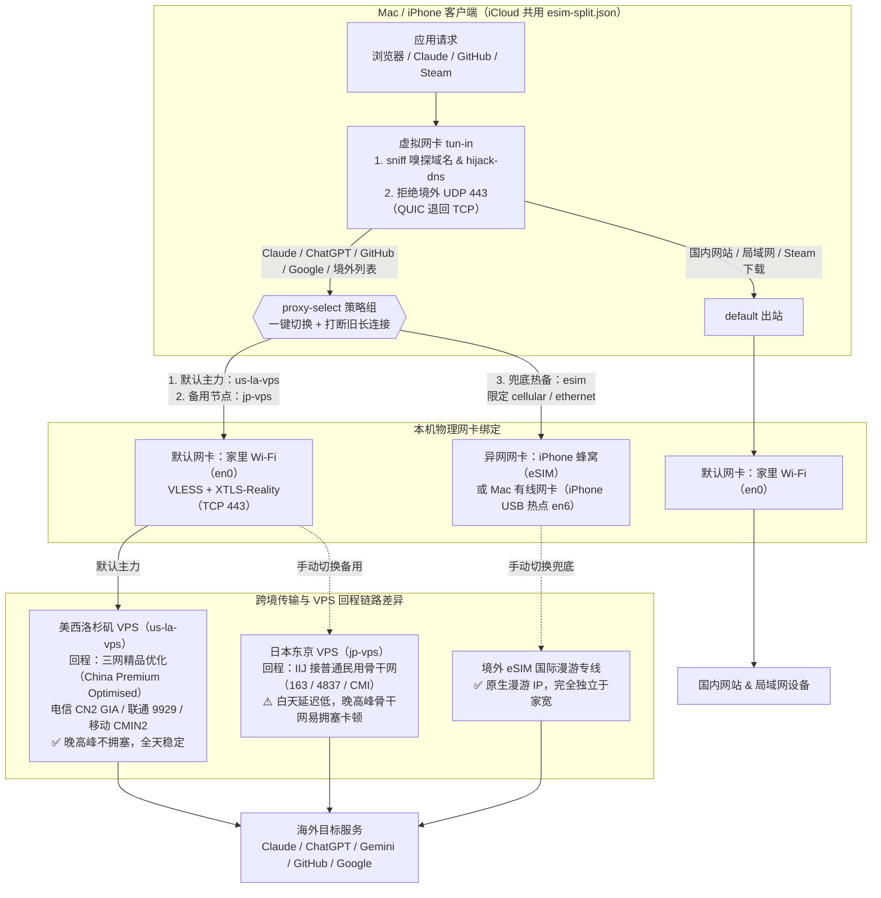

> **2026-11-16 更新**：新增一台洛杉矶三网优化 VPS（直接复用东京节点的服务端目录与密钥部署），策略组升级为「洛杉矶主力 + 东京备用 + eSIM 兜底」三出口一键切换；定位并解决了服务端每隔 30 秒刷出 `mux connection closed: read frame header: EOF` 的问题（将拒绝境外 QUIC 的规则提到域名分流规则之前），并在第五节补充了完整排查过程与 `REALITY: processed invalid connection` 日志说明；在第一节新增了多端 TUN 网卡分流与美西（GIA / 9929 / CMIN2 三网优化）vs 日本（普通骨干网）回程链路差异的全链路架构图；在第二节和第六节补充了 `systemd-journald` 系统日志限额配置（与 Docker 日志轮转配合防止小容量 SSD 被打满）；以及在客户端配置中新增 `SVCB` 记录拦截与 6 大类开发/鉴权/静态资源域名后缀补盲规则（第 6.2 条）。

在上一篇[《让 Mac 和 iPhone 指定网站走 eSIM：sing-box 分流实录》](/posts/mac-hotspot-split-routing/)里，我用一张按量计费的境外 eSIM 配合 `sing-box`，实现了 Mac（通过 iPhone 有线热点）和 iPhone 共用一份 iCloud 配置、只把指定境外网站分流给 eSIM。

这套方案跑通之后，IP 纯净度确实很高，但日常开发重度依赖 Claude、ChatGPT、Gemini 和 GitHub，电脑端长期高频使用时暴露出两个不便：一是按量计费的漫游流量成本偏高，二是 Mac 上网必须一直插着手机开热点。

因此这次的目标是在保留原有架构优点的基础上，把出口升级为「自建主力 + 备用节点 + eSIM 兜底」的多出口方案：

1. **自建容器化节点**：选用日本东京 IIJ 与美国洛杉矶三网优化 VPS（下文以单台初始化为例，新增第二台只需整目录拷过去即可共用同一套凭证），用 Docker 容器化部署 `sing-box v1.14.4`，与宿主机环境隔离，换机器或扩容时几分钟就能恢复。
2. **多出口一键切换**：保留原有的境外 eSIM 作为热备出口，在 Mac 和 iPhone 共用的 `esim-split.json` 中引入 `selector`（策略组），默认走洛杉矶三网优化 VPS（`us-la-vps`），遇到线路波动时可在客户端界面一键切到日本 VPS（`jp-vps`）或 `esim`，国内网站和其他流量照常直连走家里 Wi-Fi。
3. **规则自动跟随更新**：继续使用社区维护的 `.srs` 二进制规则集，每 7 天经当前选中的境外出口自动更新，部署完成后长期不用手动维护。

## 一、整体架构与核心概念

### 1. 多端分流与跨境回程全链路图

Mac 和 iPhone 共用同一份 `sing-box` 配置。从应用发起请求、经过本地虚拟网卡分流到不同物理网卡，再到通过不同回程线路的 VPS 访问海外服务，完整链路如下：



### 2. 为什么主力选美西三网优化，而不是物理距离更近的日本？

平时访问网页、和 AI 对话或拉取代码，请求包很小，真正占大头的是服务器发回本机的**回程（Inbound）流量**。两台 VPS 的核心差异就在回程走的是哪张网：

| 对比维度 | 美西洛杉矶 VPS（`us-la-vps`，默认主力） | 日本东京 IIJ VPS（`jp-vps`，备用） |
| --- | --- | --- |
| **回程线路** | **三网精品优化（China Premium Optimised）**<br/>电信 **CN2 GIA** / 联通 **CUII 9929** / 移动 **CMIN2** | **日本 IIJ 对接国内普通民用骨干网**<br/>电信 **163（AS4134）** / 联通 **4837** / 移动 **CMI** |
| **物理距离与基础延迟** | 跨太平洋，基础 RTT 约 140～170 ms | 物理距离近，闲时 RTT 约 50～80 ms |
| **晚高峰表现（20:00–24:00）** | 走高优先级精品轻载通道，**基本零丢包、不断流** | 与海量民用国际流量挤同一条骨干网出口，**易丢包、卡顿** |
| **实际定位** | **全天默认主力**（AI 流式输出、日常网页最稳） | **备用节点**（美西维护时切换，或白天低延迟场景使用） |

### 3. 核心协议与配置机制

动手配置之前，先理清这次升级新增的几个关键机制：

- **VLESS + XTLS-Reality**：目前主流的轻量级传输协议组合。Reality 的核心优势在于**不需要自己购买域名和申请 TLS 证书**，它会在 TLS 握手阶段直接复用真实大型网站（如 `www.apple.com`）的证书特征，未通过身份校验的连接会被无缝转发给目标网站；同时配合 `xtls-rprx-vision` 流控处理内层 TLS 握手包特征，省去了域名续费与证书维护的麻烦，兼顾连接稳定性与高吞吐性能。
- **JSONC 与二进制规则集（`rule_set`）**：`sing-box 1.14+` 原生支持在 JSON 配置文件中直接写 `//` 单行注释，配置说明可以直接留在文件里；配合预编译的 `.srs` 二进制规则集，内存占用极低，在 1GB 内存的入门级 VPS 和手机端上都游刃有余。
- **`selector` 策略组与长连接打断**：在客户端配置中加入 `selector` 类型的出口后，图形界面会自动生成节点切换面板。开启 `interrupt_exist_connections: true` 后，切换出口时会立即断开旧出口上残留的长连接，新请求立刻走新出口，不会因为复用旧连接而卡住。

## 二、VPS 选购与基础安全加固

这次选用的实例是日本东京 IIJ 线路（1 Core / 1024 MB 内存 / 15GB SSD / Debian 12 系统）。在部署容器前，先做一轮基础的系统安全加固与网络调优。

### 1. 配置 SSH 密钥登录并修改默认端口

公网上的默认 `22` 端口每分钟都会收到大量自动化扫描和口令爆破。先在本地 Mac 生成 `ed25519` 密钥对（如果 `~/.ssh/id_ed25519.pub` 已经存在，直接跳过第一行），趁 `22` 端口还没改，先把公钥传到 VPS 上：

```bash
ssh-keygen -t ed25519 -C "mac-vps"
ssh-copy-id root@<你的VPS_IP>
```

登录 VPS 后，编辑 `/etc/ssh/sshd_config`，把端口改成自定义高位端口（如 `52222`），并禁用密码登录：

```text
Port 52222
PermitRootLogin prohibit-password
PasswordAuthentication no
PubkeyAuthentication yes
```

先校验配置语法，无误后再重启 SSH 服务：

```bash
sshd -t && systemctl restart ssh
```

接着在本地 Mac 的 `~/.ssh/config` 中加上机器别名，以后只需输入 `ssh jp-vps` 就能直接免密登录：

```text
Host jp-vps
    HostName <你的VPS_IP>
    Port 52222
    User root
    IdentityFile ~/.ssh/id_ed25519
```

> **注意**：重启 SSH 后**先不要关掉当前的终端窗口**。新开一个终端窗口测试 `ssh jp-vps` 能正常连上，再进行下一步，防止配置写错把自己锁在门外。另外，改完端口后部分服务商后台网页（如 VMISS 面板）上的 `Port: 22` 卡片仍会显示初始静态信息，属于正常现象，在 VPS 终端运行 `ss -tlpn | grep sshd` 看到监听在 `52222` 即可。

### 2. 配置 UFW 防火墙与开启 BBR 拥塞控制

防火墙只放行刚才改好的 SSH 端口（`52222`）与 `sing-box` 服务端口（`443`），拒绝其余所有入站连接；同时开启 Linux 内核自带的 BBR 拥塞控制算法，改善跨境长延时链路的吞吐表现：

```bash
apt update && apt install -y ufw curl

ufw default deny incoming
ufw default allow outgoing
ufw allow 52222/tcp
ufw allow 443/tcp
ufw allow 443/udp
ufw --force enable

cat << 'EOF' >> /etc/sysctl.conf
net.core.default_qdisc=fq
net.ipv4.tcp_congestion_control=bbr
EOF
sysctl -p
```

执行完可以用 `ufw status` 和 `sysctl net.ipv4.tcp_congestion_control` 确认防火墙规则与 BBR 都已生效。

### 3. 确认 NTP 时钟同步、统一时区与安装 Docker

TLS 与 Reality 握手会校验 **UTC 时间戳**，如果服务器系统时钟偏差过大，握手会直接失败；而修改系统时区则是为了让系统日志和容器日志显示北京时间（`Asia/Shanghai`），方便日后对照排查。这里把 NTP 自动同步和东八区时区一起设好，然后安装官方 Docker 环境：

```bash
timedatectl set-ntp true
timedatectl set-timezone Asia/Shanghai
timedatectl status
curl -fsSL https://get.docker.com | sh
```

确认 `timedatectl status` 输出中 `System clock synchronized: yes` 且时区为 `Asia/Shanghai` 即可。

### 4. 限制 `systemd-journald` 系统日志体积（防止小硬盘被打满）

入门级 VPS 的硬盘通常只有 15GB 左右，而公网机器每天都会产生大量 SSH 扫描拦截、内核与服务日志。`systemd-journald` 默认最多可占用磁盘空间的 10%，日积月累很容易配合镜像缓存把小硬盘塞满。

这里用独立配置目录 `/etc/systemd/journald.conf.d/` 写入限额规则（不直接改主配置文件 `/etc/systemd/journald.conf`，后续系统升级不会产生配置冲突）：

```bash
mkdir -p /etc/systemd/journald.conf.d

cat << 'EOF' > /etc/systemd/journald.conf.d/99-size-limit.conf
[Journal]
Storage=persistent
SystemMaxUse=200M
SystemKeepFree=500M
SystemMaxFileSize=20M
MaxRetentionSec=14day
EOF

systemctl restart systemd-journald
journalctl --vacuum-size=200M
```

各参数含义：

- `Storage=persistent`：日志持久化保存在 `/var/log/journal`；
- `SystemMaxUse=200M`：系统日志最多占用 200MB 磁盘空间；
- `SystemKeepFree=500M`：至少给磁盘预留 500MB 可用空间；
- `SystemMaxFileSize=20M`：单个日志文件最大 20MB，达到后自动轮转；
- `MaxRetentionSec=14day`：只保留最近 14 天的记录；
- `journalctl --vacuum-size=200M`：立即把现有历史日志收缩到 200MB 以内。

加上下一节 `docker-compose.yml` 里给容器日志设的 `60MB` 上限（`20m × 3`），宿主机系统日志与容器日志加起来最多只占约 `260MB`，彻底杜绝日志把磁盘打满。

## 三、服务端 Docker 部署（sing-box v1.14.4）

### 1. 生成 UUID 与 Reality 密钥对

直接用官方镜像启动一次性容器来生成 `UUID` 和 Reality 公私钥对，不需要在宿主机上单独安装 `sing-box` 二进制文件：

```bash
mkdir -p /root/sing-box && cd /root/sing-box

# 生成客户端身份 UUID
docker run --rm ghcr.io/sagernet/sing-box:v1.14.4 generate uuid

# 生成 Reality 密钥对（PrivateKey 填服务端，PublicKey 填客户端）
docker run --rm ghcr.io/sagernet/sing-box:v1.14.4 generate reality-keypair
```

### 2. 编写 `docker-compose.yml`

为了防止容器长年运行后日志把 15GB 硬盘塞满，在 `logging` 里加上日志轮转限制（单文件上限 20MB，最多保留 3 份，总占用不超过 60MB），同时传入 `TZ` 环境变量并挂载 `/etc/localtime`，让容器内的日志时间与宿主机保持一致：

```yaml
services:
  sing-box:
    image: ghcr.io/sagernet/sing-box:v1.14.4
    container_name: sing-box
    restart: unless-stopped
    network_mode: host
    environment:
      - TZ=Asia/Shanghai
    volumes:
      - ./config.json:/etc/sing-box/config.json:ro
      - /etc/localtime:/etc/localtime:ro
    command: -D /var/lib/sing-box -C /etc/sing-box/ run
    logging:
      driver: "json-file"
      options:
        max-size: "20m"
        max-file: "3"
```

### 3. 服务端完整配置（`/root/sing-box/config.json`）

实测这台东京 IIJ 的原生 IP 可以直接顺畅访问 Claude、ChatGPT、Gemini 和 GitHub，不需要在服务端再套一层中转隧道，直接原生出口直出，延迟最低、链路也最简单：

```jsonc
{
  // 日志配置：稳定运行后设为 warn，仅记录警告和错误，减少磁盘写入
  "log": {
    "level": "warn",
    "timestamp": true
  },

  // DNS 配置：调用 VPS 机房自带的本地 DNS（零外部依赖），优先解析 IPv4 避免部分站点 IPv6 绕路
  "dns": {
    "servers": [
      {
        "type": "local",
        "tag": "local-dns"
      }
    ],
    "strategy": "prefer_ipv4"
  },

  // 入站：接收来自客户端的加密连接
  "inbounds": [
    {
      "type": "vless",
      "tag": "vless-in",
      "listen": "::",             // 同时监听 IPv4 和 IPv6
      "listen_port": 443,         // 复用标准 HTTPS 端口，避免非标端口被运营商限速或拦截
      "users": [
        {
          "uuid": "填入生成的UUID",
          "flow": "xtls-rprx-vision" // 开启 Vision 流控，处理内层 TLS 握手特征并提升吞吐
        }
      ],
      "tls": {
        "enabled": true,
        "server_name": "www.apple.com", // TLS 握手所使用的目标域名（SNI）
        "reality": {
          "enabled": true,
          "handshake": {
            // 复用真实大型网站的 TLS 握手特征，无需自行买域名和申请证书
            "server": "www.apple.com",
            "server_port": 443
          },
          "private_key": "填入生成的Reality_PrivateKey",
          "short_id": [
            "0123456789abcdef"    // 握手校验短 ID（0~16 位十六进制），需与客户端保持一致
          ]
        }
      }
    }
  ],

  // 出站：定义流量离开 VPS 后的去向
  "outbounds": [
    {
      "type": "direct",
      "tag": "direct-out"         // 东京 IIJ 原生直连出口
    },
    {
      "type": "block",
      "tag": "block-out"          // 黑洞拦截出口（丢弃违规或探测流量）
    }
  ],

  // 路由规则：从上往下依次匹配，命中第一条即生效
  "route": {
    "rules": [
      {
        "action": "sniff"         // 协议嗅探：从流量中识别真实域名与协议类型
      },
      {
        "protocol": "bittorrent",
        "outbound": "block-out"   // 拦截 BT/PT 流量，防止因版权投诉触发机房风控
      },
      {
        "ip_is_private": true,
        "outbound": "block-out"   // 拦截私有网段请求，防止误扫机房内网
      }
    ],
    "default_domain_resolver": "local-dns", // v1.14+ 规范必填：指定默认域名解析器
    "final": "direct-out"         // 兜底规则：其余正常请求直接从东京原生 IP 发出
  }
}
```

### 4. 静态语法校验与启动

启动容器前，先用内置的 `check` 子命令做一次静态语法校验，确认没有报错（退出码为 `0`）后再后台拉起服务。以后如果改了 `docker-compose.yml` 或配置，直接运行 `docker compose up -d` 或 `docker compose restart` 即可：

```bash
docker run --rm -v /root/sing-box/config.json:/etc/sing-box/config.json:ro ghcr.io/sagernet/sing-box:v1.14.4 check -c /etc/sing-box/config.json
docker compose up -d
```

## 四、Mac 与 iPhone 共用的客户端配置

客户端的设置方式和[上一篇](/posts/mac-hotspot-split-routing/)完全一样：把配置文件保存在「iCloud 云盘 → sing-box」目录下，Mac（SFM 客户端）和 iPhone（sing-box MT 客户端）都选 `iCloud` 类型读取同一个 `esim-split.json`。

### 相比上一版改了什么

1. **新增双自建节点与 `proxy-select` 策略组**：把原来的单一 `esim` 出口升级为 `proxy-select` 选择器，包含 `us-la-vps`（洛杉矶三网优化主力）、`jp-vps`（日本东京 IIJ 备用，直接拷贝同一套服务端配置与密钥即可上线）和 `esim`（热备，iPhone 上走蜂窝数据卡、Mac 上走 iPhone USB 有线热点）三个出口，在客户端界面可以一键切换。
2. **DNS 与规则集下载全链路跟随策略组**：境外加密 DNS（`dns-proxy`）和规则集下载客户端（`proxy-http`）的 `detour` 都指向 `proxy-select`。这样不管当前选的是洛杉矶 VPS、日本 VPS 还是 eSIM，DNS 解析和每周一次的规则集自动更新都会自动跟着当前出口走，平时在 Mac 上不插手机开热点也能独立工作。
3. **DNS 统一拦截 `AAAA`、`HTTPS` 与 `SVCB` 查询（显式返回 `rcode: NOERROR`）**：境外 eSIM 漫游只有 IPv4，而现代浏览器和部分客户端除了查 `AAAA` 记录，还会查 `HTTPS`（Type 65）和 `SVCB`（Type 64 服务绑定记录）——后者与 `HTTPS` 同样可能携带 `ipv6hint` 或 HTTP/3 参数，导致客户端跳过常规 A 记录或尝试直连 IPv6/QUIC。第一条 DNS 规则将这三种查询统一用 `predefined` 并显式返回 `"rcode": "NOERROR"` 空响应，强制所有连接走稳定的 IPv4。
4. **把拒绝境外 QUIC 放到域名分流前面**：原来拒绝境外 `UDP 443`（QUIC / HTTP/3）的规则排在最后，但 `sniff` 会从 QUIC 握手里提前读出 `google.com` 等域名，导致连接先命中按域名分流的规则、经 `xudp` 走 VPS 并在空闲 30 秒后刷出 `EOF` 日志。把这条规则提到按域名分流前面后，浏览器会立刻改用 TCP（HTTP/2）并照常按域名分流，既省去了 UDP 套 TCP 的开销，也消除了服务端 30 秒超时日志。
5. **冷启动规则集域名兜底**：在分流规则里，`github.com` 和 `githubusercontent.com` 写在远程规则集前面直接走 `proxy-select`。这样新设备第一次启动、本地还没有任何 `.srs` 规则集缓存时，去 GitHub 下载规则集的请求本身也能顺利走境外出口，不会陷入「下载规则集需要先加载规则集」的死锁。
6. **新增社区精选域名后缀补盲（规则 6.2）**：社区 `gfw.srs` 规则集并不覆盖所有日常开发与海外常用服务。新配置将第 6 条分流规则拆分为 `6.1`（原有 5 个社区 `rule_set`）与 `6.2`（53 个高频域名后缀补盲），把不在 `gfw.srs` 列表里、但日常高频遇到的容器与语言包管理器（Docker、Quay、PyPI、npm、Crates、Homebrew 等）、公共静态 CDN 与 Vercel/Cloudflare Pages 等托管平台、StackExchange 静态资源与 Auth0/Clerk 第三方登录鉴权（防止主站走 VPS 而登录组件走直连导致白屏或鉴权分裂）、AI 工具链（Hugging Face、Ollama、OpenRouter、Cursor、JetBrains 等）、《饥荒》Klei 联机服务、`testflight.apple.com` 以及 `ipinfo.io`/`ping0.cc` 等 IP 自检站（防止自检时误走直连以为分流未生效）统一纳入 `proxy-select`。

### 完整客户端配置（`esim-split.json`）

```jsonc
// ============================================================
//  esim-split.json：Mac 和 iPhone 共用的 sing-box 分流配置
//  放在「iCloud 云盘 → sing-box」里，两台设备都选 iCloud 类型的配置读取它
//
//  效果：
//    Claude、ChatGPT、GitHub、Google、常用境外网站 → 走 proxy-select（默认自建洛杉矶三网优化 VPS，可界面一键切日本 VPS 或 eSIM）
//    国内网站和其他所有流量 → 走默认网络（家里 Wi-Fi / 本地蜂窝）
//    发往境外 IP 的 QUIC（HTTP/3）一律拒绝，浏览器和 App 会自动改用 TCP
//
//  改完这个文件后，要在 sing-box 里把开关关掉再打开才会生效
//  需要 sing-box 1.14 及以上（支持 // 注释和 http_clients 写法）
// ============================================================
{
  // ---------- 日志 ----------
  // warn：只记录警告和错误。排查问题时可以临时改成 info，看每条连接的去向
  "log": {
    "level": "warn"
  },

  // ---------- DNS：域名解析 ----------
  "dns": {
    "servers": [
      {
        // 境外 DNS（Cloudflare 的加密 DNS），经当前选中的境外出口（us-la-vps、jp-vps 或 esim）发出
        // 这样拿到的是境外网络视角下真实可用的地址，且切节点时自动跟随
        "type": "https",
        "tag": "dns-proxy",
        "detour": "proxy-select",
        "server": "1.1.1.1"
      },
      {
        // 国内 DNS（阿里的加密 DNS），走默认网络，解析国内网站又快又准
        "type": "https",
        "tag": "dns-cn",
        "server": "223.5.5.5"
      }
    ],
    "rules": [
      {
        // 所有域名都只返回 IPv4 地址（拦掉 AAAA、HTTPS 与 SVCB 记录，显式返回 NOERROR 空结果）：
        //   境外 eSIM 漫游只有 IPv4，拿到 IPv6 地址或服务绑定参数会连不上
        //   统一用 IPv4 可以保证所有流量稳定经过分流规则
        "query_type": [
          "AAAA",
          "HTTPS",
          "SVCB"
        ],
        "action": "predefined",
        "rcode": "NOERROR"
      },
      {
        // 指定境外网站用境外 DNS 解析，拿到境外网络视角下可用的地址
        "rule_set": [
          "anthropic",
          "openai",
          "overseas-list",
          "github",
          "google"
        ],
        "server": "dns-proxy"
      }
    ],
    // 其他所有域名都用国内 DNS
    "final": "dns-cn"
  },

  // ---------- 下载规则集用的 HTTP 客户端 ----------
  // 规则集托管在 GitHub 上，经当前选中的境外出口下载，保证 7 天自动更新不失败
  "http_clients": [
    {
      "tag": "proxy-http",
      "version": 2,
      "detour": "proxy-select"
    }
  ],

  // ---------- 入口：虚拟网卡 ----------
  // 系统所有流量都先进这块虚拟网卡，再由下面的规则决定从哪个出口出去
  "inbounds": [
    {
      "type": "tun",
      "tag": "tun-in",
      // 虚拟网卡自己的地址，用的是不会和真实网络冲突的保留网段
      "address": [
        "172.19.0.1/30",
        "fdfe:dcba:9876::1/126"
      ],
      // 自动把系统默认路由指向虚拟网卡
      "auto_route": true,
      // 严格路由：防止流量绕过虚拟网卡直接出去
      "strict_route": true
    }
  ],

  // ---------- 出口 ----------
  "outbounds": [
    {
      // 1. 普通直连，跟随系统默认网络（在家就是 Wi-Fi）
      "type": "direct",
      "tag": "default"
    },
    {
      // 2. 策略组选择器：在客户端界面可一键切换 us-la-vps、jp-vps 或 esim
      "type": "selector",
      "tag": "proxy-select",
      "outbounds": [
        "us-la-vps",
        "jp-vps",
        "esim"
      ],
      "default": "us-la-vps",
      // 切换出口时立即断开旧出口上残留的长连接，新请求马上走新出口
      "interrupt_exist_connections": true
    },
    {
      // 3. 主力出口：洛杉矶三网优化 VPS（VLESS + XTLS-Reality）
      // 不需要 multiplex：Vision 流控本身不配合多路复用，保持默认不写即可
      // UDP 默认用 xudp 封装在 TCP 里转发；服务端日志里偶尔出现的
      // 「mux connection closed: read frame header: EOF」是 UDP 会话被客户端关闭（切节点、切网络、休眠），属正常现象
      "type": "vless",
      "tag": "us-la-vps",
      "server": "<洛杉矶VPS_IP>",
      "server_port": 443,
      "uuid": "填入生成的UUID",
      "flow": "xtls-rprx-vision",
      "tls": {
        "enabled": true,
        "server_name": "www.apple.com",
        "utls": {
          "enabled": true,
          "fingerprint": "chrome"
        },
        "reality": {
          "enabled": true,
          "public_key": "填入生成的Reality_PublicKey",
          "short_id": "0123456789abcdef"
        }
      }
    },
    {
      // 4. 备用出口：自建日本东京 IIJ VPS（VLESS + XTLS-Reality）
      //    和洛杉矶共用同一套 UUID 与 Reality 密钥（服务端配置是整目录拷过去的）
      "type": "vless",
      "tag": "jp-vps",
      "server": "<日本VPS_IP>",
      "server_port": 443,
      "uuid": "填入生成的UUID",
      "flow": "xtls-rprx-vision",
      "tls": {
        "enabled": true,
        "server_name": "www.apple.com",
        "utls": {
          "enabled": true,
          "fingerprint": "chrome"
        },
        "reality": {
          "enabled": true,
          "public_key": "填入生成的Reality_PublicKey",
          "short_id": "0123456789abcdef"
        }
      }
    },
    {
      // 5. 备用出口：直连，但只走「蜂窝」或「有线」网络（eSIM 漫游流量）
      //   iPhone：走蜂窝数据（数据卡设为 eSIM）
      //   Mac：走有线网卡（iPhone 用数据线开的热点在 Mac 上识别为有线网卡）
      //   default 策略：只用这两类网络，它们不可用时不会偷偷改走 Wi-Fi
      "type": "direct",
      "tag": "esim",
      "network_strategy": "default",
      "network_type": [
        "cellular",
        "ethernet"
      ]
    }
  ],

  // ---------- 分流 ----------
  "route": {
    // ---------- 分流规则：从上往下匹配，命中第一条就停 ----------
    "rules": [
      {
        // 1. 嗅探：从 TLS、HTTP、QUIC 握手里读出域名
        //    App 写死 IP、或浏览器自己用加密 DNS 时，靠它照样能按域名分流
        "action": "sniff"
      },
      {
        // 2. 接管所有 DNS 查询，交给上面的 DNS 规则处理
        "protocol": "dns",
        "action": "hijack-dns"
      },
      {
        // 3. 局域网地址走默认网络（Wi-Fi），不然路由器后台、打印机都访问不了
        "ip_is_private": true,
        "outbound": "default"
      },
      {
        // 4. 发往境外 IP 的 QUIC（HTTP/3，UDP 443）一律拒绝，国内 IP 的 QUIC 不受影响
        //    必须放在按域名分流的规则前面：嗅探能从 QUIC 握手里读出域名，
        //    如果排在后面，Google、YouTube 的 QUIC 会先命中第 6.1 条，经 xudp 走 VPS，
        //    空闲 30 秒后被客户端关闭，服务端就会刷「read frame header: EOF」
        //    拒绝后浏览器和 App 会立刻改用 TCP（HTTP/2），照样按域名分流，而且比 UDP 套 TCP 更稳
        "type": "logical",
        "mode": "and",
        "rules": [
          {
            "network": "udp",
            "port": 443
          },
          {
            "rule_set": "cn-ip",
            "invert": true
          }
        ],
        "action": "reject"
      },
      {
        // 5. 冷启动兜底：首次启动本地还没有规则集缓存时，让 GitHub 域名直接走境外出口完成规则集下载
        "domain_suffix": [
          "githubusercontent.com",
          "github.com"
        ],
        "outbound": "proxy-select"
      },
      {
        // 6.1 Claude、ChatGPT、境外网站、GitHub、Google 走策略组（默认 us-la-vps）
        //     Steam 不用单独写：商店和社区在境外网站列表里，下载域名不在列表里，会自动走 Wi-Fi
        "rule_set": [
          "anthropic",
          "openai",
          "overseas-list",
          "github",
          "google"
        ],
        "outbound": "proxy-select"
      },
      {
        // 6.2 社区精选补盲：不在 gfw.srs 中，但直连必卡/鉴权分裂/测试必用的后缀
        "domain_suffix": [
          // --- 容器、包管理与语言工具链 ---
          "docker.com",
          "docker.io",
          "quay.io",
          "lscr.io",
          "k8s.io",
          "pypi.org",
          "pythonhosted.org",
          "npmjs.org",
          "npmjs.com",
          "yarnpkg.com",
          "nodejs.org",
          "crates.io",
          "pkg.go.dev",
          "sum.golang.org",
          "brew.sh",
          "gitlab.com",
          // --- 公共静态 CDN、托管平台与边缘存储 ---
          "jsdelivr.net",
          "unpkg.com",
          "cdnjs.cloudflare.com",
          "vercel.app",
          "pages.dev",
          "netlify.app",
          "workers.dev",
          "r2.dev",
          "gravatar.com",
          // --- StackExchange 静态资源与海外登录鉴权 (防半截直连白屏) ---
          "sstatic.net",
          "stackexchange.com",
          "superuser.com",
          "askubuntu.com",
          "auth0.com",
          "clerk.com",
          // --- AI 平台、模型仓库与 IDE 工具 ---
          "huggingface.co",
          "hf.co",
          "ollama.com",
          "openrouter.ai",
          "groq.com",
          "perplexity.ai",
          "cursor.sh",
          "cursor.com",
          "jetbrains.com",
          "vscode-cdn.net",
          // --- 笔记协作、游戏联机与 Apple 美区 ---
          "notion.so",
          "notion.site",
          "notion-static.com",
          "figma.com",
          "klei.com",
          "kleientertainment.com",
          "testflight.apple.com",
          // --- IP 检查站 (防自检时误走直连以为分流未生效) ---
          "ipinfo.io",
          "ipsb.com",
          "ip.sb",
          "ping0.cc",
          "scamalytics.com"
        ],
        "outbound": "proxy-select"
      },
      {
        // 7. 只有 IP 的连接：按这几家服务的 IP 段兜底，也走策略组
        "rule_set": [
          "google-ip",
          "telegram-ip",
          "twitter-ip",
          "facebook-ip"
        ],
        "outbound": "proxy-select"
      }
    ],

    // ---------- 规则集：全部来自社区，每 7 天自动更新 ----------
    // 来源：https://github.com/MetaCubeX/meta-rules-dat 的 sing 分支
    // 源头列表：https://github.com/v2fly/domain-list-community 的 data 目录
    // geosite = 按域名分组，geoip = 按 IP 段分组
    "rule_set": [
      {
        // Claude / Anthropic 的全部域名，包括 Artifact 用的 claudeusercontent.com
        "type": "remote",
        "tag": "anthropic",
        "url": "https://raw.githubusercontent.com/MetaCubeX/meta-rules-dat/sing/geo/geosite/anthropic.srs",
        "update_interval": "168h0m0s"
      },
      {
        // ChatGPT / OpenAI 的全部域名，包括静态资源域名
        "type": "remote",
        "tag": "openai",
        "url": "https://raw.githubusercontent.com/MetaCubeX/meta-rules-dat/sing/geo/geosite/openai.srs",
        "update_interval": "168h0m0s"
      },
      {
        // 常用境外网站列表（上游文件名沿用项目原名）
        // Steam 商店和社区、Telegram、X、YouTube、Grok 等都在里面
        "type": "remote",
        "tag": "overseas-list",
        "url": "https://raw.githubusercontent.com/MetaCubeX/meta-rules-dat/sing/geo/geosite/gfw.srs",
        "update_interval": "168h0m0s"
      },
      {
        // GitHub 全部域名
        "type": "remote",
        "tag": "github",
        "url": "https://raw.githubusercontent.com/MetaCubeX/meta-rules-dat/sing/geo/geosite/github.srs",
        "update_interval": "168h0m0s"
      },
      {
        // Google 全部域名，包括 Gemini
        "type": "remote",
        "tag": "google",
        "url": "https://raw.githubusercontent.com/MetaCubeX/meta-rules-dat/sing/geo/geosite/google.srs",
        "update_interval": "168h0m0s"
      },
      {
        // 下面四个是这几家服务自己的 IP 段，用来兜底「只有 IP、没有域名」的连接
        "type": "remote",
        "tag": "google-ip",
        "url": "https://raw.githubusercontent.com/MetaCubeX/meta-rules-dat/sing/geo/geoip/google.srs",
        "update_interval": "168h0m0s"
      },
      {
        "type": "remote",
        "tag": "telegram-ip",
        "url": "https://raw.githubusercontent.com/MetaCubeX/meta-rules-dat/sing/geo/geoip/telegram.srs",
        "update_interval": "168h0m0s"
      },
      {
        "type": "remote",
        "tag": "twitter-ip",
        "url": "https://raw.githubusercontent.com/MetaCubeX/meta-rules-dat/sing/geo/geoip/twitter.srs",
        "update_interval": "168h0m0s"
      },
      {
        "type": "remote",
        "tag": "facebook-ip",
        "url": "https://raw.githubusercontent.com/MetaCubeX/meta-rules-dat/sing/geo/geoip/facebook.srs",
        "update_interval": "168h0m0s"
      },
      {
        // 国内 IP 段，用在第 4 条 QUIC 规则里
        "type": "remote",
        "tag": "cn-ip",
        "url": "https://raw.githubusercontent.com/MetaCubeX/meta-rules-dat/sing/geo/geoip/cn.srs",
        "update_interval": "168h0m0s"
      }
    ],

    // 8. 其他所有流量走默认网络（Wi-Fi / 本地蜂窝）
    "final": "default",
    // 自动找到真实网卡，sing-box 自己发出的连接直接绑定到真实网卡，不会又绕回虚拟网卡
    "auto_detect_interface": true,
    // sing-box 自己需要解析域名时（比如以后把 VPS 地址换成域名），默认用国内 DNS
    "default_domain_resolver": "dns-cn",
    // 下载规则集时跟随当前选中的境外出口（us-la-vps、jp-vps 或 esim）
    "default_http_client": "proxy-http"
  },

  // ---------- 其他 ----------
  "experimental": {
    // 把规则集和策略组选择状态缓存到本地，重启后不用重新下载
    "cache_file": {
      "enabled": true
    }
  }
}
```

## 五、踩坑复盘与经验总结

搭建和联调过程中遇到了几个很有代表性的问题，记录下来供日后排查参考：

1. **`sing-box v1.14` 废弃字段报错（`legacy domain strategy options is deprecated`）**
   - **原因**：从 `v1.12` 到 `v1.14`，旧版写在 `outbounds` 里的 `domain_strategy` 已被彻底移除，强行使用会导致进程启动即 `FATAL` 退出。
   - **解决**：将解析策略统一放到顶层 `dns` 模块的 `"strategy": "prefer_ipv4"`，并在 `route` 中显式声明 `"default_domain_resolver": "local-dns"`。
2. **服务端频繁报 `mux connection closed: read frame header: EOF`（其实是 QUIC 规则顺序问题）**
   - **原因**：起初看到日志里带 `mux` 且持续时间整齐卡在 `30.6s`–`30.9s`，一度以为是客户端多路复用冲突。但核查后发现客户端根本没开 `multiplex`——真正的原因是 `sing-box` 的 VLESS 出站默认用 `xudp`（底层按 mux 帧封装 UDP）转发 UDP；而客户端原本把「拒绝境外 QUIC（`UDP 443`）」放在规则第 7 条，前面第 5 条按域名分流时，`sniff` 已经从 QUIC 握手里读出了 `google.com`、`youtube.com` 等域名，导致浏览器的 HTTP/3 流量先命中了域名规则、经 `xudp` 进了 VPS。`sing-box` 客户端对 QUIC/DTLS 类型的 UDP 会话设置了 30 秒空闲超时，超时一到客户端直接关闭底层连接，服务端正在等待下一帧时就记一条 `read frame header: EOF`（此外切节点、切网络或休眠关闭长连接时也会出现个别持久会话的 EOF，属于正常现象）。
   - **解决**：把拒绝境外 QUIC 的规则提到第 4 条（放在所有按域名分流的规则前面）。这样浏览器访问境外网站时会直接退回 TCP（HTTP/2）并照常按域名分流，既消除了服务端 30 秒刷屏的 `EOF` 日志，也避免了 UDP 套 TCP 在丢包时的卡顿。
3. **多余的外部隧道反而拖累原生 IP**
   - **原因**：起初担心机房 IP 通不过部分 AI 服务的地区检测，在服务端额外挂了一层外部隧道，结果因为握手延迟叠加和出口波动，频繁触发 30 秒请求超时，而且部分直出流量与隧道出口混用反而导致地区判定不一致。实测发现这台东京 IIJ 原生 IP 本身就能直接顺畅访问 Gemini、Claude 等全部服务，去掉中间层并清理浏览器对应站点的 Cookie 缓存后，延迟大幅下降，超时断流也彻底消失。
4. **客户端 `detour` 解耦与标签名闭环检查**
   - **原因**：最初改客户端配置时，`dns-proxy` 和 `http_clients` 的 `detour` 还硬编码指在 `esim` 上，结果 Mac 没插手机开热点时境外域名完全无法解析；另外修改 DNS 服务器标签名时，如果 `dns.servers[].tag` 与 `dns.rules[].server` 名字不一致也会报错。
   - **解决**：把两处 `detour` 统一改指向 `proxy-select` 策略组，让 DNS 查询和规则集下载完全跟随当前选中的出口，并逐一核对了所有 `tag` 的引用闭环。
5. **日志里出现陌生 IP 的 `TLS handshake: REALITY: processed invalid connection`**
   - **原因**：把 30 秒 EOF 噪音清掉后，日志里偶尔会冒出来自陌生公网 IP（如云厂商扫描器、证书爬虫）的 `REALITY: processed invalid connection` 记录。这是因为 `443` 是公开端口，任何主机都能来探测，而对方没有正确的 Reality 凭证（UUID、`short_id`、密钥），`sing-box` 按设计把这类未通过校验的连接原样转发给了握手目标 `www.apple.com`。
   - **解决**：这是 Reality 正常工作的证明，**不需要任何处理**（不要为了屏蔽它把 `log.level` 调高到 `error` 以上，也不要用防火墙限制仅自己 IP 访问，否则家宽/手机 IP 变化后自己也会连不上）。

## 六、换机与扩容快速操作清单

常规 VPS 套餐不支持跨机房直接克隆系统镜像，不过得益于 Docker 部署，服务端所有状态都收敛在 `/root/sing-box` 目录下。日后新增节点（如这次在原有日本节点外新增洛杉矶三网优化节点）、更换 VPS 或换新电脑，按下面的步骤几分钟就能完成：

### 1. 新增或更换 VPS

1. **在本地 Mac 备份已有 VPS 配置**：
   ```bash
   scp -r jp-vps:/root/sing-box ~/Desktop/sing-box-backup
   ```
2. **初始化新 VPS 环境**（先用 root 登录新机器，开启 NTP 与东八区时区、安装 Docker、开启 BBR、配置防火墙并限制系统日志体积）：
   ```bash
   timedatectl set-ntp true && timedatectl set-timezone Asia/Shanghai
   apt update && apt install -y curl ufw
   curl -fsSL https://get.docker.com | sh
   cat << 'EOF' >> /etc/sysctl.conf
   net.core.default_qdisc=fq
   net.ipv4.tcp_congestion_control=bbr
   EOF
   sysctl -p
   mkdir -p /etc/systemd/journald.conf.d
   cat << 'EOF' > /etc/systemd/journald.conf.d/99-size-limit.conf
   [Journal]
   Storage=persistent
   SystemMaxUse=200M
   SystemKeepFree=500M
   SystemMaxFileSize=20M
   MaxRetentionSec=14day
   EOF
   systemctl restart systemd-journald && journalctl --vacuum-size=200M
   ufw default deny incoming && ufw default allow outgoing
   ufw allow 443/tcp && ufw allow 443/udp
   ```
   接着按第二节配置 SSH 公钥、把端口改为 `52222` 并放行 `ufw allow 52222/tcp && ufw --force enable`。
3. **推送备份配置并拉起容器**：
   ```bash
   scp -P 52222 -r ~/Desktop/sing-box-backup root@<新VPS_IP>:/root/sing-box
   ssh -p 52222 root@<新VPS_IP> "cd /root/sing-box && docker compose up -d"
   ```
4. **更新客户端地址**：把 iCloud 里 `esim-split.json` 中对应节点（如 `us-la-vps` 或 `jp-vps`）的 `"server"` 改成新 VPS 的 IP（两台机器共用同一套服务端目录，原有的 `uuid` 和 `public_key` 直接沿用，无需重新生成）。如果给 VPS 绑了自己的域名并托管在 Cloudflare，只需在 Cloudflare 里把 A 记录指向新 IP 即可免改客户端配置——**注意 Cloudflare 的 A 记录必须设为「仅 DNS（灰色云朵）」，不能开启橙色云朵 CDN 代理**，否则无法转发 Reality 握手流量。

### 2. 更换新 Mac（恢复 SSH 免密登录）

- **推荐做法（一机一钥）**：在新 Mac 上运行 `ssh-keygen -t ed25519` 生成新密钥对，用旧 Mac 登录 VPS 后执行 `echo "<新公钥内容>" >> ~/.ssh/authorized_keys` 追加授权，再把 `~/.ssh/config` 里的 `jp-vps` 别名拷到新 Mac 即可。
- **应急兜底**：如果旧电脑不在身边、也没备份过私钥，可以登录 VPS 服务商后台打开网页版 `Console`（VNC 控制台）。因为 `/etc/ssh/sshd_config` 里的 `PasswordAuthentication no` 只限制通过网络发起的 SSH 会话，不影响机房 VNC 本地终端（`tty1`）登录，在 VNC 里用 root 密码登录后把新公钥写进 `~/.ssh/authorized_keys` 即可恢复。

> 参考：[sing-box 官方文档：Migration Guide (v1.11–v1.14)](https://sing-box.sagernet.org/migration/)、[sing-box TLS / Reality 配置文档](https://sing-box.sagernet.org/configuration/shared/tls/#reality)、[MetaCubeX/meta-rules-dat 预编译规则集仓库](https://github.com/MetaCubeX/meta-rules-dat)、[《让 Mac 和 iPhone 指定网站走 eSIM：sing-box 分流实录》](/posts/mac-hotspot-split-routing/)。
