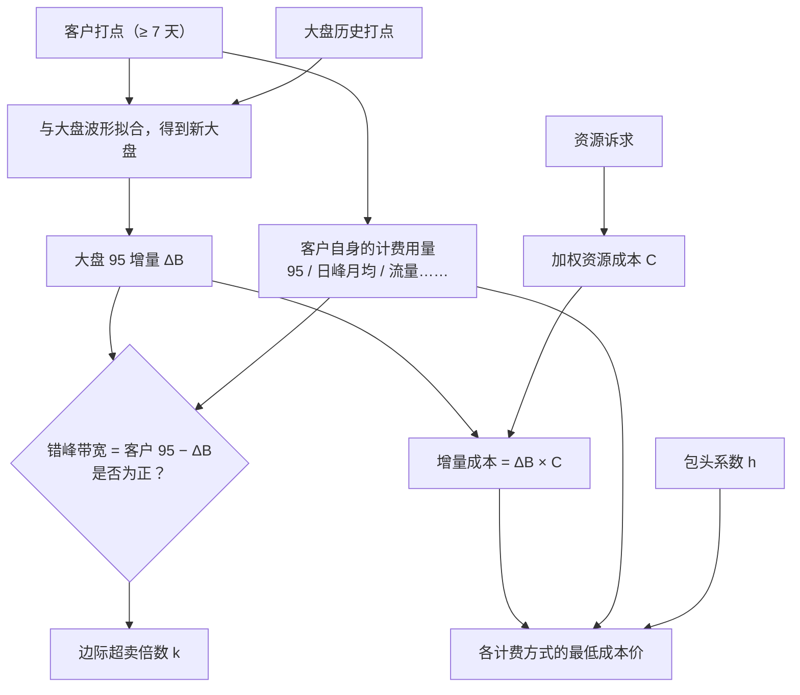
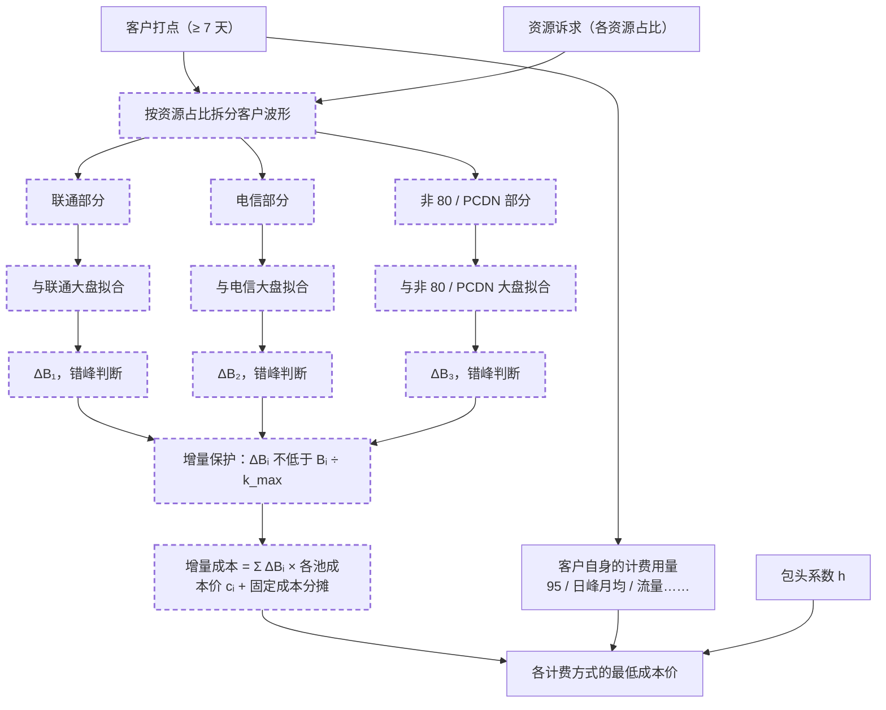

> 2026-11-03 更新：新增第四节，记录测算工具后来的一次迭代：用 94～96 百分位区间的平均增量代替 95 单点增量，以及它和单点结算之间的关系。

接入一个新的 CDN 客户之前，销售最常问的问题是：**这个客户最低能报多少钱？**

报高了，客户被竞争对手抢走；报低了，接进来就亏钱。而 CDN 的成本又很特殊：同样大小的两个客户，因为高峰时间不同，给厂商带来的成本可能差好几倍（见[《CDN 的错峰与超卖》](/posts/cdn-off-peak-and-overselling/)）。光靠经验拍价格，很难准。

火山 CDN 的经营分析平台上有一个**价格测算**功能，就是用来回答这个问题的。这篇介绍它的思路。

> 文中的数据都是模拟的，成本用相对指数表示，不代表真实价格。

## 一、输入

使用者（一般是销售或运营）需要提供三类输入：

**1. 客户的带宽打点。** 5 分钟粒度的带宽数据，要求：

- **至少 7 天**：覆盖一个完整的周周期，把工作日和周末的差异都包含进去；
- **最能体现客户业务特性的稳定波形**：不能拿一个做活动的特殊时段来测，否则拟合出来的结果不代表客户的常态。

这两点是测算结果可信的前提，平台对使用者专门做过宣贯。错峰效果完全取决于客户的波形，输入的波形不对，后面算得再精确也没有意义。

**2. 资源诉求。** 客户对接入资源的要求，比如全部要联通、全部要电信，或者可以接受非 80 端口的低价节点、PCDN 节点等。不同资源的成本差别很大。

**3. 包头系数。** 后面会讲到，它是留给销售的议价空间，测算时可以调整。

## 二、测算过程

### 1. 波形拟合：算出大盘 95 的增量

把客户的打点和大盘同一时段的打点逐点相加，得到「接入后的新大盘」，再分别计算新、旧大盘的 95，两者之差就是这个客户带来的**大盘 95 增量 ΔB**。

### 2. 判断错峰

$$
\text{错峰带宽} = B_{\text{客户}} - \Delta B, \qquad k = \frac{B_{\text{客户}}}{\Delta B}
$$

B_客户 是客户自己的 95。错峰带宽为正（k > 1），说明客户的高峰落在大盘的低谷，是错峰客户；为零或为负，说明和大盘同峰。

**这是测算里最重要的结论。** 价格是参考，错峰的正负才是判断这个客户「好不好」的依据。

### 3. 加权资源成本

客户的资源诉求决定了成本单价。把各类资源的成本按客户的流量占比加权平均：

$$
C = \sum_i w_i \cdot c_i
$$

比如：

| 资源 | 占比 wᵢ | 成本指数 cᵢ |
| --- | --- | --- |
| 联通 | 50% | 1.0 |
| 电信 | 30% | 1.2 |
| 非 80 端口节点 | 20% | 0.6 |
| **加权成本 C** | | **0.98** |

这里的加权，本来就是为了把分运营商、分资源的细分成本价模糊成一个数，和「一个大盘」的拟合方式相匹配。

### 4. 最低成本价

接入这个客户，厂商要多付的成本是 **ΔB × C**。向客户收费时，计费用量要乘以**包头系数 h**。最低成本价的原则是：**乘上包头系数之后的收入，不能低于增加的成本**。

$$
P_{\min} \times h \times B_{\text{客户}} \ \ge\ \Delta B \times C
\quad\Longrightarrow\quad
P_{\min} = \frac{C}{k \times h}
$$

这个式子很好地说明了各个因素的作用：

- **k 越大（越错峰）**，最低价越低；
- **资源越贵（C 越大）**，最低价越高；
- **包头系数 h 越大**，同样的单价能收回更多，报价就可以更低。h 在测算时是一个可调的输入，用来给销售留出议价空间。

### 5. 不同计费方式的最低价

客户可能希望按 95、按日峰月均或者按流量计费。成本侧的增量都是同一个 ΔB × C，不同的只是客户在各计费方式下的计费用量 Q。平台会根据上传的打点，分别算出各计费方式的用量，再分别给出最低价：

$$
P_{\min,\,m} = \frac{\Delta B \times C}{Q_m \times h}
$$

m 代表计费方式。销售可以同时看到「按 95 最低报多少、按流量最低报多少」，按客户的偏好去谈。

## 三、示例

用 7 天的模拟数据，测算两个规模相近的客户：客户甲的高峰在上午 10 点，客户乙的高峰在晚上 21 点，和大盘一样。大盘的 95 约为 679 Mbps，资源诉求都按上面的表格（C = 0.98）。

**错峰判断：**

| | 客户自己的 95 | 大盘 95 增量 ΔB | 错峰带宽 | 边际超卖倍数 k | 结论 |
| --- | --- | --- | --- | --- | --- |
| 客户甲 | 208.5 | 22.1 | **+186.4** | 9.42 | 错峰 |
| 客户乙 | 207.0 | 208.8 | **−1.9** | 0.99 | 同峰 |

**最低成本价**（成本指数；95 和日峰月均为每 Mbps·月，流量为每 TB）：

| 计费方式 | 客户甲（h = 1.0） | 客户甲（h = 1.1） | 客户乙（h = 1.0） | 客户乙（h = 1.1） |
| --- | --- | --- | --- | --- |
| 95 峰值 | 0.104 | 0.095 | 0.989 | 0.899 |
| 日峰月均 | 0.096 | 0.087 | 0.896 | 0.815 |
| 流量 | 1.18 | 1.07 | 11.46 | 10.42 |

两个客户规模几乎一样，资源诉求也一样，但客户甲的最低成本价只有客户乙的十分之一左右。如果按经验给两个客户报同一个价格，要么错失客户甲，要么接入客户乙就亏钱。

## 四、一次迭代：从单点增量到区间增量

### 1. 单点增量的问题

最初的版本里，大盘 95 增量 ΔB 就是「新大盘的 95 值 − 旧大盘的 95 值」，也就是两个单点之差，上面的示例用的也是这个口径。

用了一段时间发现，这个差值不太稳：

- **95 只是排序后的一个点**。客户的曲线一叠加，大盘里各个时间点的排序会变，具体是哪个时间点落在第 95 百分位，可能就换了一个，差值会跟着跳；
- **7 天的样本本身有偶然性**。同一个客户换一周数据来测，95 恰好落在哪个点就不一样；
- **错峰客户受影响最大**。错峰客户的 ΔB 本身很小，单点的一点抖动，换算成边际超卖倍数 k 就是很大的变化，而 k 直接决定最低报价。

### 2. 改法：取 94～96 区间的平均

后来测算工具改成：把新、旧大盘的打点分别排序，取**第 94 到第 96 百分位之间（左开右闭）的所有点**求平均，两者之差作为 ΔB。7 天的打点有 2016 个，这段区间约 40 个点；如果是一个月的 8640 个点，就是约 172 个点，占全部打点的 2%。

改完之后，单点增量和区间增量**两种口径都保留**，在测算结果里并排展示。两者差得很大的客户，说明他的成本对「95 恰好落在哪个点」很敏感，报价时要更谨慎。

这个思路和我做的「95 区间」成本分摊专利是一样的：不看单个点，而看 95 附近一段的整体情况（见[《我的第一项专利》](/posts/cdn-bandwidth-cost-allocation-patent/)）。分摊和测算用同一种口径，测算时预估的成本和接入之后分摊到的成本也更容易对得上。

### 3. 用模拟数据看效果

模拟一个晚上 9 点高峰的大盘，和两个新客户，用 200 组不同的随机噪声各测算一次，比较 ΔB 的波动：

| 新客户 | 单点 95 增量 | 94～96 区间平均增量 |
| --- | --- | --- |
| 错峰（上午 10 点高峰） | 均值 20.0，标准差 0.7，范围 17.9～22.0 | 均值 20.0，标准差 0.2，范围 19.4～20.5 |
| 同峰（晚上 9 点高峰） | 均值 179.2，标准差 3.4，范围 170.5～187.9 | 均值 179.2，标准差 2.3，范围 171.8～185.6 |

两种口径的均值一样，但区间平均的波动明显更小。错峰客户换算成 k，单点口径在 8.2 到 10.1 之间摆动，区间口径收窄到 8.8 到 9.4。

### 4. 和单点结算的关系

和运营商的结算毕竟是按单点 95 算的，用区间去测算合理吗？我的理解是：**结算按单点，预估按区间**。

测算面对的是未来：拿客户 7 天的样本，去预估他接入之后每个月会让账单多出多少。样本里哪个点恰好落在第 95 百分位，本身带着很大的偶然性，换个月份也不会是同一个点。所以测算真正需要的是增量成本的**期望值**，区间平均正是对它更稳的估计。

但区间和单点之间仍然会有偏差，要心里有数：

- 区间 (94, 96] 的上半段，其实落在运营商不收费的那 5% 里；下半段又在计费点之下。对大多数客户，这两部分的偏差会互相抵消；
- **短时尖峰型的客户**会偏：他的量只出现在很少的时刻，可能恰好落在「免费的 5%」里，单点口径认为他几乎不增加成本，区间口径会给他算一部分；
- **大盘在 95 附近很陡时**，客户的接入会明显改变排序，两种口径也会差得比较多。

这也是两种口径并排保留的价值。更进一步，可以在客户接入几个月后，用真实账单的变化回头对比当初的测算，看区间口径有没有系统性地偏高或偏低。

## 五、回头看：可以继续优化的地方

先看优化后的测算流程，可以和第二节的流程图对照。虚线框是新增或改变的步骤：

和原来相比，主要有两处变化：一个大盘变成了按资源池划分的多个大盘；算出增量之后、计算成本之前，多了一道保护。下面分别说。

**1. 分资源池拟合。** 当时是把所有资源放在一个大盘里拟合，再用加权成本。但实际上，上游往往是按运营商、按资源池分别结算 95 的，联通的大盘和电信的大盘高峰时间也未必一样。更精确的做法是**把每类资源当成一个独立的大盘**：按客户的资源占比，把客户的波形拆到各个大盘上，分别拟合、分别算增量，每个大盘用自己的成本价：

$$
P_{\min} = \frac{\sum_i \Delta B_i \cdot c_i}{h \times B_{\text{客户}}}
$$

这时资源占比就不再用于加权成本，而是用于拆分客户的波形；每个资源池也有各自的错峰情况。

**分池之后，怎么给出一个综合的错峰结论？** 一个客户可能在联通很错峰，在电信却和大盘同峰。直接把各池的数字相加不合适，因为各池的成本差别很大：在贵的池子里同峰，比在便宜的池子里同峰代价高得多。所以综合指标应该**按成本加权**：

$$
k_{\text{综合}} = \frac{\sum_i B_i \cdot c_i}{\sum_i \Delta B_i \cdot c_i}, \qquad \text{综合错峰成本} = \sum_i (B_i - \Delta B_i) \cdot c_i
$$

分子是「如果客户在每个池子都和大盘完全同峰，厂商要多付的成本」，分母是客户实际带来的增量成本，两者之比就是综合的边际超卖倍数；综合错峰成本为正，就是整体错峰。

这个定义代回最低价公式，结构和原来完全一样：

$$
P_{\min} = \frac{C_{\text{加权}}}{k_{\text{综合}} \times h}, \qquad C_{\text{加权}} = \frac{\sum_i B_i c_i}{B_{\text{客户}}}
$$

也就是说，原来「一个大盘」的公式，只是分池版本在只有一个池时的特例，平台的输出格式和使用者的理解方式都不用变。

看一个示意的例子：

| 资源池 | 成本 cᵢ | 客户计费带宽 Bᵢ | 增量 ΔBᵢ | 分池 k | 分池结论 |
| --- | --- | --- | --- | --- | --- |
| 联通 | 1.0 | 100 | 10 | 10 | 错峰 |
| 电信 | 1.2 | 60 | 60 | 1.0 | 同峰 |
| 非 80 | 0.6 | 40 | 5 | 8 | 错峰 |

- 简单相加：k = 200 ÷ 75 ≈ 2.67；
- 按成本加权：k_综合 = (100 + 72 + 24) ÷ (10 + 72 + 3) = 196 ÷ 85 ≈ **2.31**。

成本加权的结果更低，因为客户恰好在最贵的电信池同峰。简单相加会高估他的错峰程度，报价就可能偏低。

但综合指标会把信息压缩掉，而**分池明细里往往藏着可以操作的机会**。上面这个客户，电信同峰、联通和非 80 错峰：

- **报价**：用综合 k 定最低价；
- **调度**：和客户沟通，把一部分电信流量调到联通或非 80 节点，他的综合 k 会明显上升，最低价随之下降，厂商和客户都受益；
- **资源规划**：如果很多新客户都在电信池同峰，说明电信大盘的高峰是瓶颈，需要优先扩容，或者优先拓展在电信池错峰的客户。

所以分池之后，平台的输出应该是**一个综合结论（是否错峰、综合 k、最低价）加一张分池明细表**：综合指标用来定价，分池明细用来做优化。

**2. 对极端的错峰结果做保护。** 客户甲的 k 高达 9.4，按公式算出的最低价只有资源成本的十分之一左右。当时价格只作为参考，靠「至少 7 天、稳定波形」的输入要求来保证测算可信。如果要把测算结果直接用于报价，还可以给 k 设一个上限，并加上机房、运维等固定成本的分摊，避免因为客户业务形态变化或大盘变化导致报价过低。在分资源池的版本里，给 k 设上限等价于给每个池子的增量设一个下限：ΔBᵢ 不低于客户在这个池子的计费带宽 Bᵢ 除以 k_max，也就是图中的「增量保护」。

## 六、总结

价格测算把几件事串在了一起：

- **95 计费**决定了成本由大盘的峰值决定；
- **错峰与超卖**解释了为什么同样大小的客户成本可以差很多倍；
- **波形拟合**把这个差异量化成了一个可以算的数；
- **资源成本和包头系数**把它落到了具体的价格上。

最终，销售拿到的不只是一个价格，而是一个判断：这个客户是错峰还是同峰，最低能报到多少，议价空间有多大。
