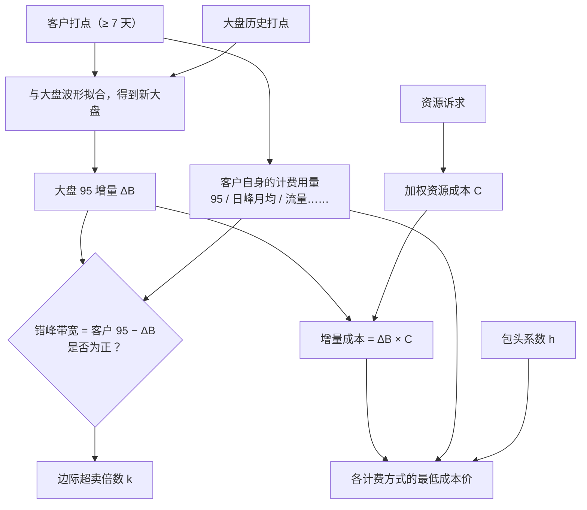

接入一个新的 CDN 客户之前，销售最常问的问题是：**这个客户最低能报多少钱？**

报高了，客户被竞争对手抢走；报低了，接进来就亏钱。而 CDN 的成本又很特殊：同样大小的两个客户，因为高峰时间不同，给厂商带来的成本可能差好几倍（见[《CDN 的错峰与超卖》](/posts/cdn-off-peak-and-overselling/)）。光靠经验拍价格，很难准。

火山 CDN 的经营分析平台上有一个**价格测算**功能，就是用来回答这个问题的。这篇介绍它的思路。

> 文中的数据都是模拟的，成本用相对指数表示，不代表真实价格。

## 一、输入

使用者（一般是销售或运营）需要提供三类输入：

**1. 客户的带宽打点。** 5 分钟粒度的带宽数据，要求：

- **至少 7 天**：覆盖一个完整的周周期，把工作日和周末的差异都包含进去；
- **最能体现客户业务特性的稳定波形**：不能拿一个做活动的特殊时段来测，否则拟合出来的结果不代表客户的常态。

这两点是测算结果可信的前提，平台对使用者专门做过宣贯。错峰效果完全取决于客户的波形，输入的波形不对，后面算得再精确也没有意义。

**2. 资源诉求。** 客户对接入资源的要求，比如全部要联通、全部要电信，或者可以接受非 80 端口的低价节点、PCDN 节点等。不同资源的成本差别很大。

**3. 包头系数。** 后面会讲到，它是留给销售的议价空间，测算时可以调整。

## 二、测算过程

### 1. 波形拟合：算出大盘 95 的增量

把客户的打点和大盘同一时段的打点逐点相加，得到「接入后的新大盘」，再分别计算新、旧大盘的 95，两者之差就是这个客户带来的**大盘 95 增量 ΔB**。

### 2. 判断错峰

$$
\text{错峰带宽} = B_{\text{客户}} - \Delta B, \qquad k = \frac{B_{\text{客户}}}{\Delta B}
$$

B_客户 是客户自己的 95。错峰带宽为正（k > 1），说明客户的高峰落在大盘的低谷，是错峰客户；为零或为负，说明和大盘同峰。

**这是测算里最重要的结论。** 价格是参考，错峰的正负才是判断这个客户「好不好」的依据。

### 3. 加权资源成本

客户的资源诉求决定了成本单价。把各类资源的成本按客户的流量占比加权平均：

$$
C = \sum_i w_i \cdot c_i
$$

比如：

| 资源 | 占比 wᵢ | 成本指数 cᵢ |
| --- | --- | --- |
| 联通 | 50% | 1.0 |
| 电信 | 30% | 1.2 |
| 非 80 端口节点 | 20% | 0.6 |
| **加权成本 C** | | **0.98** |

这里的加权，本来就是为了把分运营商、分资源的细分成本价模糊成一个数，和「一个大盘」的拟合方式相匹配。

### 4. 最低成本价

接入这个客户，厂商要多付的成本是 **ΔB × C**。向客户收费时，计费用量要乘以**包头系数 h**。最低成本价的原则是：**乘上包头系数之后的收入，不能低于增加的成本**。

$$
P_{\min} \times h \times B_{\text{客户}} \ \ge\ \Delta B \times C
\quad\Longrightarrow\quad
P_{\min} = \frac{C}{k \times h}
$$

这个式子很好地说明了各个因素的作用：

- **k 越大（越错峰）**，最低价越低；
- **资源越贵（C 越大）**，最低价越高；
- **包头系数 h 越大**，同样的单价能收回更多，报价就可以更低。h 在测算时是一个可调的输入，用来给销售留出议价空间。

### 5. 不同计费方式的最低价

客户可能希望按 95、按日峰月均或者按流量计费。成本侧的增量都是同一个 ΔB × C，不同的只是客户在各计费方式下的计费用量 Q。平台会根据上传的打点，分别算出各计费方式的用量，再分别给出最低价：

$$
P_{\min,\,m} = \frac{\Delta B \times C}{Q_m \times h}
$$

m 代表计费方式。销售可以同时看到「按 95 最低报多少、按流量最低报多少」，按客户的偏好去谈。

## 三、示例

用 7 天的模拟数据，测算两个规模相近的客户：客户甲的高峰在上午 10 点，客户乙的高峰在晚上 21 点，和大盘一样。大盘的 95 约为 679 Mbps，资源诉求都按上面的表格（C = 0.98）。

**错峰判断：**

| | 客户自己的 95 | 大盘 95 增量 ΔB | 错峰带宽 | 边际超卖倍数 k | 结论 |
| --- | --- | --- | --- | --- | --- |
| 客户甲 | 208.5 | 22.1 | **+186.4** | 9.42 | 错峰 |
| 客户乙 | 207.0 | 208.8 | **−1.9** | 0.99 | 同峰 |

**最低成本价**（成本指数；95 和日峰月均为每 Mbps·月，流量为每 TB）：

| 计费方式 | 客户甲（h = 1.0） | 客户甲（h = 1.1） | 客户乙（h = 1.0） | 客户乙（h = 1.1） |
| --- | --- | --- | --- | --- |
| 95 峰值 | 0.104 | 0.095 | 0.989 | 0.899 |
| 日峰月均 | 0.096 | 0.087 | 0.896 | 0.815 |
| 流量 | 1.18 | 1.07 | 11.46 | 10.42 |

两个客户规模几乎一样，资源诉求也一样，但客户甲的最低成本价只有客户乙的十分之一左右。如果按经验给两个客户报同一个价格，要么错失客户甲，要么接入客户乙就亏钱。

## 四、回头看：可以继续优化的地方

**1. 分资源池拟合。** 当时是把所有资源放在一个大盘里拟合，再用加权成本。但实际上，上游往往是按运营商、按资源池分别结算 95 的，联通的大盘和电信的大盘高峰时间也未必一样。更精确的做法是**把每类资源当成一个独立的大盘**：按客户的资源占比，把客户的波形拆到各个大盘上，分别拟合、分别算增量，每个大盘用自己的成本价：

$$
P_{\min} = \frac{\sum_i \Delta B_i \cdot c_i}{h \times B_{\text{客户}}}
$$

这时资源占比就不再用于加权成本，而是用于拆分客户的波形；每个资源池也有各自的错峰情况。

**2. 对极端的错峰结果做保护。** 客户甲的 k 高达 9.4，按公式算出的最低价只有资源成本的十分之一左右。当时价格只作为参考，靠「至少 7 天、稳定波形」的输入要求来保证测算可信。如果要把测算结果直接用于报价，还可以给 k 设一个上限，并加上机房、运维等固定成本的分摊，避免因为客户业务形态变化或大盘变化导致报价过低。

## 五、总结

价格测算把几件事串在了一起：

- **95 计费**决定了成本由大盘的峰值决定；
- **错峰与超卖**解释了为什么同样大小的客户成本可以差很多倍；
- **波形拟合**把这个差异量化成了一个可以算的数；
- **资源成本和包头系数**把它落到了具体的价格上。

最终，销售拿到的不只是一个价格，而是一个判断：这个客户是错峰还是同峰，最低能报到多少，议价空间有多大。
