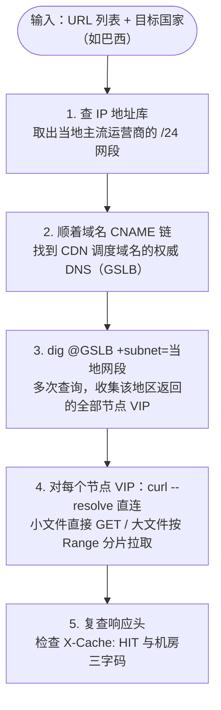
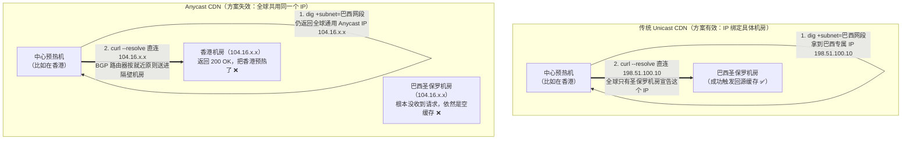

我在字节做多厂商内容管理（刷新、预热）时，接到过一个需求：海外客户希望把资源**按国家**提前预热，比如新版本发布前，先把安装包推到新加坡、日本、巴西的节点上。

问题是，不少厂商的预热接口不支持指定海外的具体地区，有的只能选"海外"这么一个大范围。于是我们自己做了一个按地区预热的能力。这篇记录当时的思路、实现细节，以及它的局限。

先说清楚范围：**按地区做的只有预热，刷新不需要**。厂商的刷新接口一般是全网生效的，调一次所有节点的缓存都会失效，不用分地区操作。

## 一、思路：假装是当地用户，替他们先访问一次

预热的本质，是让节点提前把内容缓存下来。最直接的办法就是**向那个节点请求一次资源**：节点上没有缓存，就会回源拉取并缓存下来，之后真实用户来访问时就能直接命中。

难点在于：我们的预热服务跑在国内或中心机房，怎么知道 CDN 会把"新加坡用户"调度到哪个节点？

CDN 的调度器（GSLB）本质上是一台权威 DNS，它根据查询来源判断用户在哪里，再返回就近的节点 IP（关于 DNS 调度、ECS 和 Anycast 的完整机制，见[《CDN 调度入门：用户请求是怎么找到节点的》](/posts/cdn-scheduling-overview/)）。而 DNS 有一个扩展叫 **ECS（EDNS Client Subnet，RFC 7871）**：递归 DNS 向权威 DNS 查询时，可以把用户的 IP 网段带过去，让调度器按用户的真实位置分配节点。

那么反过来，我们也可以**在向 GSLB 查询时主动带上一个新加坡的网段**，调度器就会以为是新加坡的用户在查询，把新加坡的边缘节点 IP 返回给我们。

## 二、实现步骤

接口的输入是两样东西：要预热的 URL 列表，以及要预热的地区（国家）列表。整体执行流程如下：



具体到每一步：

**1. 从 IP 地址库取一个当地的网段**

每个国家挑一个或几个当地主流运营商的 `/24` 网段。

**2. 用 `dig` 的 `+subnet` 模拟当地用户，拿到节点 IP**

```bash
# 第一步：看域名的 CNAME 链，找到它最终指向哪家 CDN 的调度域名
dig www.example.com +short

# 第二步：找到这个调度域名的权威 DNS，也就是 CDN 的调度器（GSLB）
dig cdn-cname.vendor.net NS +short

# 第三步：直接问调度器，+subnet 带上目标地区的网段
dig @ns1.vendor.net cdn-cname.vendor.net +subnet=203.0.113.0/24 +short
```

- 直接问厂商的 GSLB 权威 DNS 比通过公共 DNS 查更准，可以绕开公共 DNS 自身的缓存；
- 这里的 `203.0.113.0/24` 是文档示例地址，实际运行时换成从 IP 库查出来的当地真实网段；
- **同一个地区要多查几次，把返回的节点 VIP 都收集齐**：一个地区往往有多个边缘节点，或者一个节点暴露了多个 VIP。如果 GSLB 轮询返回了 4 个 IP，你只挑其中 1 个去预热，真实用户落到另外 3 个 IP（且背后不是共享同一池缓存）时依然会 MISS。所以收集到的每个节点 IP 都要跑一遍。

**3. 用 `curl --resolve` 直接请求这些节点**

```bash
curl -s -o /dev/null -w '%{http_code} %{time_total}\n' \
  -H 'Accept-Encoding: gzip, br' \
  --resolve www.example.com:443:198.51.100.10 \
  https://www.example.com/static/app.js
```

`--resolve 域名:端口:IP` 的作用是跳过 DNS，让 curl 把这个"域名 + 端口"直接连到指定的 IP，相当于只对这一条命令生效的临时 `hosts`。

**为什么不直接把 URL 写成 IP**：如果写成 `curl -H 'Host: www.example.com' https://198.51.100.10/...`，HTTP 下没问题，但 HTTPS 下会撞墙——TLS 握手时的 SNI（Server Name Indication）会变成 IP 地址，边缘节点上托管着成百上千个客户的域名，不看 SNI 根本不知道该拿哪张证书出来握手，证书域名校验也会失败。`--resolve` 只改变底层 TCP 连往哪个 IP，上面的 URL、`Host` 头和 TLS SNI 全都保持原域名不变，节点看到的请求和真实用户发来的一模一样。

**4. 验证是否预热成功**

```bash
curl -sI --resolve www.example.com:443:198.51.100.10 https://www.example.com/static/app.js
```

再请求一次，看响应头里的命中标识（`X-Cache`、`X-Cache-Lookup`，或者各厂商自己的字段）是不是变成了 `HIT`，以及 `Age` 有没有大于 0 的值。

## 三、大文件：分片预热

游戏安装包、视频这类几百 MB 到几 GB 的大文件，CDN 节点一般不会等整个文件下载完才存盘，而是开启**分片回源（Range Slicing）**，按固定大小的块（比如每块 2MB 或 4MB）切开缓存。如果预热时只发一个请求然后中途断开，节点只缓存了开头那一小块。

我们的做法是**先用 1 字节的 Range 请求探测总长度，再按分片并发拉取**：

```bash
# 1. 只请求第 1 个字节（0-0），从 Content-Range 响应头里拿到文件总大小
#    比如返回 Content-Range: bytes 0-0/104857600，斜杠后面的 104857600 就是总字节数（100MB）
curl -sI -r 0-0 \
  --resolve www.example.com:443:198.51.100.10 \
  https://www.example.com/pkg/client.apk | grep -iE 'HTTP/|content-range|etag|x-cache'

# 2. 按固定分片（如每片 10MB = 10485760 字节）依次或限流并发拉取，数据直接丢进 /dev/null
curl -s -o /dev/null -r 0-10485759 \
  --resolve www.example.com:443:198.51.100.10 \
  https://www.example.com/pkg/client.apk

curl -s -o /dev/null -r 10485760-20971519 \
  --resolve www.example.com:443:198.51.100.10 \
  https://www.example.com/pkg/client.apk
```

为什么第一步用 `Range: bytes=0-0` 的 GET，而不用 `HEAD`？因为有些源站或 CDN 节点对 `HEAD` 请求不走缓存逻辑，甚至不返回准确的 `Content-Length`；而带 `Range: bytes=0-0` 的 GET 走的是实打实的缓存回源路径，只花 1 个字节的流量就能从 `Content-Range` 里拿到最可信的总长度。

后来整理时又总结了几个让分片预热更严密的点：

- **分片大小尽量和 CDN 的分片回源大小对齐**：比如节点内部按 4MB 切块，预热分片设为 4MB 的整数倍（如 4MB 或 16MB），避免跨块边界导致某一块只拉了一半；
- **看状态码是 `206` 还是 `200`**：支持 Range 时节点会返回 `206 Partial Content`；如果第一步探测直接返回了 `200 OK`，说明节点忽略了 Range 头、一次就把整个文件回源拉下来了，后面就不用再继续分片请求了；
- **校验每个分片的 `ETag` / `Last-Modified`**：防止预热刚跑到一半时源站恰好更新了同名文件，导致节点里前半段是旧版、后半段是新版，拼出一个损坏的文件。

## 四、两道墙

这个方案跑起来之后，我们很快撞上了两道墙：只要碰到其中任何一个，这套模拟就走不通。

**第一道墙：厂商的调度器不支持 ECS**

ECS 需要递归侧和权威侧两边都支持才生效。如果某家 CDN 的 GSLB 压根不看查询里的 ECS 选项，那么 `dig +subnet` 带过去的巴西网段就会被直接无视，GSLB 只看收到查询包的源 IP（也就是我们中心预热机器的 IP），返回的永远是离我们中心机器最近的节点，模拟当场失效。

**第二道墙：Anycast**

海外 CDN（比如 Cloudflare、AWS CloudFront、Fastly）广泛采用 Anycast（任播）：全球几十上百个机房通过 BGP 协议宣告**同一个 IP**，数据包去哪个机房不由 DNS 决定，而是由沿途运营商路由器按网络拓扑就近送达（详见[《CDN 调度入门》第七节](/posts/cdn-scheduling-overview/)）。

把我们的预热方案放到 Anycast 面前，会发生什么？对比如下：



1. **怎么 dig 都是同一个 IP**：不管 `+subnet` 填新加坡、日本还是巴西，GSLB 返回的都是同一个 Anycast IP，因为对这类厂商来说，IP 本身根本不区分地区；
2. **请求永远落到我们家门口**：从我们位于香港或国内的预热机器用 `--resolve` 往这个 IP 发请求，运营商路由器一看香港就有宣告这个 IP 的机房，直接就把包送进了香港机房，根本不可能跨洋送到巴西；
3. **最隐蔽的是：请求照样返回 `200 OK`，第二次查也是 `X-Cache: HIT`**。因为香港机房确实被你预热成功了！预热系统的任务状态一片绿，但巴西的真实用户来访问时，全部 MISS。

怎么识破这种「假成功」？看响应头里的**机房标识**——海外 CDN 普遍用当地国际机场的 **IATA 三字码**来标记实际服务你的边缘机房：

- **Cloudflare**：看 `CF-Ray: 88a1b2c3d4e5-HKG`，横杠后面的 `HKG` 就是香港（巴西圣保罗是 `GRU`，新加坡是 `SIN`，东京是 `NRT`）；
- **AWS CloudFront**：看 `X-Amz-Cf-Pop: HKG62-C1`，前三个字母同样是机场三字码；
- **Fastly**：看 `X-Served-By: cache-hkg17923-HKG`。

只要发现不管预热哪个国家，响应头里回来的机房代码永远是离预热机器最近的那个（比如全是 `HKG`），就说明撞上 Anycast 了。

## 五、其他容易踩的坑

除了 HTTPS 的 SNI、多 VIP 轮询和上面两道墙之外，自己发请求做预热还有一串容易踩的细节，按严重程度排：

**缓存 Key 对不上：预热了，真实用户还是不命中**

- **压缩方式**：`curl` 默认不带 `Accept-Encoding`，预热下来的是未压缩的原文件；而真实浏览器访问时都会带 `Accept-Encoding: gzip, br`，如果节点把压缩格式算进缓存 Key，浏览器来访问时依然 MISS；
- **`Vary` 响应头**：源站如果返回了 `Vary: User-Agent` 或 `Vary: Accept`（比如根据浏览器是否支持 WebP 返回不同格式），每一种请求头组合都是一份独立的缓存；
- **URL 查询参数**：节点没开「忽略参数缓存」时，预热的 URL 参数必须和用户实际请求的完全一致；
- **HTTP 与 HTTPS / IPv4 与 IPv6**：有的厂商把 HTTP 和 HTTPS 分开存；另外如果域名配了 `AAAA` 记录，当地 IPv6 用户可能会落到另一组纯 IPv6 节点上，只查 `A` 记录会漏掉。

**请求被拦：预热根本没打进去**

- **URL 鉴权（Type A/B/C 签名）**：开了时间戳防盗链的域名，预热时必须由系统实时算出合法签名拼在 URL 上，否则节点在最外层直接回 `403`；
- **Referer / UA 防盗链**：配置了白名单的域名，预热请求要带上合规的 `Referer` 和 `User-Agent`；
- **WAF 与单 IP 限频**：预热机器只有一个固定出口 IP，短时间往节点打成千上万个请求，很容易触发 CDN 的 WAF 频控或五秒盾，不仅拉不到文件，甚至可能把拦截页当正常响应处理。

**缓存错了：白忙活，甚至酿成故障**

- **源站响应头禁止缓存**：源站如果带了 `Cache-Control: no-cache / no-store / private` 或者 `Set-Cookie`，你拉多少遍节点都不会存；
- **预热太早，把 `404` 缓存下来了**：业务方还没把新版本安装包传完就提前触发了预热，节点回源拿到 `404 Not Found`，如果刚好开了状态码缓存（Negative Caching），接下来几分钟真实用户全都会拿到 `404`。**这是实操里最危险的一个坑，预热前最好先探一下源站确认文件就绪**；
- **预热太早，缓存被淘汰（LRU）**：边缘节点磁盘是有限的，提前十几个小时预热，中间没人访问，等高峰期真正到来时文件早就被别的冷热数据挤出磁盘了。预热时间点最好卡在业务放量前 30~60 分钟。

**对客户源站和账单的冲击**

- 几十个国家的边缘节点同时回源拉一个几 GB 的大包，如果没开启多级缓存（L2 父节点）或合并回源，瞬间就能把客户源站带宽打满，所以预热任务必须做全局并发控制；
- 这种「从外部主动拉取」的预热，拉下来的每一份数据都实打实走边缘节点的下行带宽，**是要算进客户 CDN 流量 / 95 带宽账单的**（调厂商原生预热接口有的只算回源不算边缘下行，或者有单独策略），大批量大文件预热前一定要和客户对齐成本。

## 六、改进方向

回头看，当年那个基于 `dig +subnet` + `curl --resolve` 的方案属于典型的**「巧但脆」**：不需要海外机器就能快速上线，但严重依赖厂商支持 ECS，且遇到 Anycast 就彻底失灵。现在回头梳理，如果重新设计这一块，有这几种路子可以选：

| 方案 | 做法 | 优点 | 缺点 |
| --- | --- | --- | --- |
| **ECS 模拟（当时的方案）** | 中心机 `dig +subnet` 拿节点 IP，`curl --resolve` 直连请求 | 零海外机器成本，上线快 | 依赖厂商支持 ECS；**Anycast 下彻底失效** |
| **各地代理转发** | 中心机通过目标国家的 SOCKS5 代理发请求，用 `socks5h` 让域名也在当地解析 | 不依赖 ECS，Anycast 下也能落到当地机房 | **数据流要经过代理传回中心**，大文件预热代理带宽成本极高 |
| **当地轻量执行节点** | 在重点国家部署轻量 Agent 或 Serverless 云函数，中心只下发 URL 任务，当地拉完直接丢进 `/dev/null`，只上报状态 | 不依赖 ECS、不受 Anycast 影响；**文件内容就地丢弃，不占跨国带宽** | 需要维护海外节点或云函数 |
| **厂商原生预热接口** | 直接调 CDN 厂商的 Preload API | 最稳，直接预热到节点内部甚至 L2 父节点 | 很多厂商不支持按海外具体国家粒度指定 |
| **第三方拨测平台** | 调商业拨测平台（如博睿、听云、Catchpoint）分布在当地的探针发起请求 | 节点覆盖极广（含当地真实家庭宽带），不用自建 | 按任务次数计费贵，**只适合做预热后的落点验证**，不适合跑大流量预热 |
| **只预热 L2 中间层** | 不追求推到每个国家的 L1 边缘，只把文件预热到厂商的 L2 中心父节点 / 回源保护层 | 成本低，不会打爆客户源站 | 当地第一个访问的用户仍要从 L1 回一次 L2，不算 100% 边缘命中 |

顺带提一下表格里第 2 种「用当地代理」时的 `curl` 写法细节：

```bash
curl -s -o /dev/null -w '%{http_code}\n' \
  -x socks5h://sg-proxy:1080 \
  https://www.example.com/static/app.js
```

注意协议写的是 `socks5h://` 而不是 `socks5://`——多了末尾那个 `h`（host），`curl` 就不会在本地做 DNS 解析，而是把域名原封不动发给新加坡的代理服务器，让代理在新加坡当地做 DNS 解析并发起连接。这样无论是 Unicast 还是 Anycast，落点都一定是新加坡当地机房。

放到今天来看，最稳妥的组合架构是：**厂商原生接口能指定地区的，优先调原生接口；原生接口不支持但又是重点海外国家的，用部署在当地的轻量 Serverless 函数 / Agent 就地拉取丢弃；最后抽样用响应头里的机场三字码（`CF-Ray` 等）校验请求是不是真的落到了目标国家。**

## 七、快速排查与操作清单

1. **先问原生接口**：动手前先查厂商预热 API 文档，能传区域代码的直接调接口，别自己造轮子；
2. **先探源站防 404**：预热任务下发前，先向源站发一次探测确认文件返回 `200`，绝不把 `404` 预热进缓存；
3. **三步验 Anycast 与 ECS**：随便挑两个相隔很远的国家网段（如新加坡和巴西）跑 `dig @GSLB 域名 +subnet=网段/24`——如果返回的 IP 完全一样，说明是 Anycast 或不支持 ECS，放弃中心直连方案，改用当地节点或 `socks5h` 代理；
4. **直连必用 `--resolve`**：非 Anycast 且支持 ECS 时，对收集到的每一个节点 VIP 用 `curl --resolve 域名:443:IP` 请求，保留原域名以通过 TLS SNI 和证书校验；
5. **对齐缓存 Key 与分片**：带上 `Accept-Encoding: gzip, br`，用 `GET` 不用 `HEAD`；大文件先 `Range: bytes=0-0` 拿总大小，再按分片限速拉取并校验 `ETag`；
6. **看三字码验真伪**：预热完再发一次 `curl -sI`，同时确认两件事——命中头是 `HIT`，且机房标识（如 `CF-Ray`、`X-Amz-Cf-Pop`）里的机场三字码确实是目标国家。

参考：

- [RFC 7871: Client Subnet in DNS Queries](https://www.rfc-editor.org/info/rfc7871)（ECS 的标准文档，定义了递归 DNS 如何把客户端网段带给权威 DNS）
- [Google Public DNS: EDNS Client Subnet (ECS) Guidelines](https://developers.google.cn/speed/public-dns/docs/ecs?hl=en)（Google 公共 DNS 对 ECS 的支持方式：按权威服务器 IP 自动探测是否支持 ECS）
- [curl 官方文档：--resolve](https://curl.se/docs/manpage.html#--resolve)（`--resolve` 的格式与行为说明，在不改 URL、Host 和 TLS SNI 的前提下把指定域名和端口绑定到指定 IP）
- [CDN 调度入门：用户请求是怎么找到节点的](/posts/cdn-scheduling-overview/)（本文涉及的 LocalDNS、CNAME、ECS、GSLB 以及 Anycast 选路原理的完整梳理）
- [一个接口管多家 CDN：多厂商刷新预热的适配层设计](/posts/multi-cdn-content-management/)（本文所在的多厂商内容管理系统的整体设计）
