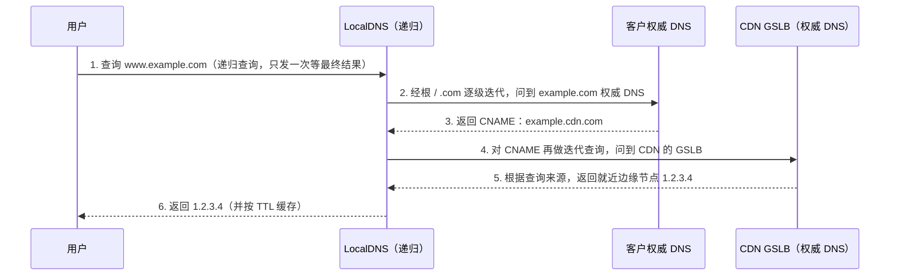
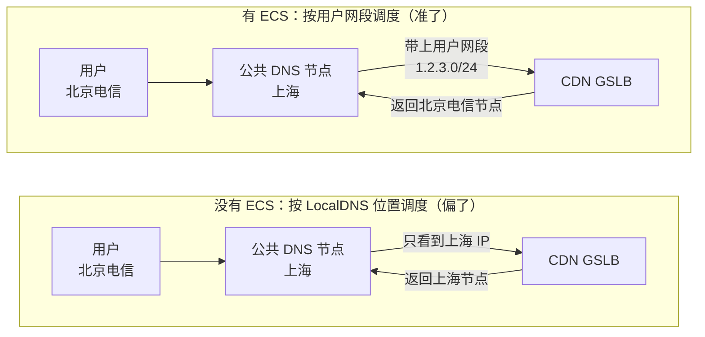
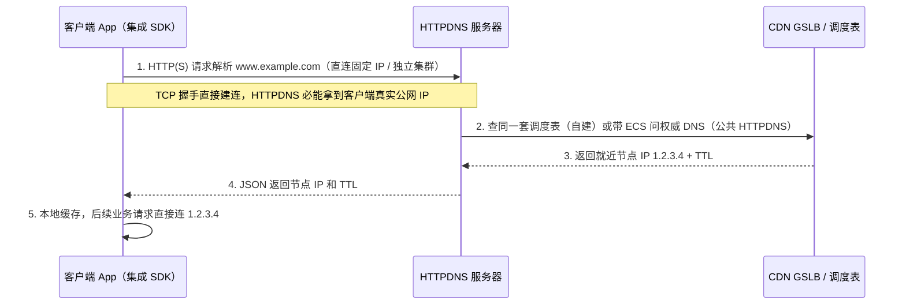
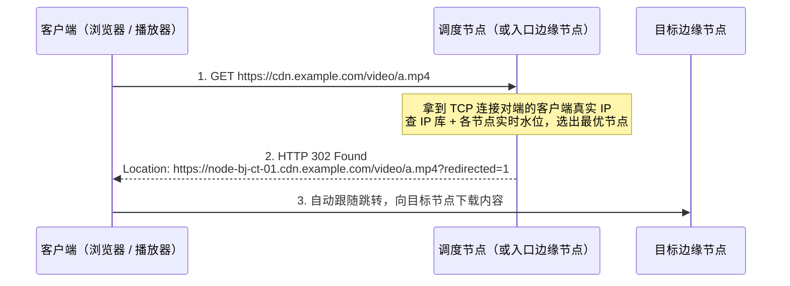
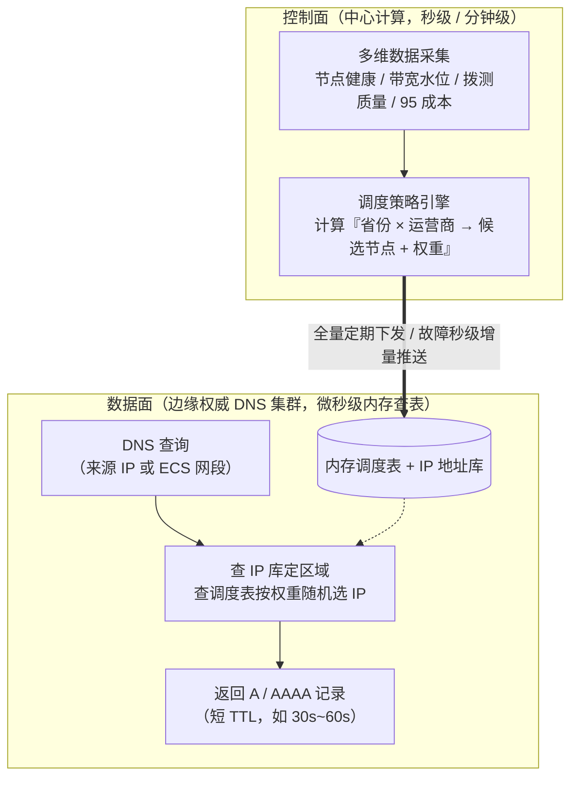
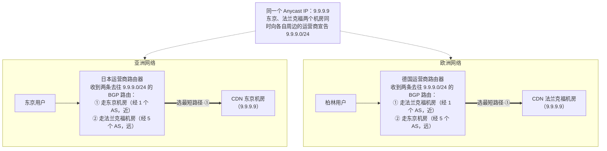
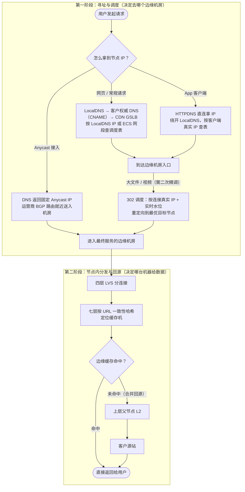

CDN 的核心问题之一是：**用户的请求该去哪个节点**。这就是调度要解决的问题，常见手段包括 DNS 调度、HTTPDNS 和 302 调度；另外还有一种不靠调度器分 IP、而是靠底层网络路由把用户引到就近机房的机制——Anycast。

请求到了节点之后，还有两件事：节点里那么多台缓存服务器由哪一台处理（负载均衡与缓存分片），以及节点没命中缓存时从哪里拉内容（回源策略）。它们严格说不属于调度，但和调度一起决定了一个请求的完整路径，后面会合并成一节简单交代。最后讲调度和带宽成本的关系，并附一份日常排查调度问题的命令清单。定位是入门梳理：讲清楚每种方式是什么、解决什么问题、有什么局限，不深入调度算法细节。

## 一、DNS 解析：LocalDNS 和权威 DNS

**LocalDNS**（本地 DNS，也叫递归 DNS）是用户设备上配置的 DNS 服务器，负责**替用户去查**：

- 一般是运营商分配的，也可能是用户手动配置的公共 DNS（`114.114.114.114`、`223.5.5.5`、`8.8.8.8` 等），或者公司内网统一的 DNS；
- 大多数情况下和用户在同一个地区、同一个运营商，但不一定：用公共 DNS、企业统一出口，都可能让 LocalDNS 离用户很远，甚至跨运营商；
- 会按 TTL 缓存结果。

**权威 DNS** 是某个域名真正的管理者，记录着这个域名的解析结果，只回答自己负责的域名。

域名接入 CDN 后，一次完整的解析过程如下：



**接入 CDN 的域名，客户的权威 DNS 一般只配一条 CNAME 指向 CDN，真正的调度在 GSLB 里完成。**在客户的权威 DNS 上按线路（运营商、地区）配置不同记录，主要用在：不用 CDN 的多线机房、在多家 CDN 之间按地区或权重分流、某家 CDN 故障时切流。

## 二、DNS 调度的问题和 ECS

GSLB 作为权威 DNS，默认**看到的请求来源是 LocalDNS 的 IP，不是用户的 IP**，所以它只能按 LocalDNS 的位置猜用户在哪。一旦 LocalDNS 离用户很远，调度就会偏，比如把北京电信的用户调到广州联通的节点。

**ECS（EDNS Client Subnet，RFC 7871）**就是为了解决这个问题：LocalDNS 向权威 DNS 查询时，把用户的 IP 网段一起带过去。



几个细节：

- **只带网段，不带完整 IP**：IPv4 常见截到 `/24`（最后一段清零），兼顾调度准确度和用户隐私；
- **按网段分别缓存**：权威 DNS 返回时会带一个 scope 掩码，告诉 LocalDNS「这个结果只适用于 `1.2.3.0/24`」，LocalDNS 就会按网段分开缓存，不会把北京的结果发给上海的用户；
- **两边都要支持才生效**：需要 LocalDNS 主动带、GSLB 也认。国内主流公共 DNS（阿里 `223.5.5.5`、腾讯 `119.29.29.29`）和 Google `8.8.8.8` 都支持；Cloudflare `1.1.1.1` 出于隐私考虑默认不发 ECS；公司内网 DNS 大多不支持，就算支持，带过去的也往往是公司统一出口的 IP。

`dig` 的 `+subnet` 参数可以手动带上 ECS，用来模拟某个地区的用户查询，排查调度问题时很好用。我在做海外按地区预热时就用过这个办法，见[《CDN 海外按地区预热：一次基于 ECS 的尝试与它的边界》](/posts/cdn-overseas-regional-preheat/)。

## 三、HTTPDNS

既然问题的根源是中间隔了一层不可控的 LocalDNS，HTTPDNS 的思路就是**直接绕开 LocalDNS**，不走 UDP 53 端口的传统 DNS 协议，改用 HTTP(S) 请求拿解析结果：



这里分两种形态：

- **CDN 厂商自家的 HTTPDNS**：它本身就是 GSLB 的另一个入口，拿到用户真实 IP 后直接查同一套内存调度表，不需要再去问一遍权威 DNS；
- **云厂商对外售卖的公共 HTTPDNS**（如阿里、腾讯的公共 HTTPDNS 服务）：它替 App 发起解析，拿着用户的真实 IP 网段，通过 ECS 去问域名对应的权威 DNS / CDN 调度器。

落地的几个关键点：

- **依赖 IP 地址库**：不管是 HTTPDNS 还是 GSLB，都要靠地址库把 IP 映射成「国家/省份 + 运营商」。地址库的准确度直接决定调度的准确度，难点在于 IPv6、移动网络的大规模跨省 NAT，以及运营商频繁的 IP 段调整；
- **SDK 做的事远不止发个请求**：成熟的 HTTPDNS SDK 会负责本地内存 + 磁盘缓存、启动时批量预解析、TTL 快过期时后台静默刷新（零延迟）、网络切换（Wi-Fi 切蜂窝）时自动清空重查，以及 HTTPDNS 不可用时自动降级回系统 LocalDNS；
- **IP 直连 HTTPS 的坑**：App 拿到 `1.2.3.4` 后把 URL 里的域名替换成 IP 直接建连，这时 HTTP 请求必须手动带上正确的 `Host: www.example.com` 头；更重要的是 **TLS 握手阶段必须显式设置 SNI（Server Name Indication）为原域名**，并且证书校验要按原域名去校，否则边缘节点不知道该给哪张证书，客户端也会报证书域名不匹配。

## 四、302 调度

前面两种都在「解析域名」这一步做文章；302 调度则放到**建立 HTTP 连接之后**：



一个用 Nginx 实现的简化示意（静态规则）：

```nginx
geo $region {
    default        default;
    1.2.3.0/24     bj_ct;
    5.6.7.0/24     gd_cu;
}

map $region $target_node {
    default  node-default.cdn.example.com;
    bj_ct    node-bj-ct-01.cdn.example.com;
    gd_cu    node-gd-cu-03.cdn.example.com;
}

server {
    location /video/ {
        # 防环：已经跳过的请求直接在本机服务，不再 302
        if ($arg_redirected = "1") {
            break;
        }
        add_header Cache-Control "no-store";
        return 302 https://$target_node$uri?redirected=1&$args;
    }
}
```

- **静态与动态**：简单场景用 `geo` 按 IP 段映射区域、`map` 映射到目标节点，规则文件由控制中心生成下发、reload 生效；实际生产中需要结合节点实时带宽水位和健康状态动态决策，一般用 OpenResty（Lua）或自研服务在内存里查 IP 库和负载表；
- **谁来当调度节点**：可以是专门的中心调度集群，也可以是**边缘节点自己**——用户先通过普通 DNS 落到某个边缘节点，节点一看客户端真实 IP 发现自己不是最优（或者自己快跑满了），就返回一个 302 把用户甩给更合适的兄弟节点，以此给 DNS 调度兜底；
- **几个细节**：跳转目标一般用单节点专属域名（`node-xx.cdn.example.com`），配一张 `*.cdn.example.com` 的泛域名证书就能过 HTTPS 校验；必须带防环标记（如上面的 `redirected=1`），防止配置失误时客户端无限死循环；302 响应本身不能被缓存；原始请求路径和鉴权签名参数要原样透传。

## 五、四种方式对比

| 维度 | 运营商 LocalDNS | 公共 LocalDNS | HTTPDNS | 302 调度 |
| --- | --- | --- | --- | --- |
| **调度器看到的 IP** | 运营商 DNS 的 IP | 公共 DNS 节点的 IP（支持 ECS 时附带用户网段） | 用户真实 IP | 用户真实 IP |
| **调度准确度** | 较高（偶有跨网/跨省） | 有 ECS 时较高，无 ECS 时容易跨省跨网 | 高 | 高 |
| **实时性 / 生效速度** | 慢（受缓存影响，部分运营商无视短 TTL） | 中（一般遵守 TTL） | 快（App 自己控制缓存和刷新） | **极快（每个请求实时决策）** |
| **额外请求开销** | 无 | 无 | 一次 HTTP 解析请求，结果可复用 | **每次请求多一次 RTT 跳转** |
| **防 DNS 劫持** | 弱 | 较好 | 强（走 HTTP/HTTPS） | 入口仍依赖 DNS，跳转后不怕 |
| **业务接入成本** | 只需配 CNAME | 无需业务改代码 | **高（需集成 SDK、改网络层，仅限 App）** | 客户端需支持跟随 302 |
| **典型适用场景** | 网页、小文件 | 通用 | 移动 App | 视频点播、大文件下载、直播拉流 |

实际生产中通常组合使用：网页和零碎静态资源直接走 DNS；自家移动 App 接入 HTTPDNS；对单次连接耗时不敏感、但对吞吐和带宽成本极敏感的大文件下载、音视频点播，用「DNS 粗调 + 302 精调」。

---

注意看上面这四种方式：不管手段怎么变，本质都是在做同一件事——**「根据用户在哪，挑一个最合适的节点 IP 返回给他」**（单播 Unicast，不同地区拿到不同的 IP）。下面先看支撑这套逻辑的 GSLB 是怎么工作的，第七节再看另一种完全相反的思路：**Anycast**。

## 六、GSLB 怎么实现

**早期做法**是 BIND 的 `view`（视图）：按来源 IP 段定义几组 ACL，每组对应一份静态的 zone 文件，改调度就改文件再 reload。缺点很明显：粒度粗、reload 慢、没法按节点的实时水位和比例动态调整。

**大型 CDN 的 GSLB 一般是自研的动态权威 DNS**，把系统拆成**控制面**和**数据面**，核心设计原则就一句话：**把复杂的计算留在后台提前算好，线上收到 DNS 查询时只做内存查表**。



- **控制面**：持续汇总各节点的健康探测、实时带宽水位、质量数据（主动拨测 + 客户端真实上报 RUM），结合容量上限和成本策略，定期算出「省份 × 运营商 → 候选节点列表 + 权重」的调度表，下发给所有 GSLB 节点；遇到机房故障或线路拥塞时秒级重算、增量推送；
- **数据面**：收到 DNS 查询后，拿 ECS 网段（没有就拿 LocalDNS IP）查内存里的 IP 库定位「省份 + 运营商」，再查调度表按权重随机挑一组 IP 返回，TTL 设得很短（比如 30~60 秒）。整个过程没有磁盘 IO 也没有远程调用，单机能扛住几十万 QPS。

中小规模如果不自研，常见做法是用 **PowerDNS** 配合 Lua 脚本或 GeoIP 插件，或者直接用云厂商的云解析 / 商业 GSLB。

GSLB 还有一个高频需求是**按比例分量**（比如把某省流量按 7:3 分给两个节点，或在多家 CDN 之间按比例切流）。分量在 DNS 层和 302 层都能做，但精度差很多：
- **DNS 分量是按「解析次数」分的**：一个运营商 LocalDNS 背后可能挂着几万个用户，解析一次缓存起来大家共用，所以 7:3 的解析比例落到真实带宽上往往偏差不小，调了权重也要等缓存过期才慢慢体现；
- **302 分量是按「真实请求」分的**：每个下载请求都过一遍调度器，7:3 就是实打实的请求数比例，改完权重下一秒流量就按新比例走。所以需要精准控流、快速止血的场景（比如大促削峰、节点快被打满时甩流）往往离不开 302。

顺带提一下常见的 DNS 软件定位，排查或选型时常遇到：**BIND**（最老牌，权威 + 递归都能干，配置即 zone 文件 + view）、**PowerDNS**（权威 DNS，支持后端接数据库或用 Lua 写动态解析逻辑）、**CoreDNS**（Go 写的插件化 DNS，K8s 集群默认 DNS）、**NSD / Knot DNS**（纯高性能权威 DNS，很多根服务器和顶级域在用）、**Unbound**（纯高性能递归 DNS）、**dnsmasq**（轻量级转发 + 缓存，常装在路由器或本机）。

## 七、Anycast：不靠 DNS 分 IP，靠网络路由指路

在实际工作里，我们平时说「CDN 调度」，指的都是上面讲的 GSLB（DNS、HTTPDNS、302）。Anycast（任播）严格说不是一种应用层的调度手段，而是**底层网络（BGP 路由）提供的一种寻址机制**。它和 GSLB 的思路正好反过来：

- **Unicast（单播 + GSLB）**：一个节点一个 IP。GSLB 操心「用户在哪」，给北京用户返回北京 IP `1.1.1.1`，给法兰克福用户返回法兰克福 IP `2.2.2.2`；
- **Anycast（任播）**：全网所有节点共用**同一个 IP**（比如 `9.9.9.9`）。DNS 什么都不用判断，问就是返回 `9.9.9.9`；至于数据包到底去哪个机房，交给互联网上的路由器按 BGP 协议去选路。

### Anycast 是怎么把包送到最近机房的？

互联网是由成千上万个自治系统（**AS，Autonomous System**，每个运营商、大型云厂商都有自己的 AS 号，比如北京电信是 AS4808）通过 **BGP 协议**连起来的一张大网。平时一个机房把自己的 IP 段通过 BGP「宣告（Announce）」出去，周围的路由器一传十、十传百，全网就知道「要去这个 IP 段，下一跳该往哪走」。

Anycast 的做法是：**CDN 厂商拿着同一段 IP（比如 `9.9.9.0/24`），在全球几十个机房同时向当地运营商宣告「这段 IP 在我这里」**。



运营商的路由器收到多条去往同一个 IP 段的路径时，会按 BGP 选路规则（最核心的一条是看 `AS_PATH` 经过了几个自治系统，越短越优先）挑一条**网络拓扑上最近**的路。于是：

- 东京用户的包一进运营商网络，路由器看东京机房就在隔壁，直接送进东京机房；
- 柏林用户的包一进德国电信网络，路由器就近送进法兰克福机房；
- 整个过程 DNS 完全不用插手，彻底避开了 LocalDNS 跨区、TTL 缓存不生效、ECS 不支持这一堆烦恼。而且某个机房万一挂了，只要停止 BGP 宣告（Withdraw），全球路由器会在几十秒内自动把流量切到次近的机房，天然具备容灾和抗 DDoS 能力。

### 既然这么省心，为什么不是所有 CDN 都只用 Anycast？

因为 Anycast 有几个绕不开的硬伤，在国内网络环境下尤其明显：

1. **「路由最近」不等于「物理最近 / 质量最好」**：BGP 只看自治系统跳数和运营商之间的结算关系，不看链路当前的延迟、丢包，更不知道机房里的服务器是不是已经满了。如果某家小运营商和海外运营商签了便宜的直连协议，国内用户的 Anycast 包甚至可能先绕去香港或美西转一圈再回来。国内三大运营商之间跨网互联关系复杂，纯靠 Anycast 很容易跑出跨网绕路，所以国内主流 CDN 在境内几乎都用 Unicast + GSLB 精细调度，Anycast 更多用在海外（如 Cloudflare、AWS CloudFront）或用于部署 **GSLB 权威 DNS 集群自身**（比如 `8.8.8.8`、`223.5.5.5` 本身就是 Anycast IP，DNS 只是单次 UDP 短查询，最适合 Anycast）。
2. **BGP 路由抖动会弄断 TCP 连接**：TCP 是有状态的，三次握手建连时的上下文只存在当时落地的那个机房（比如东京）内存里。传输中途如果底层运营商网络发生 BGP 路由切换，同一个 TCP 连接后续的数据包被路由器改送到了新加坡机房，新加坡机房根本不认识这条连接，就会直接回一个 `RST` 把连接断掉。虽然大多数时候路由是稳定的，而且大厂会做跨机房连接转发来缓解，但长连接、大文件下载对这一点依然敏感。
3. **很难按机房水位和 95 成本做精细调控**：GSLB 想把某个机房的流量切走 20%，改一下调度表权重就行；Anycast 要调流量只能靠改 BGP 属性（比如故意把某条路线的 `AS_PATH` 填长，或者停止向某个运营商宣告），粒度很粗，没法做到按比例精确削峰。
4. **门槛高**：需要申请自己的 AS 号、大段公网 IP，还要在全球各地机房和几十上百家运营商签 BGP Peering（互联），只有头部大厂玩得转。

Anycast 还带来一个运维上的副作用：**IP 不再代表地区**。在 Unicast 下，拿到法兰克福节点的 IP 直接发请求，请求一定去法兰克福；但在 Anycast 下，你在北京的机器上往这个 IP 发请求，路由器永远只会把包送进离北京最近的机房。任何依赖「先按地区解析出 IP，再从中心机器直连这个 IP」的做法（比如按地区做缓存预热、中心化拨测验证）遇到 Anycast 都会失效——这正是我在[《CDN 海外按地区预热：一次基于 ECS 的尝试与它的边界》](/posts/cdn-overseas-regional-preheat/)里踩到的那个边界。

## 八、到节点之后：请求的后半程

用户通过前面讲的调度手段连上边缘节点后，请求在 CDN 内部还要走完后半程：


- **机房内的两层分发**：入口的四层负载均衡（如 LVS）工作在 TCP 层，只看得到 IP 和端口，看不到 HTTP 里的 URL，所以它只负责把连接均匀分给后面任意一台七层服务器（Nginx / ATS）。七层拿到请求解析出 URL 后，**按 URL 做一致性哈希**（如 Nginx 的 `hash $uri consistent`），把请求转给机房里专门负责这段哈希区间的那台缓存机（很多节点里每台机器既当七层接入又当缓存存储，彼此内网互转）。之所以必须按 URL 哈希，是因为如果随机分配，同一个热门文件会在机房每台机器的硬盘上各存一份，既浪费磁盘又拉低整体命中率；而用一致性哈希代替普通取模，是为了增减机器或某台机器宕机时只让极小一部分缓存换位置，避免全机房缓存雪崩。遇到单个 URL 极热、一台机器网卡跑满的情况，再配合「热点多副本」或在前面加一层小内存缓存来分担。
- **没命中时的回源**：边缘节点（L1）没命中时，一般不会直接去打客户源站，而是先回 CDN 自己的**上层父节点（L2，多级缓存）**，选哪台父节点同样按 URL 一致性哈希，把全网边缘的未命中请求收敛到一处；同一时刻如果有几千个用户一起请求同一个还没缓存的新文件，边缘和父节点会做**合并回源（Collapsed Forwarding）**，只放一个请求去源站拉，其余请求挂起等这一个拉回来共享。到真正请求客户源站时，再按配置做多源站主备/权重切换，或者在源站挂掉时用过期缓存兜底（Stale-While-Revalidate / Stale-If-Error）。

## 九、调度和带宽成本

调度不只看「离用户近不近、快不快」，还直接绑着真金白银的成本。CDN 向运营商买带宽大多按月度 **95 峰值**计费（见[《CDN 是怎么收费的：从流量、95 峰值到日峰月均，厂商和客户两边看计费》](/posts/cdn-billing-methods/)），GSLB 的控制面在算调度表时，同时也在算一笔经济账：

- **削峰**：晚高峰某个节点或某条运营商线路快顶到当月 95 水位线时，控制面把一部分对延迟没那么敏感的流量调去还没跑满的邻近节点，避免把这根线的 95 峰值顶上去；
- **错峰与复用**：把不同波峰时段的业务混布，或者把预热、日志回传、大文件后台更新这类可延后的流量压到凌晨低谷跑，白用已经买下的 95 峰值以内的空闲带宽（见[《CDN 的错峰与超卖：为什么厂商能把同一份带宽卖好几次》](/posts/cdn-off-peak-and-overselling/)）；
- **优先用低价资源**：不同机房、不同线路的单价差很多，在拨测质量（延迟、丢包、下载速度）达标的前提下，调度引擎会优先把流量喂给单价便宜的节点。

所以 GSLB 生成调度表，本质上是一个**带约束的优化问题**：在满足节点容量上限和用户体验底线的前提下，让全网总带宽成本最低。

## 十、一张图串起请求全路径

把前面所有环节拼在一起，一个请求从敲下回车到拿到数据的完整路径就是这样：



## 十一、日常排查调度的常用命令

平时遇到「用户反馈慢」「怀疑调歪了节点」时，顺着下面几步就能摸清调度链路：

```bash
# 1. 看域名有没有 CNAME 到 CDN，以及最终解析出什么 IP
dig www.example.com

# 2. 只看简明解析链路（CNAME 链 + 最终 IP）
dig +short www.example.com

# 3. 查某个 CDN CNAME 的权威 DNS（GSLB）是谁
dig NS cdn.example.com

# 4. 用 dig +subnet 模拟指定地区/运营商的用户去问 GSLB（测试 ECS 调度）
#    下面假设 g1.cdn.example.com 是上一步查出来的 GSLB 权威 DNS，1.2.3.0/24 是要模拟的客户端网段
dig @g1.cdn.example.com www.example.com.cdn.example.com +subnet=1.2.3.0/24

# 5. 看你本机当前用的递归 DNS 出口 IP，以及它发给权威 DNS 的 ECS 网段是什么
dig TXT o-o.myaddr.l.google.com @ns1.google.com +short

# 6. 看某个 IP 属于哪个地区、哪个运营商、哪个 AS 号（判断是不是 Anycast）
curl -s https://ipinfo.io/1.2.3.4

# 7. 测试 HTTP 请求落到了哪台边缘节点、有没有发生 302 跳转（-I 只看响应头，-L 跟随跳转）
curl -IL https://www.example.com/video/test.mp4

# 8. 绕过 DNS，强制把域名解析到指定节点 IP 做直连测试（验证单节点或复现 HTTPDNS 直连）
curl -I --resolve www.example.com:443:1.2.3.4 https://www.example.com/
```

参考：

- [RFC 7871: Client Subnet in DNS Queries](https://www.rfc-editor.org/info/rfc7871)（ECS 的标准文档，定义了递归 DNS 如何把客户端网段带给权威 DNS）
- [Google Public DNS: EDNS Client Subnet (ECS) Guidelines](https://developers.google.cn/speed/public-dns/docs/ecs?hl=en)（Google 公共 DNS 对 ECS 的支持方式：按权威服务器 IP 自动探测是否支持 ECS）
- [Cloudflare Learning Center: What is Anycast?](https://www.cloudflare.com/learning/cdn/glossary/anycast-network/)（Anycast 的路由原理，以及为什么 Anycast 网络能天然分担 DDoS 流量）
- [CDN 海外按地区预热：一次基于 ECS 的尝试与它的边界](/posts/cdn-overseas-regional-preheat/)（用 `dig +subnet` 模拟当地用户做按地区预热，以及 Anycast 带来的限制）
- [CDN 是怎么收费的：从流量、95 峰值到日峰月均，厂商和客户两边看计费](/posts/cdn-billing-methods/)（95 峰值等计费方式，是理解成本调度的基础）
- [CDN 的错峰与超卖：为什么厂商能把同一份带宽卖好几次](/posts/cdn-off-peak-and-overselling/)（错峰和超卖如何影响带宽成本）
