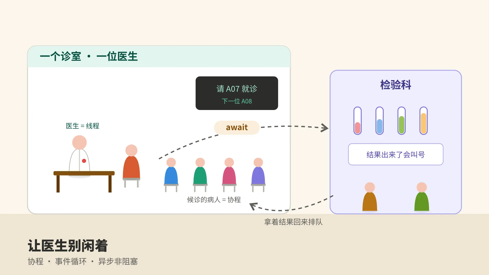
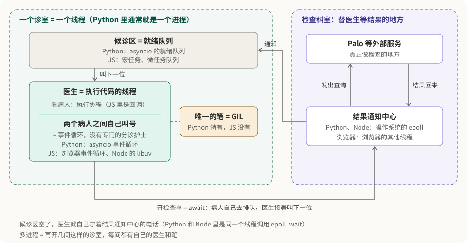
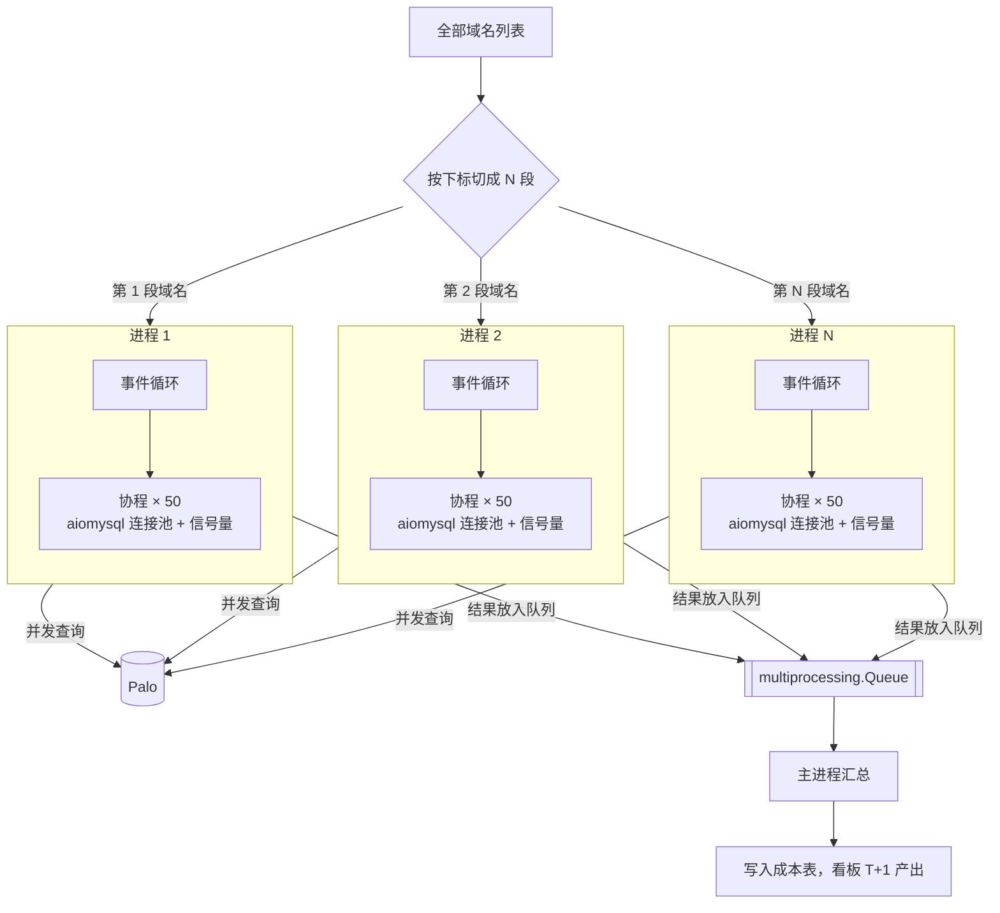
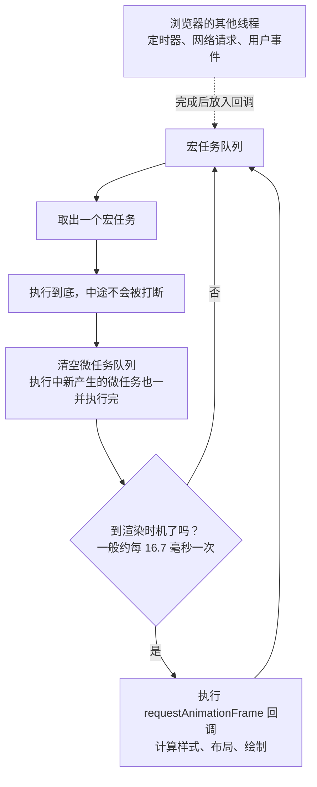
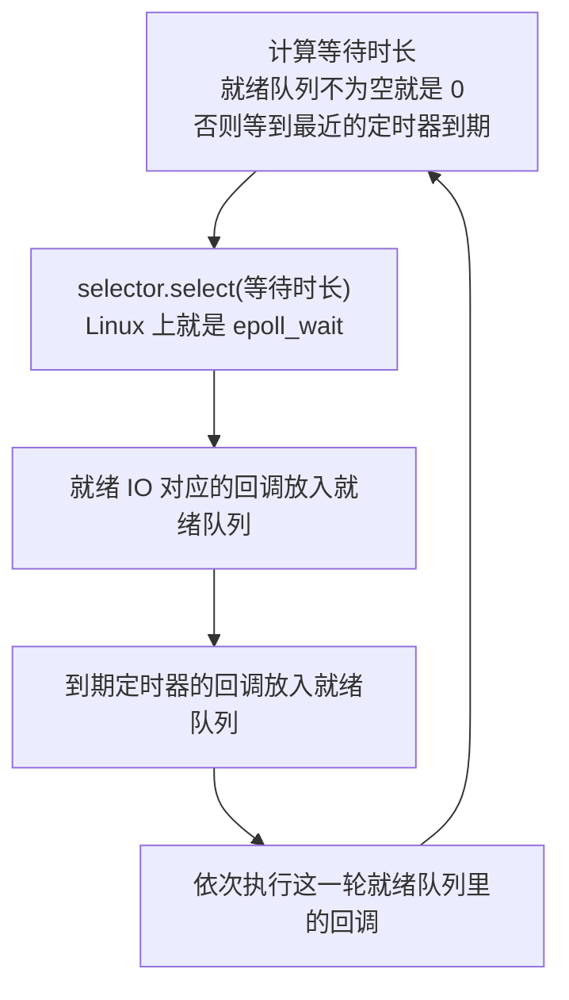

在百度云 CDN 时，我负责成本优化的数据产出：把上百个节点的带宽成本，分摊到十万多个用户、再细到每个域名，每天产出给成本看板用。这件事日均要对 Palo（也就是现在的 Apache Doris）发 80 万次以上的查询。

一开始我用单进程加协程并发发查询，后来又加上了**多进程**：每个进程里跑一个事件循环，用协程并发发查询，各进程的结果通过队列汇总，产出时间缩短到原来的十分之一左右。

协程这个思路我并不是在百度才想到的。早在中国电信写前端 JavaScript 的时候，我就琢磨过异步：浏览器里发一个请求出去，页面不能卡住等它回来，得先去干别的，等结果到了再回头处理。后来在百度遇到"大量查询、大部分时间在等"的问题，第一反应就是：这不就是同一件事吗。

> 说明：这篇是 2026 年根据当年的项目回忆整理的。具体代码已经记不清，下面的代码是按通用做法写的示例，用来说明思路，不是原始实现。
>
> 2026-10-30 更新：修正了并发方案的描述（实际是单进程协程，后来加上多进程、用队列汇总结果，没有用多线程）；第一节补充了诊所运转图；第五节补充了浏览器、Node.js 和 Python asyncio 事件循环的调度原理。

## 一、医院里的异步

我自己理解异步，用的是医院看病的类比：

- **医生**是 CPU，负责"看"和"判断"；
- **病人**是一个个任务；
- **抽血、核磁、B 超**这些检查科室，是读文件、查数据库、调接口这类**需要等**的事情。

一个病人看病的过程，大概是：医生问诊 → 开检查单 → 病人去做检查 → 拿着结果回来 → 医生看结果、下诊断。

### 同步阻塞：医生陪着病人去做检查

如果医生开完检查单，亲自陪病人去抽血，在化验室门口站着等结果出来，再一起回诊室，那么整个等待期间，医生什么也没干。后面排队的病人只能干等。

这就是**同步阻塞**：程序发出一次查询，就停在那里等结果，等到了才发下一次。一次查询如果 1 秒，其中 0.95 秒都在等数据库返回，那 CPU 有 95% 的时间是闲着的。

### 异步非阻塞：开完单子就叫下一位

正常医院不是这样运转的。医生开完检查单，病人自己去排队做检查，医生马上叫下一位。等前面病人的检查结果出来了，医生看完手上这一位，再把他叫回来接着看。

这就是**异步非阻塞**：

- **非阻塞**：发出查询后不原地等，马上去处理别的任务；
- **异步**：结果好了会有通知（叫号），再回头接着处理。

医生始终在看病人，没有在等。病人多、检查多的时候，效率差别非常大。

### 对应到代码里

| 医院 | asyncio |
| --- | --- |
| 医生 | CPU（一个线程） |
| 病人 | 协程（coroutine），一个个 `async def` 函数 |
| 开检查单，让病人去排队 | `await`：发起一个要等的操作，把控制权交出去 |
| 医生自己叫号 | 事件循环（event loop）：谁的结果好了就切回谁 |
| 检查科室同时能接待几个人 | 并发上限（连接池大小、信号量） |

要注意，这家诊所**没有专门的分诊护士**：事件循环和协程跑在同一个线程上。医生看完一个病人，自己看看候诊区、接一下检验科的电话，再叫下一位；候诊区空了，就守着电话等。所以医生一旦被某个病人拖住，连叫号都没人做了。

把整家诊所画出来，每个位置都标上了对应的模块，Python 和 JavaScript 都有：



有一个关键前提：**病人得自己去排队，不能拖着医生走**。如果某个"检查"是医生必须亲自陪着做的（在协程里调用了一个同步阻塞的函数），医生就又被拖住了，后面所有人都得等。这一点后面讲代码时还会提到。

## 二、并发的基础：进程、线程、协程

在讲项目之前，先把几种并发方式捋一下。

### 并发和并行

- **并发**（concurrency）：一段时间内同时处理多件事，但不一定在同一时刻都在做。一个医生轮流看好几个病人，是并发。
- **并行**（parallelism）：同一时刻真的在同时做多件事。好几个医生各看各的病人，是并行。

并行需要多个 CPU 核心；并发一个核心也能做到。

### 三种方式

**多进程**：开好几个诊室，每个诊室一个医生，各自有一套病历柜。

- 进程是操作系统分配资源的单位，每个进程有独立的内存空间。
- 进程之间互不干扰，一个崩了不影响别的；但要交换数据就得通过管道、队列、共享内存这类方式，比较麻烦。
- 创建和切换的开销最大，能真正利用多核并行。

**多线程**：一个诊室里有好几个医生，共用一套病历柜。

- 线程是操作系统调度的单位，同一进程里的线程共享内存。
- 共享数据很方便，但多个线程同时改同一份数据会出问题，需要加锁。
- 线程由操作系统调度，**抢占式**切换：操作系统说切就切，线程自己控制不了。

**协程**：只有一个医生，但他自己安排看病顺序，病人去做检查时就先看下一个。

- 协程是用户态的"轻量级线程"，由程序自己调度，操作系统不知道它的存在。
- **协作式**切换：只在 `await` 这种明确的地方切换，所以不会在一行代码执行到一半时被切走，大多数情况下不用加锁。
- 一个协程只是一个小对象，开几万个也没压力；线程每个都要占一块栈内存，开几千个就吃力了。
- 一个协程如果不主动让出（比如执行了一段很长的计算，或者调用了阻塞函数），其他协程就都得等着。

### Python 的特殊情况：GIL

Python（默认的 CPython 解释器）有一把**全局解释器锁**（GIL）：同一时刻，一个进程里只有一个线程能执行 Python 代码。

套到医院里，就像一个诊室里虽然有好几个医生，但只有一支笔，谁拿到笔谁才能写病历。所以在 Python 里：

- **CPU 密集型任务**（大量计算）：多线程没有用，几个线程抢一支笔，还多了切换开销。要用**多进程**，开好几个诊室，才能真正用上多核。
- **IO 密集型任务**（大量等待）：线程在等 IO 的时候会把 GIL 让出来，所以多线程是有用的；协程也有用，而且更轻。

> Python 3.13 开始提供了可选的去掉 GIL 的构建版本，但默认版本仍然有 GIL，上面的结论在大多数环境里依然成立。

### 对比

| | 多进程 | 多线程 | 协程 |
| --- | --- | --- | --- |
| 谁来调度 | 操作系统 | 操作系统（抢占式） | 程序自己（协作式） |
| 内存 | 各自独立 | 共享 | 共享（同一线程内） |
| 切换开销 | 大 | 中 | 小 |
| 能开多少 | 几个到几十个 | 几十到几百个 | 成千上万个 |
| 数据安全 | 天然隔离 | 要加锁 | 大多不用加锁 |
| 能否利用多核 | 能 | Python 里受 GIL 限制 | 不能（单线程） |
| 适合 | CPU 密集 | IO 密集，且要用同步库 | 大量 IO 密集任务 |

实际项目里经常组合使用：多进程把多核用满，每个进程里再跑一个事件循环处理大量 IO。

## 三、项目里的问题：80 万次查询，大部分时间在等

回到百度的成本数据产出。查询量大，有几个原因叠在一起：

- **数据多，而且大多没有聚合。** 带宽数据是细粒度的明细，要分摊到用户、域名，就得按各种维度去查。
- **指标多。** 带宽、流量、请求数、各计费方式的计费值，每个都要单独算。
- **存储分散。** 数据分布在不同的表、不同的库里，没办法一条 SQL 全拿出来。

结果就是：一天要对 Palo 发 80 万次以上的查询。每次查询本身并不复杂，但网络往返加上等 Palo 返回结果，总要等上一会儿。如果一条一条查，大部分时间都是程序在"站在化验室门口等"。

这正是协程最适合的场景：**任务很多，彼此独立，每个任务大部分时间在等 IO。**

### 优化分两半

成本产出的优化其实做了两方面：

- **让每次检查更快**：建上卷表（预聚合）、加索引，减少单次查询扫描的数据量。
- **让医生不闲着**：用协程并发发查询，在等一个结果的时候去发别的查询。

这篇只讲第二部分。

### 为什么没用多线程

说到并发，Python 里最先想到的通常是多线程。查询是 IO 密集的，线程等结果时会让出 GIL，理论上是有用的。但当时我已经知道 GIL 的存在，没有走多线程这条路，一开始就选了协程。

写这篇文章时，我把多线程为什么不合适的账重新算了一遍，主要是下面三点。

**1. 一个线程同一时刻只有一个查询在路上。**

线程发出查询后就阻塞在那里，直到结果回来才能发下一个。所以多线程的并发度就等于线程数。

可以算一笔账（数字是举例，不是当时的实测值）：假设一次查询从发出到拿到结果平均要 0.5 秒，开 50 个线程，每秒最多完成

$$
\frac{\text{同时在路上的查询数}}{\text{单次耗时}} = \frac{50}{0.5\,\text{s}} = 100\ \text{次/秒}
$$

80 万次查询就要 8000 秒，两个多小时。想再快，只能把同时在路上的查询变多，也就是加线程。

**2. 线程加不上去。**

每个线程都要占一块栈内存（Linux 上默认按 8MB 预留虚拟内存），由操作系统调度。线程开到几百个时，创建、切换、调度本身就成了负担，加线程的收益越来越小。

**3. 线程越多，GIL 抢得越凶。**

等 IO 的时候 GIL 会让出来，可查询结果回来之后，解析结果、组装数据、做计算都是 Python 代码，必须拿到 GIL 才能执行。常用的 MySQL 驱动 PyMySQL 是纯 Python 实现的（aiomysql 底层用的也是它），连解析 MySQL 协议、把返回的字节转成 Python 对象都要占着 GIL。成本数据的查询结果往往不小，这部分开销并不低。

线程一多，大家的结果差不多同时回来，排队等同一把锁；Python 还会每隔一小段时间强制让持锁的线程交出 GIL，切换越频繁，浪费越多。结果是加了线程，真正干活的时间却没有成比例增加。

用医院来说：多线程是多请了几个医生，但每个医生还是陪着自己的病人去做检查，一次只能陪一个；医生多了，诊室里那支唯一的笔又不够用，大家先在抢笔。

协程正好解决第 1、2 点：一个线程里可以同时有几十、上百个查询在路上，而协程只是一个小对象，开多少都不会给操作系统添负担。第 3 点协程解决不了，这也是后来又加上多进程的原因。

## 四、asyncio + aiomysql

Palo 兼容 MySQL 协议，可以直接用 MySQL 客户端连。要在协程里查，就得用异步的 MySQL 客户端：**aiomysql**。

这里正好对应前面说的那个前提：如果在协程里用普通的 `pymysql`，执行查询时会阻塞整个线程，相当于医生又亲自陪病人去抽血了，所有协程都会被卡住，并发效果为零。aiomysql 在等结果时会把控制权交还给事件循环，这才是"病人自己去排队"。

一个简化的示例：

```python
import asyncio

import aiomysql

CONCURRENCY = 50  # 同时最多跑多少个查询，按 Palo 监控调


async def run_query(pool, sem, sql, params):
    async with sem:  # 超过并发上限的查询在这里排队
        async with pool.acquire() as conn:
            async with conn.cursor(aiomysql.DictCursor) as cur:
                await cur.execute(sql, params)  # 交出控制权，等 Palo 返回
                return await cur.fetchall()


async def main(queries):
    pool = await aiomysql.create_pool(
        host="palo-fe.example", port=9030,
        user="reader", password="***", db="cost",
        minsize=1, maxsize=CONCURRENCY,
    )
    sem = asyncio.Semaphore(CONCURRENCY)
    try:
        tasks = [run_query(pool, sem, sql, params) for sql, params in queries]
        return await asyncio.gather(*tasks, return_exceptions=True)
    finally:
        pool.close()
        await pool.wait_closed()


results = asyncio.run(main(queries))
```

几个要点：

- **连接池**：建立数据库连接本身也要时间，用连接池复用，不用每次查询都重新连。
- **信号量控制并发**：`asyncio.Semaphore` 规定同时最多有多少个查询在跑，相当于检查科室同时能接待的人数。这里连接池的 `maxsize` 也能起到同样的作用，写成信号量是为了让"并发上限"这件事更直观。
- **`gather` 收集结果**：所有查询一起提交，全部完成后按原顺序拿到结果。`return_exceptions=True` 让单个查询失败不会中断其他查询，失败的再单独重试。
- 查询数量特别多时，一次性创建几十万个协程对象会占不少内存。可以分批提交，或者改成"固定数量的 worker 从队列里取任务"的写法，效果一样。

### 从单进程到多进程

一开始只有一个进程、一个事件循环，就是上面这段代码的样子。协程让同时在路上的查询从一个变成了几十个，"等"的问题解决了。

但接下来就碰到了前面说的第 3 点：查询结果回来以后，解析结果、整理数据、做计算都要执行 Python 代码，一个进程受 GIL 限制，最多只能用满一个核。查询并发越高，结果回来得越密集，这部分 CPU 工作就越成为瓶颈。

所以后来又加上了**多进程**：每个进程有自己独立的解释器和 GIL，可以各自用满一个核；每个进程里再跑一个事件循环，用协程并发发查询。各进程的结果通过**队列**（`multiprocessing.Queue`）传回主进程汇总。

任务是按域名拆的：把全部域名列表按下标切成几段，每个进程负责一段域名；进程里再把这批域名要查的各项指标、各张表的查询，用协程并发跑完。整体结构如下：



对应的代码：

```python
import multiprocessing as mp

PROCESSES = 8


def worker(domains, queue):
    queries = build_queries(domains)      # 这批域名要查的所有指标、所有表
    results = asyncio.run(main(queries))  # 每个进程有自己的事件循环和连接池
    queue.put(results)                    # 结果放进队列，交给主进程


if __name__ == "__main__":
    size = (len(domains) + PROCESSES - 1) // PROCESSES
    chunks = [domains[i:i + size] for i in range(0, len(domains), size)]  # 按下标切分

    queue = mp.Queue()
    procs = [mp.Process(target=worker, args=(chunk, queue)) for chunk in chunks]
    for p in procs:
        p.start()

    all_results = [queue.get() for _ in procs]  # 先把结果都取出来
    for p in procs:
        p.join()                                 # 再等子进程退出
```

几个要点：

- **按域名拆，进程之间几乎不用通信**。每个域名的成本只和它自己的数据有关，各段之间互不依赖，进程之间不共享状态、不用加锁，只在最后通过队列交一次结果。
- **先取结果，再 `join`**。子进程往队列里放了大量数据时，要等这些数据被取走才能真正退出。如果主进程先 `join` 等子进程退出，子进程又在等数据被取走，两边就会互相卡住。Python 官方文档专门提醒过这一点。
- **入口要放在 `if __name__ == "__main__":` 下面**。macOS 和 Windows 上默认用 spawn 方式创建子进程，子进程会重新导入主模块，不加这句会反复创建进程。
- **进程数一般不超过 CPU 核数**。进程是为了用满多核，超过核数就只剩切换开销了。

还是用上面的账：8 个进程、每个进程 50 个并发，同时在路上的查询就是 400 个；而且结果解析和计算分到了 8 个核上并行，不再挤在一把 GIL 下排队。

回头看，有一处可以改进：队列里传的是 Python 对象，放进去时要序列化（pickle），主进程取出来再反序列化，结果数据量大时这部分开销不小，而且所有数据最后都压在主进程一个核上汇总。如果再做一次，我会让每个进程直接把自己那段域名的结果写进成本表，主进程只负责分配任务和确认是否都完成，省掉跨进程搬运大量数据。

### 并发开多大

并发不是越大越好。医生不闲着了，压力就转移到了检查科室：同时发太多查询，Palo 的 CPU、内存、查询队列会扛不住，查询反而变慢，甚至失败。

我的做法是**看着 Palo 的监控调**：逐步加大并发，观察 Palo 的 CPU、内存和查询耗时，停在不触发告警线的位置。当时这套 Palo 是成本数据专用的服务器，不用担心影响其他业务，所以可以放心把它的余量用起来。

### 效果

改成多进程 + 协程之后，数据产出时间缩短到原来的十分之一左右。

为什么是十倍，而不是并发数那么多倍？因为瓶颈转移了：

- 查询并发起来以后，Palo 本身的处理能力成了上限，再加并发也不会更快；
- 结果解析、计算、写库这些 CPU 工作虽然分到了多个进程，但进程数受核数限制，不可能无限扩。

这也说明，协程解决的是"等"的问题，多进程解决的是"算"的问题，两者各管一半，组合起来才把一台机器的能力用满。

## 五、从 JavaScript 到 Python：事件循环是怎么调度的

最后说回开头。我在电信写前端时第一次认真想异步，是因为浏览器的 JavaScript 只有一个线程：页面渲染、响应点击、发请求都在这一个线程上。如果发一个请求就卡住等它回来，整个页面都会冻住。所以 JavaScript 从一开始就是异步的：先是回调函数，后来是 Promise，再后来是 `async`/`await`。

Python 的 asyncio 和它是同一套思想，连 `async`/`await` 这两个关键字都一样。但"同一套思想"具体是什么，每次循环里到底按什么顺序执行，当时我只有个模糊的印象。这一节把浏览器、Node.js 和 Python asyncio 的事件循环放在一起讲清楚。

### 共同的骨架

三者的结构是一样的，用医院的类比就是：

- **只有一个医生**：只有一个线程在执行代码，同一时刻只做一件事；
- **病人都在排队**：要执行的回调放在队列里；
- **医生自己叫号**：事件循环不断地从队列里取一个任务执行，执行完再取下一个；
- **检查交给别人去等**：发请求、等定时器这类事情，由医生以外的"科室"负责等，结果好了再把病人送回候诊区。

区别主要在两点：**谁负责"等"**，以及**排队的规则**。

### 浏览器的事件循环

浏览器里，JavaScript 运行在一个主线程上，但浏览器本身是多线程的：定时器计时、网络请求、用户点击的监听，都由浏览器的其他线程负责。它们完成后，把对应的回调放进任务队列，等主线程来执行。

队列分两种：

- **宏任务**（task）：`setTimeout`、`setInterval` 的回调，网络请求完成、用户点击这些事件的回调，以及整段 `<script>` 代码本身；
- **微任务**（microtask）：`Promise.then`、`await` 之后的代码、`queueMicrotask`。

每一轮循环的规则是：



一个经典的例子：

```javascript
console.log('1');
setTimeout(() => console.log('4'), 0);
Promise.resolve().then(() => console.log('3'));
console.log('2');
// 输出：1 2 3 4
```

整段脚本是第一个宏任务，先把同步代码执行完，打印 1 和 2；然后清空微任务队列，打印 3；`setTimeout` 的回调是下一个宏任务，最后才打印 4。即使延迟写的是 0，它也要排到下一轮。

套回医院：

- **宏任务**是医生叫号叫来的新病人；
- **微任务**是当前病人看完之前补开的单子，必须马上处理完，才能叫下一位；
- **渲染**是大厅的叫号屏，大约每 16.7 毫秒刷新一次，但只有医生手上空下来时才能刷新。

这就解释了前端最常见的卡顿：一段 JavaScript 执行太久，或者微任务一个接一个地产生停不下来，医生一直腾不出手，叫号屏就不刷新，页面看起来就冻住了。

### Node.js 和浏览器一样吗

**不完全一样**。Node.js 是同一个思想，但实现不同：它的事件循环由 libuv 提供，负责"等"的不是浏览器的线程，而是操作系统。网络 IO 交给操作系统的 IO 多路复用（Linux 上是 epoll）；文件读写这类没法这样等的操作，交给 libuv 的一个后台线程池（默认 4 个线程）。

Node 的每一轮循环分成几个**阶段**，按顺序轮转：

1. **timers**：执行到期的 `setTimeout`、`setInterval` 回调；
2. **pending callbacks**：执行上一轮延后的部分 IO 回调；
3. **poll**：通过 epoll 等待 IO 事件，并执行 IO 回调。等多久取决于最近的定时器和有没有 `setImmediate`；
4. **check**：执行 `setImmediate` 的回调；
5. **close callbacks**：执行连接关闭之类的回调。

（中间还有两个内部使用的阶段，平时接触不到，这里省略。）

微任务的规则和浏览器类似：每执行完一个回调，就先清空微任务队列。Node 多了一个 `process.nextTick` 队列，它比 Promise 的微任务还优先。

```javascript
const fs = require('fs');
setTimeout(() => console.log('setTimeout'), 0);
setImmediate(() => console.log('setImmediate'));
Promise.resolve().then(() => console.log('Promise.then'));
process.nextTick(() => console.log('nextTick'));
fs.readFile(__filename, () => {
  setTimeout(() => console.log('IO 回调里的 setTimeout'), 0);
  setImmediate(() => console.log('IO 回调里的 setImmediate'));
});
```

我在 Node 22 上跑的输出是：

```text
nextTick
Promise.then
setTimeout
setImmediate
IO 回调里的 setImmediate
IO 回调里的 setTimeout
```

- `nextTick` 和 `Promise.then` 在主代码执行完后马上执行，`nextTick` 在前；
- 主代码里的 `setTimeout` 和 `setImmediate` 谁先谁后，Node 官方文档说是**不保证**的，取决于进入循环时定时器是否已经到期；
- 在 IO 回调里就是确定的：IO 回调在 poll 阶段执行，接下来就是 check 阶段，所以 `setImmediate` 一定先于下一轮 timers 阶段的 `setTimeout`。

两者的区别对比：

| | 浏览器 | Node.js |
| --- | --- | --- |
| 谁负责"等" | 浏览器的其他线程 | 操作系统（epoll），文件 IO 用线程池 |
| 宏任务怎么排 | 浏览器从各个任务队列里选 | 按固定阶段轮转 |
| 微任务 | Promise、`queueMicrotask` | 同上，另有更优先的 `process.nextTick` |
| 特有的 API | `requestAnimationFrame`，有渲染步骤 | `setImmediate`，没有渲染 |

如果还用医院的类比：浏览器是一家带叫号屏的门诊，Node.js 则是医生**按固定顺序轮流叫号**，先叫定时复诊的，再叫检查结果回来的，再叫插队登记的。

### Python asyncio 的事件循环

asyncio 和 Node.js 更像：负责"等"的也是操作系统。它通过标准库的 `selectors` 模块使用 IO 多路复用，Linux 上是 epoll，macOS 上是 kqueue（Windows 上默认是另一种基于 IOCP 的实现）。

asyncio 的事件循环里有两样东西：

- **就绪队列**：马上可以执行的回调，按先进先出排队；
- **定时器堆**：按到期时间排序的回调，比如 `asyncio.sleep` 登记的唤醒。

每一轮循环是这样的：



协程是怎么挂进这个循环的？`asyncio.run` 或 `gather` 会把协程包装成 **Task**。Task 推进协程执行，直到遇到 `await` 一个还没完成的操作，比如等数据库返回数据：

1. 底层把这个连接注册到 selector 上，表示"可读时通知我"；
2. 协程在 `await` 处暂停，Task 把"恢复这个协程"登记成这个操作完成时的回调，然后把控制权还给事件循环；
3. 数据到达后，selector 返回这个连接，对应的回调读出数据、标记操作完成，再把"恢复协程"放进就绪队列；
4. 下一次轮到它时，协程从 `await` 的下一行继续执行。

用一个小例子看执行顺序：

```python
import asyncio

async def worker(name, delay):
    print(f"{name} 开始")
    await asyncio.sleep(delay)   # 挂起：登记一个定时器，把控制权还给事件循环
    print(f"{name} 结束")

async def main():
    loop = asyncio.get_running_loop()
    loop.call_soon(lambda: print("call_soon 回调"))
    await asyncio.gather(worker("A", 0.2), worker("B", 0.1))

asyncio.run(main())
```

输出：

```text
call_soon 回调
A 开始
B 开始
B 结束
A 结束
```

`call_soon` 的回调先进了就绪队列，`gather` 创建的两个 Task 排在它后面，所以按顺序先打印"call_soon 回调"，再分别开始 A 和 B。两个协程遇到 `sleep` 都挂起了，事件循环在 epoll 上等到最近的定时器（0.1 秒）到期，先恢复 B，再等到 0.2 秒恢复 A。

和 JavaScript 比，asyncio 的规则更简单：**没有宏任务和微任务之分**，所有马上要执行的回调都在同一个就绪队列里排队。医院的类比里，就是医生每一轮先看看下一个复诊病人还要多久，最多等那么久；检验科的结果和到点的复诊一起放进候诊区，医生再按顺序一个个看。

### 三者放在一起

| | 浏览器 | Node.js | Python asyncio |
| --- | --- | --- | --- |
| 执行代码的线程 | 一个主线程 | 一个主线程 | 一个线程 |
| 谁负责"等" | 浏览器的其他线程 | epoll + 文件 IO 线程池 | epoll（或 kqueue 等） |
| 队列 | 宏任务、微任务 | 分阶段的队列、微任务、nextTick | 就绪队列、定时器堆 |
| 什么时候切换 | 一个任务或回调执行完 | 一个回调执行完 | 协程执行到 `await` |
| 长时间计算的后果 | 页面卡住 | 整个服务卡住 | 所有协程卡住 |

三者共同的限制也一样：**只有一个医生**。它们解决的是"等"的问题，不是"算"的问题。这也是我在百度最后用了多进程 + 协程的原因：协程负责让每个进程在等 Palo 的时候不闲着，而单个事件循环只能用满一个核的上限，要靠多开几个"诊室"（进程）来突破。

所以在百度遇到这个问题时，与其说是学了一个新技术，不如说是把以前在前端想明白的东西搬到了后端：**让医生一直在看病人，而不是在门口等结果。**
