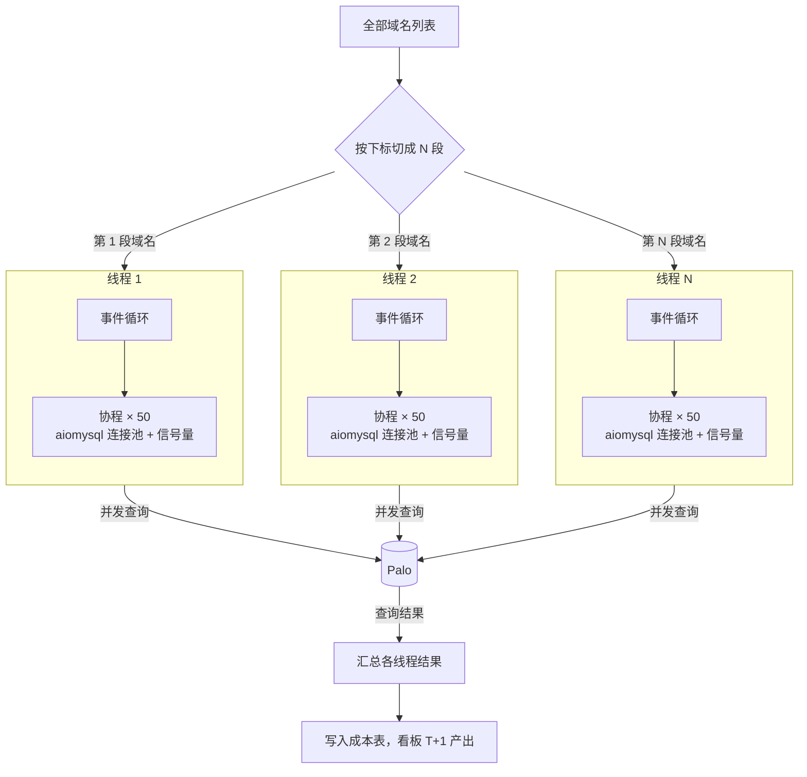

在百度云 CDN 时，我负责成本优化的数据产出：把上百个节点的带宽成本，分摊到十万多个用户、再细到每个域名，每天产出给成本看板用。这件事日均要对 Palo（也就是现在的 Apache Doris）发 80 万次以上的查询。

一开始我用多线程并发查询，但在 Python 里效果不理想，提速有限。后来改成**多线程 + 协程**：每个线程里再用协程并发发查询，产出时间缩短到原来的十分之一左右。

协程这个思路我并不是在百度才想到的。早在中国电信写前端 JavaScript 的时候，我就琢磨过异步：浏览器里发一个请求出去，页面不能卡住等它回来，得先去干别的，等结果到了再回头处理。后来在百度遇到"大量查询、大部分时间在等"的问题，第一反应就是：这不就是同一件事吗。

> 说明：这篇是 2026 年根据当年的项目回忆整理的。具体代码已经记不清，下面的代码是按通用做法写的示例，用来说明思路，不是原始实现。

## 一、医院里的异步

我自己理解异步，用的是医院看病的类比：

- **医生**是 CPU，负责"看"和"判断"；
- **病人**是一个个任务；
- **抽血、核磁、B 超**这些检查科室，是读文件、查数据库、调接口这类**需要等**的事情。

一个病人看病的过程，大概是：医生问诊 → 开检查单 → 病人去做检查 → 拿着结果回来 → 医生看结果、下诊断。

### 同步阻塞：医生陪着病人去做检查

如果医生开完检查单，亲自陪病人去抽血，在化验室门口站着等结果出来，再一起回诊室，那么整个等待期间，医生什么也没干。后面排队的病人只能干等。

这就是**同步阻塞**：程序发出一次查询，就停在那里等结果，等到了才发下一次。一次查询如果 1 秒，其中 0.95 秒都在等数据库返回，那 CPU 有 95% 的时间是闲着的。

### 异步非阻塞：开完单子就叫下一位

正常医院不是这样运转的。医生开完检查单，病人自己去排队做检查，医生马上叫下一位。等前面病人的检查结果出来了，分诊台再把他叫回来，医生接着看。

这就是**异步非阻塞**：

- **非阻塞**：发出查询后不原地等，马上去处理别的任务；
- **异步**：结果好了会有通知（叫号），再回头接着处理。

医生始终在看病人，没有在等。病人多、检查多的时候，效率差别非常大。

### 对应到代码里

| 医院 | asyncio |
| --- | --- |
| 医生 | CPU（一个线程） |
| 病人 | 协程（coroutine），一个个 `async def` 函数 |
| 开检查单，让病人去排队 | `await`：发起一个要等的操作，把控制权交出去 |
| 分诊台叫号 | 事件循环（event loop）：谁的结果好了就切回谁 |
| 检查科室同时能接待几个人 | 并发上限（连接池大小、信号量） |

有一个关键前提：**病人得自己去排队，不能拖着医生走**。如果某个"检查"是医生必须亲自陪着做的（在协程里调用了一个同步阻塞的函数），医生就又被拖住了，后面所有人都得等。这一点后面讲代码时还会提到。

## 二、并发的基础：进程、线程、协程

在讲项目之前，先把几种并发方式捋一下。

### 并发和并行

- **并发**（concurrency）：一段时间内同时处理多件事，但不一定在同一时刻都在做。一个医生轮流看好几个病人，是并发。
- **并行**（parallelism）：同一时刻真的在同时做多件事。好几个医生各看各的病人，是并行。

并行需要多个 CPU 核心；并发一个核心也能做到。

### 三种方式

**多进程**：开好几个诊室，每个诊室一个医生，各自有一套病历柜。

- 进程是操作系统分配资源的单位，每个进程有独立的内存空间。
- 进程之间互不干扰，一个崩了不影响别的；但要交换数据就得通过管道、队列、共享内存这类方式，比较麻烦。
- 创建和切换的开销最大，能真正利用多核并行。

**多线程**：一个诊室里有好几个医生，共用一套病历柜。

- 线程是操作系统调度的单位，同一进程里的线程共享内存。
- 共享数据很方便，但多个线程同时改同一份数据会出问题，需要加锁。
- 线程由操作系统调度，**抢占式**切换：操作系统说切就切，线程自己控制不了。

**协程**：只有一个医生，但他自己安排看病顺序，病人去做检查时就先看下一个。

- 协程是用户态的"轻量级线程"，由程序自己调度，操作系统不知道它的存在。
- **协作式**切换：只在 `await` 这种明确的地方切换，所以不会在一行代码执行到一半时被切走，大多数情况下不用加锁。
- 一个协程只是一个小对象，开几万个也没压力；线程每个都要占一块栈内存，开几千个就吃力了。
- 一个协程如果不主动让出（比如执行了一段很长的计算，或者调用了阻塞函数），其他协程就都得等着。

### Python 的特殊情况：GIL

Python（默认的 CPython 解释器）有一把**全局解释器锁**（GIL）：同一时刻，一个进程里只有一个线程能执行 Python 代码。

套到医院里，就像一个诊室里虽然有好几个医生，但只有一支笔，谁拿到笔谁才能写病历。所以在 Python 里：

- **CPU 密集型任务**（大量计算）：多线程没有用，几个线程抢一支笔，还多了切换开销。要用**多进程**，开好几个诊室，才能真正用上多核。
- **IO 密集型任务**（大量等待）：线程在等 IO 的时候会把 GIL 让出来，所以多线程是有用的；协程也有用，而且更轻。

> Python 3.13 开始提供了可选的去掉 GIL 的构建版本，但默认版本仍然有 GIL，上面的结论在大多数环境里依然成立。

### 对比

| | 多进程 | 多线程 | 协程 |
| --- | --- | --- | --- |
| 谁来调度 | 操作系统 | 操作系统（抢占式） | 程序自己（协作式） |
| 内存 | 各自独立 | 共享 | 共享（同一线程内） |
| 切换开销 | 大 | 中 | 小 |
| 能开多少 | 几个到几十个 | 几十到几百个 | 成千上万个 |
| 数据安全 | 天然隔离 | 要加锁 | 大多不用加锁 |
| 能否利用多核 | 能 | Python 里受 GIL 限制 | 不能（单线程） |
| 适合 | CPU 密集 | IO 密集，且要用同步库 | 大量 IO 密集任务 |

实际项目里经常组合使用：多进程把多核用满，每个进程里再跑一个事件循环处理大量 IO。

## 三、项目里的问题：80 万次查询，大部分时间在等

回到百度的成本数据产出。查询量大，有几个原因叠在一起：

- **数据多，而且大多没有聚合。** 带宽数据是细粒度的明细，要分摊到用户、域名，就得按各种维度去查。
- **指标多。** 带宽、流量、请求数、各计费方式的计费值，每个都要单独算。
- **存储分散。** 数据分布在不同的表、不同的库里，没办法一条 SQL 全拿出来。

结果就是：一天要对 Palo 发 80 万次以上的查询。每次查询本身并不复杂，但网络往返加上等 Palo 返回结果，总要等上一会儿。如果一条一条查，大部分时间都是程序在"站在化验室门口等"。

这正是协程最适合的场景：**任务很多，彼此独立，每个任务大部分时间在等 IO。**

### 优化分两半

成本产出的优化其实做了两方面：

- **让每次检查更快**：建上卷表（预聚合）、加索引，减少单次查询扫描的数据量。
- **让医生不闲着**：用协程并发发查询，在等一个结果的时候去发别的查询。

这篇只讲第二部分。

### 先试了多线程，效果不理想

最先想到的是多线程：开一批线程，每个线程拿一个数据库连接，各自发查询。按前面的分析，查询是 IO 密集的，线程等结果时会让出 GIL，理论上应该有用。

实际效果却不理想，提速很有限。当时没有细查原因，现在回头分析，主要是下面几点叠在一起。

**1. 一个线程同一时刻只有一个查询在路上。**

线程发出查询后就阻塞在那里，直到结果回来才能发下一个。所以多线程的并发度就等于线程数。

可以算一笔账（数字是举例，不是当时的实测值）：假设一次查询从发出到拿到结果平均要 0.5 秒，开 50 个线程，每秒最多完成

$$
\frac{\text{同时在路上的查询数}}{\text{单次耗时}} = \frac{50}{0.5\,\text{s}} = 100\ \text{次/秒}
$$

80 万次查询就要 8000 秒，两个多小时。想再快，只能把同时在路上的查询变多，也就是加线程。

**2. 线程加不上去。**

每个线程都要占一块栈内存（Linux 上默认按 8MB 预留虚拟内存），由操作系统调度。线程开到几百个时，创建、切换、调度本身就成了负担，加线程的收益越来越小。

**3. 线程越多，GIL 抢得越凶。**

等 IO 的时候 GIL 会让出来，可查询结果回来之后，解析结果、组装数据、做计算都是 Python 代码，必须拿到 GIL 才能执行。我们用的 MySQL 驱动是纯 Python 实现的，连解析 MySQL 协议、把返回的字节转成 Python 对象都要占着 GIL。成本数据的查询结果往往不小，这部分开销并不低。

线程一多，大家的结果差不多同时回来，排队等同一把锁；Python 还会每隔一小段时间强制让持锁的线程交出 GIL，切换越频繁，浪费越多。结果是加了线程，真正干活的时间却没有成比例增加。

用医院来说：多线程是多请了几个医生，但每个医生还是陪着自己的病人去做检查，一次只能陪一个；医生多了，诊室里那支唯一的笔又不够用，大家先在抢笔。

协程正好解决第 1、2 点：一个线程里可以同时有几十、上百个查询在路上，而协程只是一个小对象，开多少都不会给操作系统添负担。第 3 点协程解决不了，这个后面再说。

## 四、asyncio + aiomysql

Palo 兼容 MySQL 协议，可以直接用 MySQL 客户端连。要在协程里查，就得用异步的 MySQL 客户端：**aiomysql**。

这里正好对应前面说的那个前提：如果在协程里用普通的 `pymysql`，执行查询时会阻塞整个线程，相当于医生又亲自陪病人去抽血了，所有协程都会被卡住，并发效果为零。aiomysql 在等结果时会把控制权交还给事件循环，这才是"病人自己去排队"。

一个简化的示例：

```python
import asyncio

import aiomysql

CONCURRENCY = 50  # 同时最多跑多少个查询，按 Palo 监控调


async def run_query(pool, sem, sql, params):
    async with sem:  # 超过并发上限的查询在这里排队
        async with pool.acquire() as conn:
            async with conn.cursor(aiomysql.DictCursor) as cur:
                await cur.execute(sql, params)  # 交出控制权，等 Palo 返回
                return await cur.fetchall()


async def main(queries):
    pool = await aiomysql.create_pool(
        host="palo-fe.example", port=9030,
        user="reader", password="***", db="cost",
        minsize=1, maxsize=CONCURRENCY,
    )
    sem = asyncio.Semaphore(CONCURRENCY)
    try:
        tasks = [run_query(pool, sem, sql, params) for sql, params in queries]
        return await asyncio.gather(*tasks, return_exceptions=True)
    finally:
        pool.close()
        await pool.wait_closed()


results = asyncio.run(main(queries))
```

几个要点：

- **连接池**：建立数据库连接本身也要时间，用连接池复用，不用每次查询都重新连。
- **信号量控制并发**：`asyncio.Semaphore` 规定同时最多有多少个查询在跑，相当于检查科室同时能接待的人数。这里连接池的 `maxsize` 也能起到同样的作用，写成信号量是为了让"并发上限"这件事更直观。
- **`gather` 收集结果**：所有查询一起提交，全部完成后按原顺序拿到结果。`return_exceptions=True` 让单个查询失败不会中断其他查询，失败的再单独重试。
- 查询数量特别多时，一次性创建几十万个协程对象会占不少内存。可以分批提交，或者改成"固定数量的 worker 从队列里取任务"的写法，效果一样。

### 多线程 + 协程

最后的结构是在原来多线程的基础上，**每个线程里跑一个事件循环**，用协程并发发查询。

任务是按域名拆的：把全部域名列表按下标切成几段，每个线程负责一段域名；线程里再把这批域名要查的各项指标、各张表的查询，用协程并发跑完。整体结构如下：



对应的代码：

```python
from concurrent.futures import ThreadPoolExecutor

THREADS = 8


def worker(domains):
    queries = build_queries(domains)  # 这批域名要查的所有指标、所有表
    # 每个线程有自己的事件循环和连接池
    return asyncio.run(main(queries))


size = (len(domains) + THREADS - 1) // THREADS
chunks = [domains[i:i + size] for i in range(0, len(domains), size)]  # 按下标切分

with ThreadPoolExecutor(max_workers=THREADS) as ex:
    results = list(ex.map(worker, chunks))
```

按域名拆的好处是各段之间互不依赖：每个域名的成本只和它自己的数据有关，线程之间不用共享状态，也不用加锁。

这样每个线程同时能有几十个查询在路上，而不再是一个。还是用上面的账：8 个线程、每个线程 50 个并发，同时在路上的查询就是 400 个，每秒能完成的查询多了好几倍，线程数反而少了，抢 GIL 的也少了。

回头看，如果再做一次，我会把线程换成**进程**：每个进程负责一段域名，跑一个事件循环。协程负责"等"，进程负责把多核用起来，这样前面说的第 3 点，结果解析和计算也能真正并行，不用再在一个 GIL 下排队。

### 并发开多大

并发不是越大越好。医生不闲着了，压力就转移到了检查科室：同时发太多查询，Palo 的 CPU、内存、查询队列会扛不住，查询反而变慢，甚至失败。

我的做法是**看着 Palo 的监控调**：逐步加大并发，观察 Palo 的 CPU、内存和查询耗时，停在不触发告警线的位置。当时这套 Palo 是成本数据专用的服务器，不用担心影响其他业务，所以可以放心把它的余量用起来。

### 效果

改成多线程 + 协程之后，数据产出时间缩短到原来的十分之一左右。

为什么是十倍，而不是并发数那么多倍？因为瓶颈转移了：

- 查询并发起来以后，Palo 本身的处理能力成了上限，再加并发也不会更快；
- 程序里还有一部分不是在等 IO，比如结果的计算、写库，这部分协程帮不上忙。

这也说明，协程解决的是"等"的问题，不是"算"的问题。如果一个任务大部分时间在计算，就该考虑多进程了。

## 五、从 JavaScript 到 Python

最后说回开头。我在电信写前端时第一次认真想异步，是因为浏览器的 JavaScript 只有一个线程：页面渲染、响应点击、发请求都在这一个线程上。如果发一个请求就卡住等它回来，整个页面都会冻住。所以 JavaScript 从一开始就是异步的：先是回调函数，后来是 Promise，再后来是 `async`/`await`。

Python 的 asyncio 和它是同一套思想：一个线程，一个事件循环，遇到要等的事就挂起，结果到了再回来。连 `async`/`await` 这两个关键字都一样。

所以在百度遇到这个问题时，与其说是学了一个新技术，不如说是把以前在前端想明白的东西搬到了后端：**让医生一直在看病人，而不是在门口等结果。**
