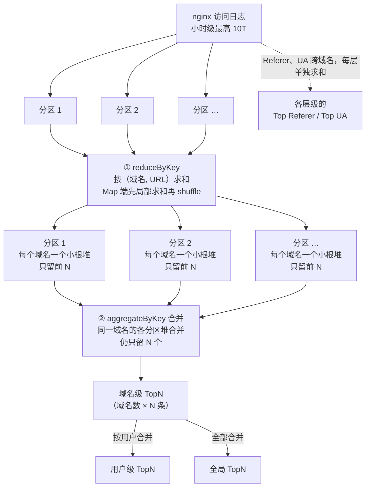

在百度云 CDN 时，我做过一个热点分析的任务：从 CDN 节点的 nginx 访问日志里，统计出各个维度的热门资源，比如每个域名访问最多的 URL、带来流量最多的 URL、主要的 Referer 和 User-Agent。这类热点数据通常用于控制台展示、排查热点、缓存预热和发现盗链。

日志量很大，小时级最高能到 10T。这篇讲这个任务的核心思路：**用小根堆在 MapReduce 里算 TopN**。

> 说明：这篇是 2026 年根据当年在百度做的项目回忆整理的，发布时间标在项目所在的时间段（2019–2021 年）。时间久远，当时的具体代码和参数已经记不清，下面的代码是按通用做法整理的 PySpark 示例，用来说明思路，不是原始实现。

## 一、要统计什么

统计分三个层级，从小到大：

- **域名级**：每个加速域名下的 TopN；
- **用户级**：一个客户名下所有域名合在一起的 TopN；
- **全局**：整个平台的 TopN。

每个层级都统计几类对象，按不同的指标排序：

| 统计对象 | 排序指标 |
| --- | --- |
| URL | 请求数（PV）、流量 |
| Referer | 请求数 |
| User-Agent | 请求数 |

这和主流 CDN 厂商控制台提供的 TOP 统计基本一致。比如百度智能云 CDN 的文档里就列了 TOP URL、TOP Referer、TOP HTTP 状态码、TOP 域名，统计范围是「当前域名或当前用户」。

## 二、为什么不能直接全量排序

最直接的写法是：按 (域名, URL) 分组求和，然后按值排序取前 N 个。

```python
totals = logs.map(lambda r: ((r.domain, r.url), r.bytes)).reduceByKey(add)
top = totals.sortBy(lambda kv: -kv[1]).take(100)
```

问题在于规模：

- 一小时的日志里，不同的 URL 数量是亿级的，带参数的动态 URL 更多；
- `sortBy` 是**全量排序**，所有数据都要按值重新分区（shuffle），代价和数据量成正比；
- 我们只要每个域名的前 N 个，比如前 100 个，却把上亿条数据完整地排了一遍，绝大部分排序工作都是浪费的。

而且这还只是全局的一个 TopN。要按域名分别取 TopN，就得 `groupByKey` 把每个域名的所有 URL 拉到一起再排序，大域名的数据会全部挤在一个 executor 上，很容易内存溢出。

## 三、小根堆：只记住前 N 名

取 TopN 有一个经典的做法：**维护一个大小为 N 的小根堆**。

- 小根堆的堆顶，永远是堆里**最小**的元素，也就是「当前第 N 名」；
- 来一个新元素，如果堆还没满，直接放进去；
- 如果堆满了，就和堆顶比：比堆顶大，说明它能挤进前 N 名，替换掉堆顶；比堆顶小，直接丢弃。

```python
import heapq

N = 100

def push(heap, item):
    """item = (指标值, URL)；heap 最多保留 N 个最大的元素"""
    if len(heap) < N:
        heapq.heappush(heap, item)
    elif item > heap[0]:            # 比当前第 N 名大
        heapq.heapreplace(heap, item)
    return heap
```

为什么用**小根堆**取**最大的** N 个，而不是大根堆？因为我们需要随时知道「门槛」是多少，也就是前 N 名里最小的那个。小根堆的堆顶正好就是这个门槛，比较一次就能决定新元素要不要进来。

它的好处：

- **内存固定**：不管输入多少条，堆里永远只有 N 个元素；
- **时间省**：每个元素最多一次堆操作，复杂度 O(M log N)。M 是元素总数，N 是 100 这样的小数，log N 几乎是常数；而全量排序是 O(M log M)。

## 四、放进 MapReduce：先局部取 TopN，再合并

先看整体流程，后面两节逐步展开：



数据量在每一步都在收缩：原始日志先被求和压缩成「每个 URL 一条」，再被小根堆压缩成「每个域名 N 条」，用户级和全局只是在这个很小的结果上再合并一次。


小根堆在单机上很好用。到了分布式环境，关键是一个性质：

**全局的前 N 名，一定在各个分区各自的前 N 名里。**

道理很简单：如果某个元素在它所在的分区里连前 N 都排不进，说明那个分区里已经有 N 个比它大的元素了，它在全局也不可能进前 N。

所以计算可以分两步：

1. **Map 端**：每个分区各自维护一个小根堆，只保留本分区的前 N 名；
2. **Reduce 端**：把各分区的堆合并，合并时还是用同一个 `push`，最后仍然只保留 N 个。

每个分区交给下游的只有 N 条数据，shuffle 的数据量从「所有 URL」收缩到了「分区数 × N」。

在 Spark 里，「按域名分组、每组维护一个堆」可以用 `aggregateByKey` 实现，它天然就是这种「分区内先聚合、分区间再合并」的结构：

```python
from operator import add

def merge(heap_a, heap_b):
    for item in heap_b:
        push(heap_a, item)
    return heap_a

# 第一步：先把每个 (域名, URL) 在整个小时内的流量加总
totals = (logs
          .map(lambda r: ((r.domain, r.url), r.bytes))
          .reduceByKey(add))

# 第二步：按域名维护大小为 N 的小根堆
#   seqOp：分区内，把 (流量, URL) 放进该域名的堆
#   combOp：分区间，两个堆合并
domain_top = (totals
              .map(lambda kv: (kv[0][0], (kv[1], kv[0][1])))   # (域名, (流量, URL))
              .aggregateByKey([], push, merge))
```

注意第一步不能省：同一个 URL 的日志分散在不同的分区里，必须先把它的总流量加起来，才能拿去比大小。第一步的 `reduceByKey` 也是先在 Map 端局部求和再 shuffle，数据量同样会大幅收缩。

## 五、多层级：上一层复用下一层的结果

URL 有一个很好的性质：**每个 URL 只属于一个域名，每个域名只属于一个用户。**

结合上一节的道理：

- 一个用户的 Top N URL，一定在他名下各个域名的 Top N URL 里；
- 全局的 Top N URL，一定在所有域名的 Top N URL 里。

所以用户级和全局的 TopN 不需要从原始数据重新算，**直接把域名级的结果按用户合并一次就行**：

```python
# domain_owner：域名 → 用户 的映射（广播出去）
user_top = (domain_top
            .map(lambda kv: (domain_owner.value[kv[0]], kv[1]))
            .reduceByKey(merge))

global_top = domain_top.values().reduce(merge)
```

域名级的结果一共只有「域名数 × N」条，在这个基础上合并，开销几乎可以忽略。

**但 Referer 和 User-Agent 不能这么做**：同一个 Referer 可能出现在很多个域名下，它在全局的总量，是在各个域名下的量加起来，而不在某个域名里排第几。一个 Referer 可能在每个域名下都排不进前 N，加起来却是全局第一。所以这类对象，在每个层级都要先按该层级的维度重新求和，再取 TopN。

## 六、按流量和按请求数

URL 有两个排序指标：请求数和流量。这两个指标可以在一次遍历里同时计算：第一步求和时，同时累加请求数和流量，第二步分别维护两个堆。

为什么不单独做一个「按带宽排序」？因为在同一个统计时段里，带宽等于流量除以时间，两者的排序结果完全一样，没有必要重复计算。

## 七、配置化：加指标不用重新发版

统计哪些对象、按什么指标、取多少个、在哪些层级统计，这些都写在一个 JSON 配置里，作为任务参数传入：

```json
{
  "top_n": 100,
  "levels": ["domain", "user", "global"],
  "metrics": [
    { "name": "top_url_pv",      "key": "url",        "value": "requests" },
    { "name": "top_url_traffic", "key": "url",        "value": "bytes" },
    { "name": "top_referer",     "key": "referer",    "value": "requests" },
    { "name": "top_ua",          "key": "user_agent", "value": "requests" }
  ]
}
```

程序根据配置动态生成计算逻辑。运营想加一个新的统计维度，比如 Top 客户端 IP，只要改配置，不用重新打包、部署 Spark 程序。

## 八、几个实践中的问题

- **数据倾斜**：头部大域名的日志量可能是普通域名的成千上万倍。好在 `reduceByKey` 和 `aggregateByKey` 都会先在 Map 端局部聚合，大域名的数据在进入 shuffle 之前就已经被压缩了，比 `groupByKey` 稳定得多。
- **URL 归一化**：同一个资源带上不同的查询参数（比如时间戳、签名），会被当成不同的 URL，把热点打散。统计前要按业务需要去掉无关参数，这一点和 CDN 缓存 key 的处理是一样的道理。
- **N 要留余量**：如果控制台展示前 100，计算时可以多保留一些。这样后续按其他条件过滤（比如去掉某类请求）后，依然能凑够 100 条。

## 九、总结

这个任务的核心就是一句话：**只需要前 N 名的时候，就不要对全部数据排序。**

- 单机上，用大小为 N 的小根堆，把内存固定在 N，把排序代价降到 O(M log N)；
- 分布式下，利用「全局前 N 一定在各分区前 N 里」，先局部取 TopN 再合并，让 shuffle 的数据量收缩几个数量级；
- 多层级时，对只属于一个上级的对象（URL），上层直接复用下层结果；对跨上级的对象（Referer、UA），每层单独求和。

## 参考

- [百度智能云 CDN：TOP 类数据](https://intl.cloud.baidu.com/doc/CDN/s/Hjwvyeb4z-en)
- [PySpark aggregateByKey 文档](https://spark.apache.org/docs/latest/api/python/reference/api/pyspark.RDD.aggregateByKey.html)
