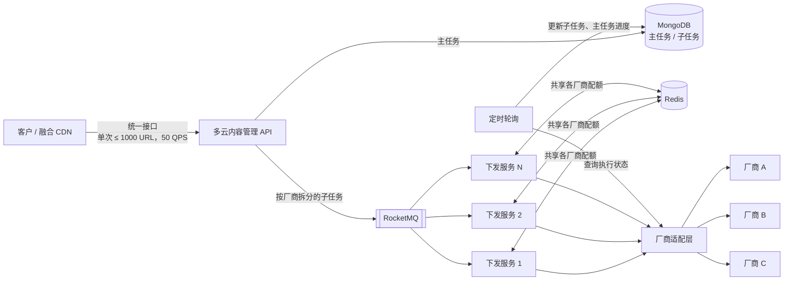
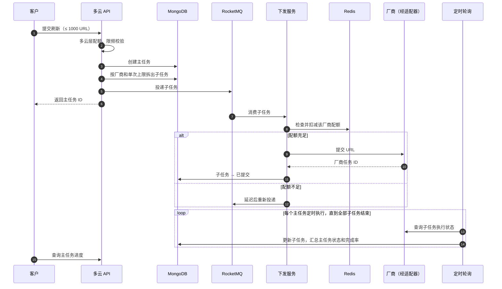
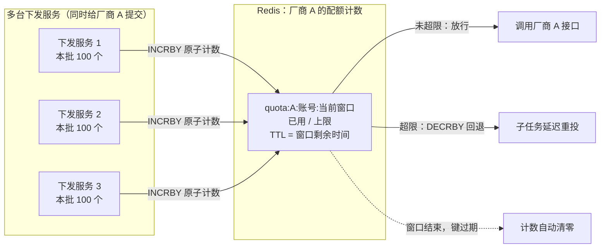
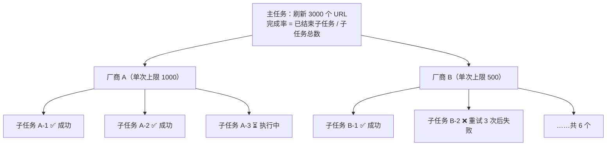

很多公司会同时用好几家 CDN：容灾、调度、成本都需要。但每家厂商的控制台和 API 都不一样，刷新一批 URL，要分别登录几个控制台、调几套接口。

我在字节参与过火山引擎多云 CDN 的商业化，负责其中的**内容管理**模块：客户只调用多云的一套接口，多云平台把刷新、预热任务分发到客户接入的各家厂商，汇总结果后统一返回。同一套能力，对内也服务字节的融合 CDN 平台，两条线并行维护。

这篇整理这个模块的设计思路。

> **说明**：文中的架构图和代码都是为了说明思路而简化的示例，不是原始实现。实际系统还要处理很多这里没有展开的细节，比如各厂商千差万别的边界情况、任务去重、异常告警、灰度发布和监控等。

## 一、要解决的问题

内容管理看起来简单，就是把一批 URL 发给厂商。难点在于**各家厂商的差异和限制**：

- **接口不同**：认证方式（AK/SK 签名、Token、各种自定义签名算法）、入参出参格式、任务状态的定义都不一样；
- **单次提交上限不同**：有的厂商一次最多提交几十个 URL，有的上百个；
- **频率限制不同**：每秒能调用几次、超了是直接报错还是排队，各不相同；
- **总量限制不同**：很多厂商对每个账号每天能刷新、预热的 URL 总数有配额；
- **都是异步的**：提交成功只代表厂商收到了任务，真正执行完要另外查询。

多云平台要做的，就是把这些差异全部吸收掉，让客户感觉只在用「一家」CDN。

## 二、整体架构



一次刷新请求的生命周期：



1. 客户调用多云接口提交 URL，多云层先做**自己的配额和限频**；
2. 生成一个**主任务**，存进 MongoDB；
3. 按客户接入的厂商、以及每家厂商的单次上限，把主任务拆成多个**子任务**，投递到 RocketMQ 排队；
4. 多台下发服务消费子任务，通过 Redis 检查并扣减该厂商的**共享配额**，再经适配层调用厂商接口；
5. 每个主任务开启**定时轮询**，查询各子任务在厂商侧的执行状态，汇总成主任务的状态和完成率。

下面逐个展开。

## 三、适配器模式：屏蔽厂商差异

所有厂商实现同一个接口，多云平台的其他部分只和这个接口打交道，完全不知道背后是哪家厂商：

```go
// 统一的任务类型和状态，由多云平台定义
type TaskType string // refresh_url / refresh_dir / preload

type VendorTaskStatus string // pending / running / success / failed

// 每家厂商的能力和限制，作为适配器的一部分声明出来
type Limits struct {
	MaxURLsPerCall int           // 单次提交上限
	CallsPerSecond int           // 接口频率限制
	DailyQuota     map[TaskType]int // 每日总量配额，0 表示不限
}

type Adapter interface {
	Name() string
	Limits() Limits
	// 提交任务，返回厂商侧的任务 ID
	Submit(ctx context.Context, cred Credential, typ TaskType, urls []string) (vendorTaskID string, err error)
	// 查询执行状态，把厂商自己的状态翻译成统一状态
	Query(ctx context.Context, cred Credential, vendorTaskID string) (VendorTaskStatus, error)
}

var registry = map[string]Adapter{}

func Register(a Adapter) { registry[a.Name()] = a }
```

每家厂商一个实现，认证签名、参数拼装、状态翻译都封装在里面。接入一家新厂商，就是新写一个适配器并注册进去，核心流程一行都不用改。

**限制也是适配器的一部分**。单次上限、频率、配额这些信息跟着适配器走，拆分和限流的逻辑读取它们，而不是写死在流程里。这样不同厂商的差异就收敛在一个地方。

## 四、多云层的配额与限频

客户面对的是多云平台，所以多云层先要有一套**自己的、统一的限制**：

- **单次最多 1000 个 URL**；
- **接口频率 50 QPS**，也就是每秒最多可以接收 5 万个 URL。

这组数值是参考各家主流厂商的能力，取的一个中间值。它带来两种情况：

- 如果多云的单次上限比某家厂商的大，提交给这家厂商时要**拆分**成多批；
- 如果比厂商的小，就直接提交。

这样设计的好处是，客户不需要了解每家厂商的限制；代价是多云层要负责把一个「大请求」翻译成符合每家厂商规矩的若干「小请求」。

另外，如果厂商侧有**每日总量限制**，这是多云平台无法替厂商突破的。这类限制会同步给客户，让客户去厂商那里申请提高限额。

## 五、任务拆分与排队：RocketMQ

客户的请求是突发的，比如一次发版要刷新几万个 URL；而厂商接口的承受能力是固定的。中间必须有一层缓冲，所以子任务会进 **RocketMQ** 排队，由多台下发服务按各厂商的节奏消费。

拆分逻辑按每家厂商的单次上限切批：

```go
func split(urls []string, limit int) [][]string {
	var batches [][]string
	for len(urls) > limit {
		batches = append(batches, urls[:limit])
		urls = urls[limit:]
	}
	if len(urls) > 0 {
		batches = append(batches, urls)
	}
	return batches
}

// 一个主任务，按客户接入的每家厂商分别拆成子任务
func dispatch(task *MainTask) error {
	for _, vendor := range task.Vendors {
		a := registry[vendor]
		for _, batch := range split(task.URLs, a.Limits().MaxURLsPerCall) {
			sub := NewSubTask(task.ID, vendor, batch)
			if err := saveSubTask(sub); err != nil { // 子任务先落库，再投递
				return err
			}
			if err := mq.Send("content-task", sub.ID); err != nil {
				return err
			}
		}
	}
	return nil
}
```

实际的拆分比这复杂一些：有的厂商对目录刷新、URL 刷新、预热分别有不同上限，有的对单个任务里的域名数量也有要求，所以每家厂商有自己单独的拆分逻辑。这部分只能靠深入了解每家厂商的机制，再一点点适配。

主任务和子任务存在 **MongoDB** 里：一个主任务下挂着数量不定的子任务，每家厂商返回的任务信息格式也不一样，文档型数据库存这种结构很自然。

## 六、分布式共享配额：Redis

下发服务有多台，它们同时在给同一家厂商提交任务。厂商的频率和总量限制是针对**整个账号**的，不是针对某一台机器的。如果每台服务器各自计数，加起来就会超限。

所以配额计数放在 **Redis** 里，所有下发服务共享。Redis 的键可以设置过期时间，**正好对应厂商限额的时间窗口**：限每秒就让键 1 秒过期，限每天就让键在当天结束时过期，窗口一过，计数自动清零。



检查和扣减必须避免竞争：如果先 `GET` 读出已用量、判断够不够、再写回去，两台服务器可能同时读到「还剩 100」，都去提交 100 个，就超了。

解决办法是利用 **`INCRBY` 本身是原子的**：不先读再写，而是**先加、再判断**。Redis 单线程执行命令，多台服务并发 `INCRBY` 时，每台拿到的都是自己加完之后的结果，不会读到同一个值。加完发现超过上限，就 `DECRBY` 把这次的数量退回去，本次不放行。

下发服务用 Go（go-redis）直接操作 Redis，大致是这样（示例）：

```go
// 申请本次要提交的 n 个 URL 的配额；limit 为该厂商在窗口内的上限
func acquire(ctx context.Context, rdb *redis.Client, vendor, account string,
	n, limit int64, window time.Duration) (bool, error) {

	// 键名带上窗口编号，窗口切换时自然换成新键
	key := fmt.Sprintf("quota:%s:%s:%d", vendor, account,
		time.Now().Unix()/int64(window.Seconds()))

	// 窗口内第一次使用时创建键并设置过期时间；键已存在则什么都不做
	if err := rdb.SetNX(ctx, key, 0, window).Err(); err != nil {
		return false, err
	}

	// 原子地加上本次数量，返回加完之后的总量
	used, err := rdb.IncrBy(ctx, key, n).Result()
	if err != nil {
		return false, err
	}
	if used > limit {
		// 超限：把本次数量退回去，不放行
		rdb.DecrBy(ctx, key, n)
		return false, nil
	}
	return true, nil
}
```

这里有两个细节：

- **先 `SET NX` 带过期时间，再 `INCRBY`**。如果反过来先 `INCRBY` 再单独 `EXPIRE`，进程恰好在两步之间挂掉，这个键就永远不过期，配额会一直被占着。`SET NX` 一条命令同时完成「创建」和「设置过期」，就没有这个问题。
- **超限时的回退是安全的**。在 `INCRBY` 和 `DECRBY` 之间，其他服务可能短暂看到一个偏高的已用量，结果只是它们这一次也被拒绝、稍后重试，不会导致超发。宁可偶尔少放行，也不能多放行。

如果逻辑更复杂，比如要同时扣减「每秒频率」和「每日总量」两个计数器，并且要求两者同时成功或同时失败，就可以把这些步骤写成一段 Lua 脚本，在 Go 里用 `EVAL` 调用，由 Redis 一次性执行完。单个计数器的场景，直接用命令就足够了。

这里只是配额控制的基本思路。实际实现中还要考虑更多细节，比如窗口边界上的计数、各厂商限额口径的差异（按 URL 数、按请求次数还是按目录）、Redis 不可用时的降级等，这里不一一展开。

拿不到配额的子任务不会被丢弃，而是稍后重新投递，等下一个窗口再提交。

## 七、失败重试与进度汇总

**重试**：调用厂商接口失败（超时、限流、服务端错误）时，最多重试 3 次。仍然失败就不再重试，这个子任务标记为失败，但**主任务照常完成**，只是完成结果里会体现哪些子任务、哪家厂商失败了。

这样做的考虑是：一家厂商出问题，不应该拖住其他厂商的结果。客户能清楚地看到「厂商 A、B 已刷新成功，厂商 C 失败」，再决定要不要单独重试。

**进度汇总**：厂商的刷新、预热都是异步的，提交成功之后还要等它真正执行完。所以每个主任务都会开启一个**定时轮询**：



图中的厂商上限只是示意。同一批 URL 要分别提交给客户接入的每一家厂商，所以每家厂商各有一组子任务。

- 查询所有未结束子任务在厂商侧的状态，经适配器翻译成统一状态后更新；
- 根据子任务的状态，汇总出主任务的状态和**完成率**；
- 所有子任务都结束（成功或失败）后，主任务结束，停止轮询。

客户在多云的任务列表里看到的是一个主任务，点开可以看到它被拆成了哪些厂商的哪些子任务，以及每个子任务的执行情况。

## 八、接入新厂商：从手工适配到 AI 辅助

最初接入一家新厂商很慢。要先读完厂商的文档，弄清楚它的认证鉴权方式、内容管理的接口和限制，再手动写签名算法、请求和响应的结构体、状态映射，最后按适配器模式嵌入平台、联调测试。

后来我们开始借助 AI 来写适配器里最繁琐的部分：**各厂商的认证鉴权实现，以及接口入参、出参的代码**。这部分本质上是把厂商文档翻译成代码，规则明确、重复性高，正好是 AI 擅长的。人主要负责的，变成了确认厂商的限制和边界情况、设计拆分策略、联调验证。

结果是，接入一家新厂商从原来的较长周期，缩短到**一两天就能完成开发并发布上线**。

之所以能做到这一点，前提是前面的适配器设计：接口和限制的抽象已经稳定，新厂商只需要填空，AI 生成的代码有明确的边界和约束，验证起来也简单。

## 九、总结

回头看，这个模块的几个关键决策：

1. **适配器模式**把厂商差异收敛到一处，核心流程和厂商无关；
2. **多云层先定义自己的统一限制**，再负责翻译成每家厂商的规矩，客户不需要了解厂商细节；
3. **消息队列削峰**，把突发请求转成平稳的下发节奏；
4. **Redis 共享配额**，用过期时间对齐厂商的限额窗口，用 INCRBY 的原子性保证多台服务不超发；
5. **失败隔离**，一家厂商失败不影响其他厂商，结果透明地展示给客户；
6. **稳定的抽象让 AI 辅助真正落地**，接入新厂商从「写一个系统」变成「填一个模板」。
