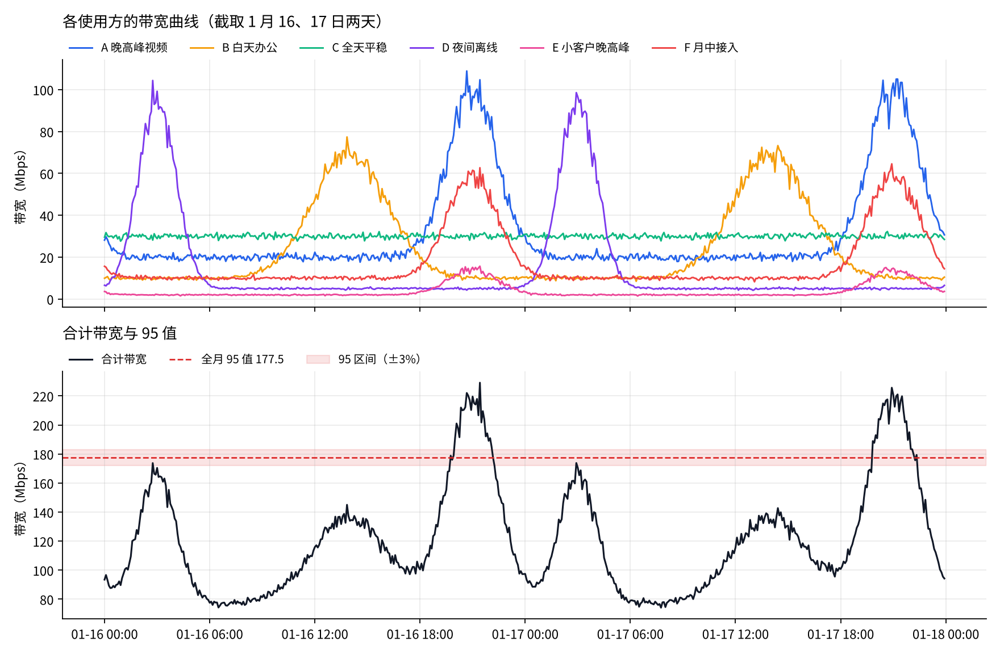

我在字节做 CDN 经营分析时，和「分钱」打了好几年交道，用过两种方法：

- **成本分摊**：一个月的带宽账单，按什么比例分给几万个客户、域名，或者分给公司内部的各个业务。我设计了「95 区间」分摊法，后来申请了专利（见[《我的第一项专利》](/posts/cdn-bandwidth-cost-allocation-patent/)）；
- **价格测算**：接入一个新客户之前，估算他会让账单增加多少，据此给出最低报价（见[《CDN 新客户接入前的价格测算》](/posts/cdn-new-customer-pricing/)）。

当时做这些，主要靠对业务的理解和数据验证。最近系统了解了一遍博弈论里关于成本分摊的经典方法，发现很多问题早有成熟的讨论，自己的两种做法也能在这套理论里找到对应的位置。这篇把它们整理在一起，尽量不用公式，用一组模拟数据来说明各种方法的区别。

> 文中的模拟数据都是用 Python 生成的，只用来说明各种方法的倾向，不是真实业务数据。

## 一、问题：一笔共享的成本，每人该付多少

### 1. 用 CDN 带宽来说

CDN 厂商（或者公司内部的 CDN 平台）向上游买带宽，通常按 **95 峰值**结算：一个月每 5 分钟采一个总带宽点，去掉最高的 5%，剩下的最大值就是计费带宽（详见[《CDN 计费方式详解》](/posts/cdn-billing-methods/)）。

这份带宽被很多使用方共享。后面所有的方法，都要反复问同一类问题：**「如果只有其中一部分人，账单会是多少？」** Shapley 要问，边际贡献法要问，检查公平性也要问。所以先把这个问题起个名字。

**S 是一群使用方**，也就是从所有使用方里挑出来的任意一个组合。比如一共有 A、B、C 三个客户，S 可以是 {A}、{A, B}，也可以是 {A, B, C}。

**c(S) 是「假如只有 S 这群人一起买带宽，要付多少钱」**。c 是 cost（成本）的意思，算法是：把 S 里每个人的带宽曲线逐点加起来，取这条合计曲线的 95，再乘单价。它是一个假设的成本，因为现实中所有人一直都在一起用，只有一张账单。

在所有可能的 S 里，有两种特别重要：

- **总成本**：S 是全体使用方时的 c，就是实际收到的那张账单；
- **独立成本**：S 只有一个人时的 c，比如 c({A})，相当于 A 不和别人共享、自己单独去买带宽要付的钱。

用一个只有两个客户的小例子来看。A 是晚高峰业务，B 是白天业务，单价按 1 算：

| 组合 S | 说明 | c(S) |
| --- | --- | --- |
| {A} | A 单独买，A 自己曲线的 95 | 100 |
| {B} | B 单独买，B 自己曲线的 95 | 80 |
| {A, B} | 两人合买，合计曲线的 95，也就是实际账单 | 120 |

两人的高峰一个在晚上、一个在白天，叠加之后的 95 只有 120，而各自单独买要 100 + 80 = 180。**合买比分开买省了 60**，这就是错峰复用的收益（[《CDN 的错峰与超卖》](/posts/cdn-off-peak-and-overselling/)讲过这件事）。

现在要把实际账单 120 分给 A 和 B。不同的方法，分法不一样：

| 方法 | A 付 | B 付 | 思路 |
| --- | --- | --- | --- |
| 独立值 | 66.7 | 53.3 | 按 100 : 80 的比例分 120，省下的钱按规模平分 |
| 留一边际 | 80 | 40 | 去掉 A 账单少 40（120 − 80），去掉 B 少 20（120 − 100），按 40 : 20 分 |
| Shapley | 70 | 50 | A 先来付 100、后来付 40，两种顺序取平均是 70；B 同理是 50 |

三种分法加起来都是 120，也都没让谁比自己单独买更贵，但给 A 的数字从 66.7 到 80 都有。区别全在于那省下来的 60 怎么算：独立值按规模分，留一边际偏向让「对账单影响大的人」多付，Shapley 在所有加入顺序之间取平均。

所以成本分摊的各种方法，本质的分歧就是一个问题：**合买省下来的钱，该算给谁。** c(S) 这套记号，就是用来把这些「假设只有一部分人」的成本说清楚，后面讲 Shapley、边际贡献、核的时候都会用到它。

### 2. 用什么标准评价一种分法

| 标准 | 含义 | 为什么重要 |
| --- | --- | --- |
| 分完等于总数 | 所有人分到的成本加起来正好等于账单 | 财务对账的底线 |
| 一样的人付一样的钱 | 带宽曲线相同的两个使用方，分摊相同 | 公平的最低要求 |
| 不比自己单独买贵 | 任何一个人或一群人，分到的不超过他们自己采购的成本 | 否则他们有理由退出联合采购；博弈论里叫「在核里」 |
| 和计费规则一致 | 分摊的依据就是决定账单的那个因素 | 95 计费下，低谷用量不该分太多成本 |
| 稳定 | 数据小幅变化，结果不会大幅跳动 | 每个月的结果要能解释 |
| 算得动 | 十万级使用方，每天能算完 | 工程约束 |
| 讲得清 | 财务和业务能听懂、能复核 | 决定方法能不能推得动 |

后面会看到，没有一种方法能把这些全部做到最好，选择方法其实是在这些标准之间取舍。

## 二、我在工作中用过的两种方法

### 1. 分摊：95 区间法

最常见的做法是**单点法**：找到 95 值对应的那个时间点，按各使用方在这个点的带宽比例分。它简单，但有两个硬伤：一个点代表不了整个月；有好几个点都等于 95 值时，选哪个点结果差别很大。

我的做法是把「一个点」换成「一段区间」：在 95 值上下各取一个阈值，总带宽落在这条带里的所有时间段叫管理区间，按各使用方在所有管理区间里的用量占比来分。它保留了 95 计费的含义（分摊依据仍然是决定账单的高峰时段），又解决了单点法不准、不稳的问题。

### 2. 测算：边际增量

价格测算回答的是另一个问题：**多接一个客户，账单会多出多少钱**。做法是把新客户的带宽曲线叠加到现有大盘上，看大盘 95 增加了多少（ΔB），再乘资源单价，就是接入他的增量成本。错峰的客户 ΔB 远小于他自己的 95，可以报很低的价格。

后来测算工具又迭代过一次：把新旧大盘的打点分别排序，取**第 94 到第 96 百分位之间（左开右闭）的所有点**求平均，用两者之差来代表成本增长，按月的打点算就是 2% 的点。原因和分摊专利一样：95 只是排序后的一个点，新客户的曲线一叠加，具体是哪个时间点落在第 95 百分位就可能变化，单点的差值会跟着跳。换成一段的平均值，结果稳定得多。单点和区间两种口径在测算结果里并排保留，两者差得大的客户，说明成本对 95 的落点很敏感。第五节有一组数据。

和运营商的结算毕竟是按单点 95 算的。我的理解是**结算按单点，预估按区间**：测算是拿 7 天样本去预估未来每个月的增量，样本里哪个点恰好落在第 95 百分位本身就有偶然性，测算需要的是增量的期望值，区间平均是对它更稳的估计（详见[价格测算那篇](/posts/cdn-new-customer-pricing/)的第四节）。

### 3. 两者其实在回答不同的问题

当时我没有特别区分这两件事，学了这些理论之后才看清楚：

- **测算是「定价」问题**：面向未来的决策，问的是「多他一个，会多花多少」。这在理论上叫**顺序边际**：假设其他人都已经在了，他最后一个加入；
- **分摊是「记账」问题**：面向已经发生的账单，问的是「这张账单里，每人该承担多少」。

两者不能混用。如果每个客户都按「自己是最后一个加入」来算边际成本，加起来不等于总账单；而如果用分摊结果去给新客户报价，又没有反映他真正带来的增量。

## 三、Shapley 家族

### 1. 精确 Shapley

Shapley 值由 Lloyd Shapley 在 1953 年提出，是合作博弈里最有名的分配方法。

**思路**：想象使用方一个接一个加入，每个人加入时总成本增加了多少，就是他的「边际成本」。但加入的顺序会影响结果：第一个加入的人要付自己全部的 95，后来的人可以填进别人的低谷，付得少。Shapley 的做法是**对所有可能的加入顺序取平均**。

**为什么被认为公平**：它是唯一同时满足四条公理的分法：分完等于总数；一样的人付一样的钱；对任何组合都没有贡献的人不付钱；两笔成本分开分和合起来分，结果一样。

**问题**：

- **算不动**：n 个使用方有 2^n 个组合，每个组合都要把曲线加起来取一次 95。20 个使用方就是百万级组合，几万个客户完全不可能；
- **按「假设的世界」收钱**：它要问「如果只有你和某几个人，95 会是多少」。一个只在半夜跑的离线业务，在很多假设的小组合里会变成峰值的制造者，于是被分到不少成本，尽管它从没推高过实际的账单。第五节的例子里能清楚地看到这一点；
- **讲不清**：对财务说「对所有加入顺序取平均」，很难复核。

### 2. 蒙特卡洛排列 Shapley

**思路**：不枚举所有顺序，只随机抽几百、几千个顺序，对抽到的顺序算边际成本再取平均。

**代价**：误差大致按抽样次数的平方根下降，想把误差缩小 10 倍，要多抽 100 倍。每抽一个顺序，都要依次加入 n 个人、算 n 次 95。小客户的边际成本接近 0，相对误差会很大。工程上还有一个麻烦：结果带随机性，每次重算都不一样，对账时必须固定随机种子。不过在今天的算力下，计算量本身已经不大，第五节有一万个用户的实测。

### 3. Owen 分组 Shapley

**思路**：Guillermo Owen 在 1977 年提出，先把使用方分组，再分两层算：先把每个组当成一个整体，在组之间做 Shapley，决定每组付多少；再在组内做 Shapley，分给组里的每个人。

**优点**：和组织结构天然对应。比如公司内部按业务线（服务树）分摊，顶层只有几十个业务线，算得动；组内再换一种简单的方法也可以。

**问题**：结果依赖分组方式。组织架构一调整，同一个业务的成本就会变。

### 4. 加权 Shapley

**思路**：标准 Shapley 认为每个加入顺序都一样可能；加权版本给每个使用方一个权重，权重大的人更可能「排在后面」。在带宽场景里排在后面往往更便宜，因为可以填别人的低谷。权重可以来自合同规模、接入时间或优先级。

**问题**：权重是人定的，公平性的争议会从「算法」转移到「权重怎么定」。

## 四、非 Shapley 的方法

### 1. 独立值分摊

**做法**：算每个使用方自己的 95，按占比分总账单。

**问题**：完全忽略错峰。一个半夜高峰很高的离线业务，和一个晚高峰视频业务自己的 95 差不多，就分差不多的钱，尽管前者可能从没推高过总账单。省下来的钱被按规模平均分了，而不是给了创造它的人。

### 2. 边际贡献法

有两种常见的做法：

- **留一边际**：算「去掉某个使用方，总账单会少多少」，再按这个差值的占比分。一个小客户单独去掉几乎不影响 95，边际接近 0；但一千个小客户加起来就不是 0。所以这种方法会把成本推给大客户；
- **顺序边际**：按一个固定的顺序依次加入，每人付自己加入时带来的增量。它就是**只取一个顺序的 Shapley**，先加入的人吃亏。价格测算就是这种思路，新客户永远是「最后一个」。用来定价合理，用来记账就不公平。

### 3. Aumann–Shapley

**思路**：Shapley 把使用方看成一个个「人」，Aumann–Shapley 把用量看成可以无限细分的「量」。想象所有人的用量**同时、按同样的比例**从 0 慢慢涨到实际值，每涨一点，总成本就增加一点，这一点按当时各人「多用一个单位会带来多少成本」分掉。最后每种资源得到一个「单位价格」，每个人按自己的用量乘以单价付钱。

> **先补一点数学：什么是导数**
>
> 导数就是**变化率**：一个量增加一点点，结果跟着变多少。画一条「成本随用量变化」的曲线，某一点的导数就是曲线在这一点的**斜率**。比如单价固定为 3，成本 = 3 × 用量，是一条直线，每一点的斜率都是 3，也就是单价。
>
> 放到成本分摊里，导数可以理解成**边际单价**：多用一个单位，账单实际要多付多少钱。上面说的「多用一个单位会带来多少成本」，就是它。要注意它不一定等于合同单价：后面会看到，95 计费下同样多用 1 Mbps，在高峰那一刻要付全价，在其他时刻一分钱不用多付。只有成本和用量成正比时，边际单价才处处等于合同单价。
>
> 如果一个函数在某处「往上加一点」和「往下减一点」时的变化率不一样，比如往上加，结果跟着涨；往下减，结果却纹丝不动，这种「拐角」的地方就说它**不可导**：没有一个确定的变化率。

它在成本分摊里有经典的应用，比如 Billera 等人在 1978 年用这类方法给大学内部的电话服务定结算价：服务是整体采购的，却由大量小用户分摊。

**为什么适合 CPU、内存**：这类资源用量连续，成本随总用量平滑变化，而且使用方多到无法枚举。Aumann–Shapley 不需要枚举组合，只需要知道成本对用量的导数，十万级使用方也算得动。如果成本和用量成正比，它就退化成「按用量比例分」。

**放到 95 计费上，会发生一件有意思的事**：

- 所有人的用量同比例放大时，各个时间点的总带宽排序不变，所以「第 95 分位是哪个时间点」始终是同一个；
- 总成本只对这一个时间点的用量敏感：在 95 那个时间点给某个客户多加 1 Mbps，账单就多 1 Mbps 的钱，边际单价就是合同单价；在其他时间点多加 1 Mbps，只要排序没变，第 95 分位的值就不变，账单一分钱不涨，边际单价是 0；
- Aumann–Shapley 的「单位价格」，就是把一路涨上去时每一刻的边际单价取平均。95 计费下，只有 95 那个时间点的边际单价是合同单价，其他点都是 0，所以 **Aumann–Shapley 在 95 计费下恰好就是单点法**。对比一下 CPU、内存：成本和用量成正比，边际单价处处等于合同单价，Aumann–Shapley 就是「按用量 × 单价分」。

单点法的两个问题，在这个视角下也有了解释：

- **导数只集中在一个点**：整个月 8640 个点里，只有一个点的导数不是 0，其余全是 0。这一个点代表不了整个月，这就是单点法「不准」的根源；
- **好几个点都等于 95 值时不可导**：假设有两个时间点的总带宽恰好都等于 95 值，排在第 433 和第 434 位。给第 433 位那个点再加一点，它的值变大，账单跟着涨；给它减一点，它掉到第 434 位，原来第 434 位的点顶上来，值还是那么多，账单不动。往上和往下的变化率不一样，就是上面说的「拐角」，没有确定的导数，也就说不清该按哪个点分，这就是单点法「不稳」的根源。

Aumann–Shapley 的标准形式要求成本函数可导，对不可导的情况，学界也有专门的扩展。

而我的 95 区间法，把这个「只在一个点不为零」的导数，换成了「在 95 值附近一条带里都不为零」，**可以理解为 Aumann–Shapley 在 95 计费下的平滑版**。做专利的时候我是从业务出发想到的，现在回头看，它和这套经典理论是连得上的。

### 4. 核与核仁

**先理解「核」**：一个分摊结果，如果满足「任何一群人加起来付的钱，都不超过他们自己单独组队采购的成本」，就说它在核里。在核里意味着没有任何一群人有理由退出联合采购，各自单干。

**核仁**：David Schmeidler 在 1969 年提出。对每一群人，算「他们自己采购的成本」减「分给他们的成本」，这个差越小，这群人越不满意。核仁找的是**让最不满意的那群人尽可能满意**的分法；如果有并列，再照顾第二不满意的，依次类推。只要核不是空的，核仁就一定在核里，而且是唯一的。

**问题**：要解一串线性规划，约束数是 2^n 级的，大规模不可行，结果也很难向业务解释。

实际中更有用的是把「核」当成一个**检查条件**：用任何方法算完分摊后，检查大客户、大业务分到的成本有没有超过他们自己单独采购的成本。在基础设施里，「自己单独采购的成本」往往有现成的对标，就是外部市场价。

### 5. 基准分层（Shapley-Ref 一类）

**做法**：把总成本切成两层：一条基准线以下的部分按平均用量分；基准线以上的峰值部分，按 Shapley 或边际贡献分。直觉是：基础的容量大家都在用，按量分；峰值是谁推高的，就由谁付。

**关键在于基准线怎么定**：定得太高，就退化成按量分，全天平稳的用户会被多收钱，甚至超过他自己单独采购的成本，下一节的例子里就出现了这种情况；定得太低，又回到了纯峰值分摊。

## 五、用一组模拟数据比较

### 1. 分摊：同一份数据，九种分法

模拟 30 天、每 5 分钟一个点，6 个使用方：

- A：晚高峰视频，晚上 9 点前后有大峰；
- B：白天办公，下午 2 点前后有峰；
- C：全天平稳；
- D：夜间离线，凌晨 3 点前后有大峰；
- E：小客户，晚高峰；
- F：月中才接入，晚高峰。

截取月中两天（这时 F 已经接入）的波形，画在同一张图里：

从下图能直接看到几件后面会用到的事：合计带宽每天只有晚上 9 点前后的高峰会冲过 95 值，穿过浅红色的 95 区间；凌晨 D 的大峰把合计推到 170 左右，接近但没有越过 95 值；下午 B 的高峰只到 140 上下，离 95 值更远。

总账单的 95 值是 177.5，而 6 个使用方各自的 95 加起来是 329.4，错峰复用省下了 46%。用各种方法分这张账单：

| 方法 | A 晚高峰 | B 白天 | C 平稳 | D 夜间 | E 小客户 | F 月中接入 | 最多超出独立采购 |
| --- | --- | --- | --- | --- | --- | --- | --- |
| 单点法（= Aumann–Shapley） | 43.1% | 6.5% | 16.5% | 2.7% | 6.3% | 24.9% | 0.7% |
| 独立值 | 27.9% | 20.4% | 9.6% | 24.6% | 3.9% | 13.7% | 14.1% |
| 留一边际 | 39.3% | 8.6% | 23.6% | 3.8% | 6.7% | 17.9% | 33.0% |
| 按总流量 | 28.2% | 20.7% | 26.7% | 13.3% | 3.3% | 7.7% | 50.4% |
| 精确 Shapley | 33.0% | 14.3% | 17.0% | 17.1% | 4.7% | 13.9% | 0.1% |
| 蒙特卡洛 Shapley（随机 20 个顺序） | 32.8% | 13.9% | 17.1% | 15.7% | 4.8% | 15.7% | 0.0% |
| Owen（A、E、F 一组；B、C 一组；D 一组） | 31.1% | 16.5% | 17.0% | 18.9% | 4.3% | 12.2% | 1.5% |
| **95 区间（上下 ±3%）** | **39.0%** | **6.0%** | **17.0%** | **11.0%** | **5.2%** | **21.9%** | **0.2%** |
| 基准分层（基准 = 平均带宽） | 30.0% | 18.4% | 23.1% | 14.7% | 3.8% | 10.0% | 30.6% |

模拟数据和复算脚本都可以下载，方便手动验证：

- [bandwidth-sample.csv](/files/cost-allocation/bandwidth-sample.csv)：6 个使用方 30 天的带宽打点，每 5 分钟一行，共 8640 行，单位为 Mbps；
- [verify.py](/files/cost-allocation/verify.py)：只用 Python 标准库，运行 `python3 verify.py bandwidth-sample.csv` 就能复算出上面这张表。蒙特卡洛那一行用的是固定的随机种子，换一个种子结果会变，这本身就是它的特点。

最后一列的意思是：在所有 63 个可能的组合里，某一群人分到的成本，最多超出他们自己单独采购成本的比例。接近 0，说明基本在核里，没有人吃亏。

从这张表能读出几件事：

- **D 夜间离线是分歧最大的**：单点法只给 2.7%，独立值给 24.6%，Shapley 给 17.1%，95 区间给 11.0%。Shapley 给得多，是因为在很多「假设只有少数几个人」的组合里，D 的半夜大峰会变成 95 值，但在真实账单里它并没有推高峰值。这正是两种思路的差别：**Shapley 问的是「错峰省下的钱怎么公平地分」，95 区间问的是「谁推高了这张账单」**。两种都有道理，取决于你想要哪种公平；
- **按总流量和基准分层都多收了平稳用户的钱**：C 全天平稳，按流量要付 26.7%，比它自己单独采购还贵 50%，明显说不过去；
- **单点法对 F 月中接入给了 24.9%**：这次 95 时间点恰好落在下半月的晚高峰。换一组随机数据，它可能落在上半月，F 就是 0。这就是单点法的不稳定；
- **95 区间**在「不比自己单独买贵」上和 Shapley 一样好，计算量是线性的，而且和实际账单的驱动因素一致。

### 2. 蒙特卡洛的误差

还是这 6 个使用方，用蒙特卡洛近似 Shapley，每种抽样次数各跑 10 次，看单个使用方的最大偏差：

| 抽样的顺序数 | 平均最大偏差 |
| --- | --- |
| 20 | 3.7 个百分点 |
| 200 | 1.1 个百分点 |
| 2000 | 0.4 个百分点 |

只有 6 个使用方，抽 2000 个顺序误差还有 0.4 个百分点。换成几万个客户，计算量和误差都会成为大问题。

### 3. 测算：单点增量和 (94, 96] 区间平均增量

模拟一个大盘（晚上 9 点高峰）和两个新客户，用 200 组不同的随机噪声各测算一次，比较增量 ΔB 的波动：

| 新客户 | 单点 95 增量 | 94～96 平均增量 |
| --- | --- | --- |
| 错峰（上午 10 点高峰） | 均值 20.0，标准差 0.7，范围 17.9～22.0 | 均值 20.0，标准差 0.2，范围 19.4～20.5 |
| 同峰（晚上 9 点高峰） | 均值 179.2，标准差 3.4，范围 170.5～187.9 | 均值 179.2，标准差 2.3，范围 171.8～185.6 |

两种算法的均值一样，但区间平均的波动明显更小。错峰客户的增量本身很小，单点的抖动对结果影响尤其大：换算成边际超卖倍数 k，单点算法在 8.2 到 10.1 之间摆动，区间平均收窄到 8.8 到 9.4。k 直接决定最低报价，这个差别对销售来说就是报价能不能站得住。

### 4. 算力还是问题吗：一万个用户实测

前面说精确 Shapley「算不动」，那蒙特卡洛呢？在今天的算力下，我用模拟数据实测了一次：1 万个用户、30 天、每 5 分钟一个点，用户规模按长尾分布，高峰时间各不相同。

| 项目 | 结果 |
| --- | --- |
| 数据量 | 1 万 × 8640 个点，单精度浮点约 346MB |
| 每个排列的耗时 | 约 0.2 秒（Python + numpy，单核） |
| 达到 1% 相对误差需要的排列数 | 大用户约 60 个，中等用户约 140 个，最小的用户约 200 个 |
| 总耗时 | 200 个排列 × 0.2 秒 ≈ 40 秒，单核 |

每个排列的算法很简单：按随机顺序依次把用户加进来，维护一条累计曲线，每加一个人就用快速选择取一次 95，前后之差就是这个人的边际成本。各个排列之间互相独立，可以直接并行。按域名粒度算，比如 10 万个域名，单个排列大约慢 10 倍，放到多核或 Spark 上也是分钟级。

所以**算力已经不是问题**，月度数据 D+1 产出完全没压力（精确 Shapley 仍然不可能，2 的 10000 次方个组合不是算力能解决的）。真正的障碍是另外几件事：结果有随机性，对账时要固定随机种子；最小的用户相对误差最大；对财务解释「随机抽 200 个加入顺序取平均」，比「按高峰区间的用量占比」难得多。

同一份数据，我还比较了三种方法的结果，用「有多少比例的成本被分给了不同的人」来衡量差异：

| 对比 | 差异 |
| --- | --- |
| Shapley 和单点法 | 7.2% |
| **Shapley 和 95 区间** | **0.9%** |
| 单点法和 95 区间 | 7.3% |

**用户一多，Shapley 的结果和 95 区间法几乎一样**，和单点法反而差得多。这不是巧合，可以从 Shapley 的计算过程里看出原因。

**Shapley 在 95 计费下，其实是在给每个时间点一个权重。**

1. Shapley 是对所有加入顺序取平均。某个用户在某个位置加入时，面对的是随机抽出的一群人组成的组合 S；
2. 用户很多、每个人都不大时，他的加入只让 S 的合计曲线有微小变化，所以他的边际成本约等于**他在「S 的 95 时间点」上的带宽**；
3. 于是一个用户的 Shapley 值，约等于他在各个时间点的带宽，按「这个时间点成为随机组合的 95 点的概率」加权求和。也就是说，**Shapley 就是一组时间权重下的加权占比**；
4. 这组权重落在哪里，决定了结果：
    - 如果每个随机组合都只是全体的等比例缩小、没有任何噪声，95 点永远是同一个时刻，权重全部集中在一个点上，就是单点法，也就是第四节说的 Aumann–Shapley；
    - 但真实的随机组合各有各的波动，95 点会在「合计带宽接近 95 值」的那些时刻之间来回漂移，权重于是平滑地分布在 95 值附近的一条带上；
5. 95 区间法做的是同一件事：合计带宽落在 95 值上下阈值内的时刻权重取 1，其余取 0，再按带内的用量占比分。**Shapley 是一条自然形成、边界模糊的带，95 区间是一条显式划定、边界清晰的带**，两者形式一样，结果自然接近。

换句话说，**单点法是没有噪声时 Shapley 的极限，95 区间法是有噪声时 Shapley 的显式近似。**

在这 1 万个用户的蒙特卡洛过程里，我记录了每一步「95 点」落在哪个时刻，正好可以验证这个机制：

| Shapley 的 95 点落在 | 比例 |
| --- | --- |
| 合计带宽在 95 值 ±1% 以内的时刻 | 79.5% |
| **±3% 以内（前面例子用的宽度）** | **98.2%** |
| ±5% 以内 | 99.2% |

Shapley 实际「看」的时刻，98% 都落在 ±3% 这条带里。直接用 Shapley 自己的这组时间权重做加权占比，和 Shapley 的结果只差 0.63%，剩下的主要是蒙特卡洛的随机误差，说明「Shapley 就是时间加权占比」这个近似是成立的。

区间宽度对结果的影响也不大：

| 区间宽度 | 带内点数 | 与 Shapley 的差异 |
| --- | --- | --- |
| ±0.5% | 73 | 0.73% |
| ±1% | 149 | 0.74% |
| ±2% | 333 | 0.81% |
| ±3% | 602 | 0.92% |
| ±5% | 743 | 0.75% |
| ±10% | 968 | 1.09% |
| ±20% | 1373 | 2.70% |

宽度在 0.5% 到 10% 之间，结果都在 1% 左右；放宽到 20% 才开始明显偏离，因为带里混进了太多不影响账单的时刻。这正好对应专利里「区间不能太宽，也不能太窄」的约束。

这个机制也解释了第 1 小节 6 个使用方的例子为什么差别大：加入顺序靠前时，组合只有一两个人，95 点会跑到带外面去，比如跑到 D 的凌晨高峰，D 就被分到了「假设的世界」里的成本。1 万个用户时，这种很小的组合只占所有位置的千分之几，影响可以忽略；6 个用户时却占了一半。真实业务里常常是少数大客户占大头，大客户之间仍可能出现这种差异。

当然，这只是一组模拟数据，规模分布和高峰形态都是我设定的，不能当成严格的结论；接近 Shapley 也只说明它符合一种公平标准，不等于它是唯一正确的分法。但比较准确的说法是：**在 95 计费、使用方众多的场景下，95 区间法可以看作 Shapley 的一个显式、确定、线性复杂度的近似**；在少数大客户主导的场景，两者的差异恰好反映了「按假设的组合分」和「按实际账单分」两种公平观的不同。

这一小节所有的测试都在一个脚本里：[shapley_bench.py](/files/cost-allocation/shapley_bench.py)（需要 numpy，约 1GB 内存，固定了随机种子，除了耗时之外的数字都能复现）。

## 六、总对比

| 方法 | 分摊依据 | 公平性 | 计算量 | 稳定性 | 可解释性 | 一句话定位 |
| --- | --- | --- | --- | --- | --- | --- |
| 精确 Shapley | 所有加入顺序的平均边际 | 理论上最完备 | 2^n，只能几十个使用方 | 高 | 低 | 理论标尺 |
| 蒙特卡洛 Shapley | 抽样顺序的平均边际 | 近似 Shapley | 抽样数 × n | 中，带随机误差 | 低 | 中等规模的近似 |
| Owen | 组间 Shapley + 组内 Shapley | 接近 Shapley，受分组影响 | 可大幅降低 | 中，分组变就变 | 中，和组织结构一致 | 按组织层级分摊 |
| 加权 Shapley | 按权重改变顺序的概率 | 取决于权重 | 同 Shapley | 高 | 低 | 写进业务差异 |
| 独立值 | 各自的 95 | 忽略错峰，差 | 线性 | 高 | 高 | 简单但不准 |
| 留一边际 | 去掉自己后账单少多少 | 小客户都接近 0，差 | 线性 | 中 | 高 | 只适合少数大使用方 |
| 顺序边际 | 按固定顺序的增量 | 先来的吃亏 | 线性 | 高 | 高 | 适合定价，不适合记账 |
| Aumann–Shapley | 成本对用量的导数 | 连续资源下很好 | 低 | 取决于成本函数是否平滑 | 中，就是单位价格 | CPU、内存这类资源 |
| 核仁 | 让最不满意的人最满意 | 稳定性最强 | 线性规划，约束 2^n 级 | 高 | 低 | 当检查条件用 |
| 基准分层 | 基准按量 + 峰值按贡献 | 取决于基准线 | 取决于峰值层的方法 | 中 | 中 | 固定加变动的混合 |
| **95 区间** | **95 值附近高峰区间的用量占比** | **对应实际账单的驱动因素** | **线性** | **高** | **高** | **95 计费下 Aumann–Shapley 的平滑版** |

## 七、几点体会

**1. 先想清楚是在「定价」还是在「记账」。** 价格测算用边际增量，是因为要回答「多接一个客户会多花多少」；成本分摊要回答「这张账单每人承担多少」。前者天然是顺序边际，后者需要分完等于总数。很多争议其实是把这两个问题混在了一起。

**2. 没有唯一正确的公平。** Shapley 认为错峰省下的钱应该大家公平地分，95 区间认为成本应该由推高账单的人承担。前者对夜间离线业务更「严」，后者对晚高峰业务更「严」。选哪种，取决于希望用成本引导什么样的行为：如果希望鼓励业务错峰，后者的激励更直接。

**3. 理论方法适合当标尺。** 精确 Shapley 和核仁算不动；蒙特卡洛 Shapley 在一万个用户的规模下几十秒就能算完，算力已经不是问题，真正的障碍是结果的随机性和可解释性。所以更适合把它当标尺：每月离线跑一遍，看实际使用的方法有没有系统性地偏向某一类客户；再用「不比自己单独买贵」检查有没有让大客户吃亏。模拟里，使用方一多，Shapley 和 95 区间的结果只差 0.9%，这也从另一个角度说明了区间法的合理性。

**4. 区间比单点稳。** 不管是分摊专利，还是测算工具后来的 94～96 迭代，做的都是同一件事：95 只是排序后的一个点，对噪声很敏感，换成附近一段的平均，结果就稳定了。现在用 Aumann–Shapley 的视角再看，这件事也有了理论上的解释：单点法的「导数」只集中在一个点，区间法把它平滑到了一条带上。

参考：

- [The Aumann–Shapley prices: a survey](https://cambridge.org/core/books/shapley-value/aumannshapley-prices-a-survey/8023E3AE9A301A872C386FB4E7409C0C)（剑桥大学出版社《The Shapley Value》论文集中的一章，综述 Aumann–Shapley 价格在成本分摊中的理论和应用）
- [Billera, Heath, Raanan. Internal Telephone Billing Rates: A Novel Application of Non-Atomic Game Theory. Operations Research, 1978](https://ideas.repec.org/a/inm/oropre/v26y1978i6p956-965.html)（用非原子博弈的值，给整体采购、由大量小用户分摊的大学内部电话服务定结算价，是这类方法的经典应用）
- [Haimanko. Cost sharing: the nondifferentiable case. Journal of Mathematical Economics, 2001](https://ratio.huji.ac.il/files/dp205.pdf)（指出 Aumann–Shapley 只适用于可导的成本函数，并把它推广到凸的、分段线性的不可导情形）
- [Cost allocation problems on highways with grouped users](https://arxiv.org/pdf/2304.10002)（arXiv 论文，研究按用户分组的高速公路成本分摊，文中介绍了 Owen 值先在组间、再在组内两次使用 Shapley 值的做法）
- [一篇关于核仁计算的论文](https://cptra.ln.edu.hk/~mmleng/assets/nucleolus-100715-final.pdf)（PDF，介绍 Schmeidler 1969 年对核仁的定义、逐步最小化最大不满意度的线性规划算法，以及核非空时核仁一定在核里）
