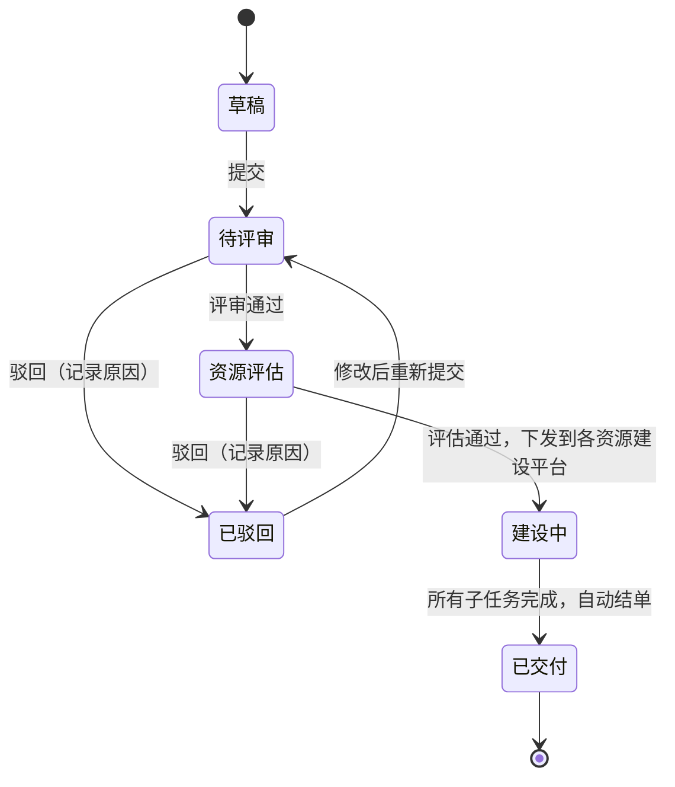

在字节做 CDN 的时候，我从零设计开发过一个资源建设流程平台（内部叫 CRM）。它管的是 CDN 最主要的几项成本：物理机、带宽、IP。一个资源需求从发起、评审、资源团队评估，到派给各个建设平台、最终交付，整个过程都在这个平台上流转。后端用 Go 实现，由我一个人负责，状态机和审批流都是自己写的。

这篇前半部分记录当时的设计，后半部分是回头看的反思：哪些地方做对了，哪些地方如果重来会换一种做法。文中的代码是按场景整理的示例，不是当时的原始实现。

## 一、业务背景

资源建设原来主要靠线下沟通：需求方在群里提，评审靠拉人对齐，建设团队各自排期，进度靠人去问。问题很明显：

- **需求不规范**：同样是要带宽，有人写清了区域和运营商，有人只写了一个总量；
- **进度不透明**：一个需求卡在哪个环节、谁在处理，只能挨个问；
- **无法追溯**：事后想查某批机器是谁批的、数量被谁改过、什么时候交付的，找不到记录。

平台要做的事很明确：**把流程线上化，每个节点的进度可视化、每一次变更都可追溯**。

## 二、流程与状态



整个流程有两级把关：

1. **需求评审**：确认需求本身是否合理；
2. **资源团队评估**：评审通过后，根据资源类型和模板类型，流转到对应的资源团队，评估资源是否可以满足、怎么建设。

两级都可以通过或驳回，**每一次驳回都必须填写原因**并记录下来。被驳回的需求可以修改后重新提交，重新走一遍评审。

评估通过后，需求按资源类型拆成多个建设任务，下发到各类资源建设平台。每次状态变更，都会给相关的人发飞书消息：发起人、审批人、跟进人收到的链接不同，审批人点进去直接就是审批页面。

需求的入口是**模板**：不同资源类型对应不同的模板，需求方必须按模板填写，精确到机器型号、带宽的服务区域和运营商等。需求在入口就是规范的，后面的评审和建设才有依据。

## 三、几个关键设计

### 1. 并发控制：乐观锁

两个审批人同时操作同一个单子，比如一个点通过、一个点驳回，状态不能被改两次。用的是乐观锁：更新时把旧状态和版本号作为条件。

```sql
UPDATE requests
SET state = 'evaluating', version = version + 1
WHERE id = ? AND state = 'reviewing' AND version = ?;
```

影响行数为 0，说明单子已经被别人处理过了，这次操作直接失败，提示刷新。审批场景冲突很少，乐观锁比加锁更轻，也不会出现锁等待。

### 2. 变更审计：通用 diff，而不只是流转日志

「可追溯」是这个平台的核心诉求之一，我的做法比单纯记状态流转更进一步：

- 单子本身落在业务库里；
- 另有一个独立的日志库，用 **MongoDB** 存储，因为日志是类 JSON 的半结构化数据，不同模板的字段各不相同，用文档库最自然；
- **每次状态变更，或者模板里任何字段的变更**（比如机器数量、资源类型），都会触发后端的 diff 逻辑：比较变更前后的单子，把差异记录进 diff 库。

所以在平台上，一个单子从创建到交付，每个字段被谁、在什么时候、从什么改成了什么，都能看到。

diff 的思路大致是这样（示例）：

```go
type Change struct {
	Field string `bson:"field"`
	From  any    `bson:"from"`
	To    any    `bson:"to"`
}

type DiffLog struct {
	RequestID int64     `bson:"request_id"`
	Operator  string    `bson:"operator"`
	Kind      string    `bson:"kind"`    // "state" 状态变更 / "field" 字段变更
	Changes   []Change  `bson:"changes"`
	Comment   string    `bson:"comment"` // 驳回原因等
	CreatedAt time.Time `bson:"created_at"`
}

// 把单子转成 map 后逐个字段比较，嵌套的模板字段用点号路径表示，比如 "spec.machine_count"
func diff(before, after map[string]any, prefix string) []Change {
	var out []Change
	for k, a := range after {
		key := prefix + k
		b, ok := before[k]
		bm, bIsMap := b.(map[string]any)
		am, aIsMap := a.(map[string]any)
		switch {
		case ok && bIsMap && aIsMap:
			out = append(out, diff(bm, am, key+".")...)
		case !ok || !reflect.DeepEqual(b, a):
			out = append(out, Change{Field: key, From: b, To: a})
		}
	}
	for k, b := range before {
		if _, ok := after[k]; !ok {
			out = append(out, Change{Field: prefix + k, From: b, To: nil})
		}
	}
	return out
}
```

前端的流程图也是建立在这份数据上的：**只查询 `kind = state` 的记录，按时间排列，就是流转记录**；节点详情里的审批意见、驳回原因、交付明细，也都来自这里。一份数据，同时支撑了「流程图」和「完整变更历史」两个视图。

### 3. 父子任务与自动结单

一个需求往往同时包含机器、IP、带宽，由不同的建设平台负责，进度各不相同。所以评估通过后会拆成多个**子任务**分别跟踪，父任务是需求单本身。

收尾不靠人工确认，而是**定时任务**校验：所有子任务都已交付时，自动把父任务变更为已交付，完成结单。

### 4. 和各资源建设平台对接：状态对齐与轮询

各资源建设平台有自己的流程和状态定义，所以对接的第一步是**和每个平台对齐状态枚举**：它们的哪些状态对应我们的「建设中」，哪些算「已交付」，哪些算失败。

进度同步靠轮询，因为各平台不一定支持回调。轮询频率不是统一的，而是**按资源类型分别和各个平台协商**，根据对方接口能承受的压力配置成各自的定时任务。这一点很重要：轮询方是在消耗别人的资源，频率应该由双方商量，而不是自己说了算。

### 5. 失败处理：操作事务化与回滚

一次操作可能包含多个步骤，比如评估通过后，要把多个子任务分别下发到不同的建设平台。如果其中一个失败了，单子就会处于「部分下发」的尴尬状态。

当时的做法是**把一次操作事务化**：流程中任何一个子项失败，整个操作回滚，单子回到操作前的状态；失败和回滚都会发消息通知相关的人，处理完问题后重新操作即可。这样保证了单子的状态永远是一致的，不会出现一半成功、一半失败。

## 四、回头看：做对了什么

- **先解决业务问题**。平台最大的价值不在技术，而是把一个靠人推动的流程，变成了规范、透明、可追溯的线上流程。
- **审计做成了通用能力**。diff 机制不关心具体是哪个字段，新增模板字段不用改审计逻辑，就自动有了变更记录。
- **结单自动化**。父子任务加定时校验，减少了人工跟进和遗漏。
- **尊重下游**。状态枚举对齐、轮询频率协商，让对接方愿意配合，这比技术本身更难。

## 五、回头看：如果重来会改什么

### 1. 状态机和业务规则解耦

当时最大的问题是：状态流转是按业务需求一点点实现的。某个节点只能到某个节点、某些节点不能驳回、某类资源由哪些团队评估，这些规则散落在状态处理的代码里，和流转本身绑在一起。规则越加越多，改规则就要改代码、发版本，一个状态能去哪里也要把好几处代码拼起来才看得清。

现在会把「当前状态 + 事件 → 目标状态」抽成一张**转移表**，状态机核心只负责查表，业务规则通过 Guard（流转前校验）和 Action（流转后动作）挂上去：

```go
type Transition struct {
	From   State
	Event  Event
	To     State
	Guard  func(*Ctx) error // 返回 error 则拒绝，比如操作人不是该资源类型的评估人
	Action func(*Ctx) error // 流转后的动作，比如拆分并下发子任务
}

var transitions = []Transition{
	{From: Draft, Event: Submit, To: Reviewing, Guard: requireTemplateComplete},
	{From: Reviewing, Event: Approve, To: Evaluating, Guard: requireReviewer},
	{From: Reviewing, Event: Reject, To: Rejected, Guard: requireReviewerAndReason},
	{From: Evaluating, Event: Approve, To: Building, Guard: requireEvaluator, Action: dispatchSubTasks},
	{From: Evaluating, Event: Reject, To: Rejected, Guard: requireEvaluatorAndReason},
	{From: Rejected, Event: Submit, To: Reviewing, Guard: requireApplicant},
	{From: Building, Event: Deliver, To: Delivered, Guard: requireAllSubTasksDone},
}
```

「某个节点只能到某些节点」就是表里有没有这一行，「某个节点不能驳回」就是这个状态没有 `Reject` 这一行。变化最频繁的「哪类资源由哪些团队评估」，则放到配置表里由 Guard 读取，调整团队不用发版本：

```yaml
- resource_type: bandwidth
  evaluators: [network-team, cost-team]
- resource_type: physical_machine
  evaluators: [server-team, cost-team]
- resource_type: ip
  evaluators: [network-team]
```

### 2. 区分两类副作用

当时把一次操作整体事务化、失败就回滚，保证了一致性。回头看，副作用其实分两类，可以分开处理：

- **决定业务结果的**，比如下发建设任务：失败了单子就不该推进，回滚是对的。但要注意，回滚数据库很容易，已经在外部平台创建成功的任务却回滚不了，需要调用对方的取消接口做**补偿**，这就是 Saga 模式的思路。所以下发前最好先做预校验，下发接口本身也要幂等，避免重试时重复建单。
- **不影响业务结果的**，比如发飞书通知：不应该因为通知发失败就回滚整个审批。更好的做法是**事务性发件箱（Outbox）**：在同一个事务里把「待发送的通知」写进一张表，事务提交后由后台任务发送，失败重试。


### 3. 为什么没用现成的工作流引擎

Java 生态有 Camunda、Flowable 这类 BPMN 引擎，Go 生态有 Temporal 这样的编排框架，也有 `looplab/fsm`、`qmuntal/stateless` 这类状态机库。在这个场景下，自己实现是合理的：

- 流程本身不复杂，状态不多，引入完整的工作流引擎，运维和学习成本可能比收益还大；
- 审批规则和公司内部的组织架构、资源平台深度绑定，引擎能省掉的只是很薄的状态流转那一层；
- 后端只有我一个人负责，一个轻量、完全掌控的实现更容易维护。

但如果流程变得很复杂，比如有并行会签、超时自动升级、需要业务人员自己拖拽配置流程，现成的引擎就值得考虑了。选型的关键不是「自研好还是开源好」，而是**复杂度在哪一层**。

## 六、总结

这个平台的状态机，是从业务里一点点长出来的。它在一致性（乐观锁、事务化回滚）和可追溯（通用 diff 审计）上做得比较扎实，这两点也正是审批类系统最核心的要求。最大的遗憾是状态流转和业务规则耦合在一起。如果重来，第一件事就是把稳定的状态机核心和易变的业务规则分开：前者用转移表一次写好，后者交给配置。
