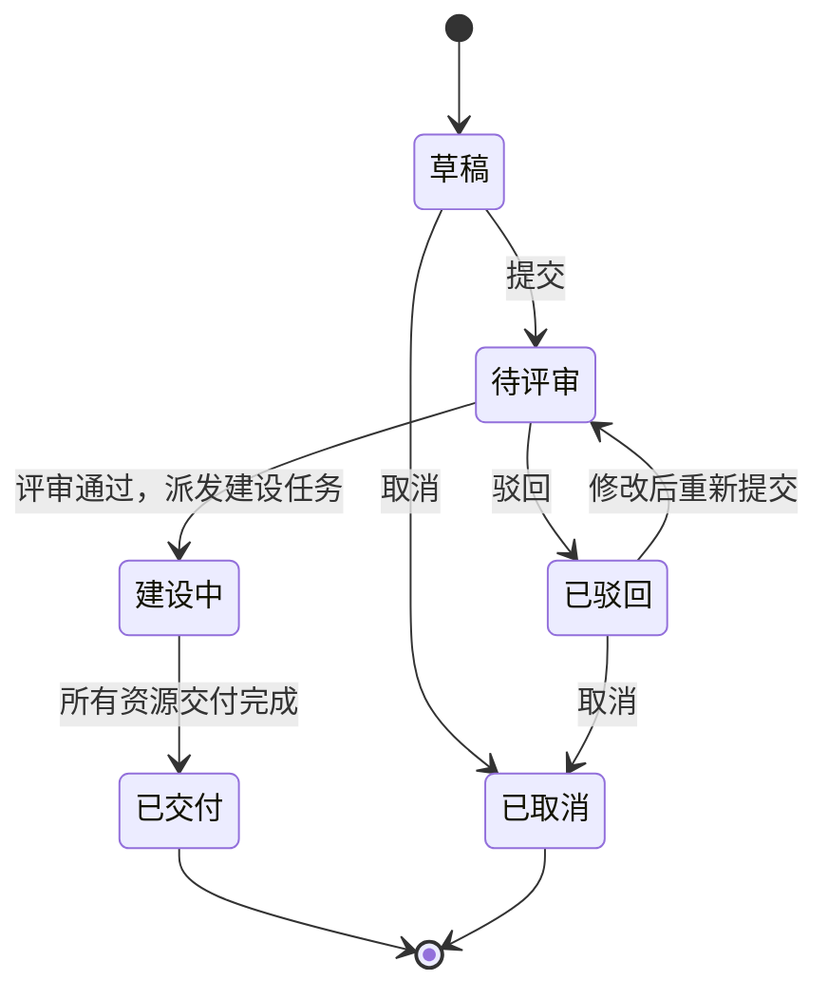
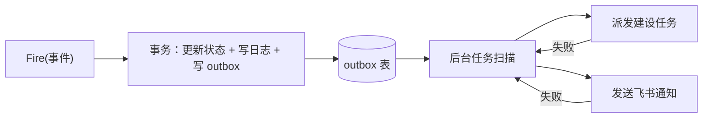

在字节做 CDN 的时候，我从零设计开发过一个资源建设流程平台（内部叫 CRM）。它管的是 CDN 最主要的几项成本：物理机、带宽、IP。一个资源需求从发起、评审、派给各个建设团队，到最后交付上线，整个过程都在这个平台上流转。后端用 Go 实现，状态机和审批流是自己写的。

这篇分两部分：前半部分记录当时的做法和遇到的问题；后半部分是现在回头看，一个更规范的状态机应该怎么设计。后半部分的代码是按这个场景重新整理的示例，不是当时的原始实现，状态名也做了简化。

## 一、业务背景：为什么需要这个平台

资源建设原来主要靠线下沟通：需求方在群里提，评审靠拉人对齐，建设团队各自排期，进度靠人去问。问题很明显：

- **需求不规范**：同样是要带宽，有人写清了区域和运营商，有人只写了一个总量；
- **进度不透明**：一个需求卡在哪个环节、谁在处理，只能挨个问；
- **无法追溯**：事后想查某批机器是谁批的、什么时候交付的，找不到记录。

所以平台要做的事很明确：**把流程线上化，每个节点的进度可视化、可追溯**。

## 二、当时的设计

整个流程是这样的：



几个关键设计：

**1. 需求模板。** 不同资源类型对应不同的模板，需求方必须按模板填写，精确到机器型号、带宽的服务区域和运营商等。需求在入口就是规范的，后面的评审和建设才有依据。

**2. 按规则路由评审人。** 不同类型的资源由不同的团队评审。哪类资源找哪些评审人、哪些节点允许驳回、某个节点只能流转到哪些节点，都是业务规则。

**3. 派发给各资源建设平台。** 评审通过后，按资源类型把建设任务分派到对应的建设团队和平台，一个需求会拆成多个建设子任务。

**4. 轮询同步交付进度。** 各资源建设平台都有查询接口，但不一定支持回调。所以平台定时轮询这些接口，判断进度（比如物理机是否已经上线），再更新到自己这边。

**5. 按角色推送飞书通知。** 每次流程有进度变更，都会给相关的人发飞书消息。发起人、审批人、跟进人收到的链接不同，审批人点进去直接就是审批页面。

**6. 流程图展示。** 前端同事把整个流程画成流程图，每个节点能看到详细进度，比如已经交付的 IP 具体是哪些。

平台上线后，资源建设有了统一的入口和规范，每个需求走到了哪一步、卡在谁那里、交付了什么，都能在一个页面上看到。

## 三、当时的问题：状态管理和业务耦合太深

状态流转完全是按业务需求一点点实现的：某个节点只能到某个节点、某些节点不能驳回、某类资源由哪些团队审批。这些规则散落在状态处理的代码里，和状态流转本身紧紧绑在一起。

刚开始规则不多，这样写最快。但随着规则变多，问题就出来了：

- **改规则就要改代码、发版本**：加一种资源类型、调整一个审批团队，都得动代码；
- **流转关系看不全**：一个状态能去哪些状态，要把好几处代码拼起来才知道；
- **容易漏校验**：新加一条流转路径时，权限、能否驳回这些检查要在每个地方都记得写。

这也是我后来反思最多的一点：**状态机本身应该是稳定的，变化的是业务规则，两者要分开。**

## 四、现在会怎么设计

### 1. 用转移表描述所有流转

把「当前状态 + 事件 → 目标状态」抽成一张表。状态机的核心只负责查表，业务规则通过两个钩子挂上去：

- **Guard（守卫）**：流转前的校验，比如操作人是不是这类资源的评审人、这个节点允不允许驳回；
- **Action（动作）**：流转后的副作用，比如派发建设任务、发通知。

```go
type State string
type Event string

const (
	Draft      State = "draft"
	Reviewing  State = "reviewing"
	Rejected   State = "rejected"
	Building   State = "building"
	Delivered  State = "delivered"
	Cancelled  State = "cancelled"

	Submit   Event = "submit"
	Approve  Event = "approve"
	Reject   Event = "reject"
	Deliver  Event = "deliver"
	Cancel   Event = "cancel"
)

type Ctx struct {
	Req      *Request // 需求单
	Operator string   // 操作人
	Comment  string
}

type Transition struct {
	From   State
	Event  Event
	To     State
	Guard  func(*Ctx) error // 返回 error 则拒绝流转
	Action func(*Ctx) error // 流转成功后的副作用
}

var transitions = []Transition{
	{From: Draft, Event: Submit, To: Reviewing, Guard: requireTemplateComplete},
	{From: Reviewing, Event: Approve, To: Building, Guard: requireReviewer, Action: dispatchBuildTasks},
	{From: Reviewing, Event: Reject, To: Rejected, Guard: requireReviewer},
	{From: Rejected, Event: Submit, To: Reviewing, Guard: requireApplicant},
	{From: Building, Event: Deliver, To: Delivered, Guard: requireAllSubTasksDone},
	{From: Draft, Event: Cancel, To: Cancelled, Guard: requireApplicant},
	{From: Rejected, Event: Cancel, To: Cancelled, Guard: requireApplicant},
}
```

好处是一目了然：

- 「某个节点只能到某些节点」，就是表里有没有这一行；
- 「某个节点不能驳回」，就是这个状态没有 `Reject` 这一行；
- 新增一条路径就是加一行，校验逻辑通过 Guard 复用，不会漏。

### 2. 把易变的规则做成配置

「哪类资源由哪些团队评审」这种规则变化最频繁，不应该写死在代码里，而是存在配置表里，Guard 去读：

```yaml
- resource_type: bandwidth
  reviewers: [network-team, cost-team]
- resource_type: physical_machine
  reviewers: [server-team, cost-team]
- resource_type: ip
  reviewers: [network-team]
```

这样调整审批团队只改配置，不用发版本。转移表本身也可以放进数据库，但我的经验是：状态和流转关系相对稳定，放在代码里更容易测试和审查；真正需要配置化的是这类经常变的业务规则。

### 3. 并发控制：乐观锁

两个评审人同时点了「通过」，或者一个点通过、一个点驳回，状态不能被改两次。最简单可靠的办法是乐观锁，更新时把旧状态作为条件：

```sql
UPDATE requests
SET state = 'building', version = version + 1
WHERE id = ? AND state = 'reviewing' AND version = ?;
```

影响行数为 0，说明状态已经被别人改过了，这次操作直接失败，提示用户刷新。状态机的核心逻辑：

```go
func Fire(ctx *Ctx, ev Event) error {
	t, ok := find(ctx.Req.State, ev)
	if !ok {
		return fmt.Errorf("状态 %s 不允许操作 %s", ctx.Req.State, ev)
	}
	if t.Guard != nil {
		if err := t.Guard(ctx); err != nil {
			return err
		}
	}
	return db.Transaction(func(tx *Tx) error {
		n, err := tx.UpdateState(ctx.Req.ID, t.From, t.To, ctx.Req.Version)
		if err != nil {
			return err
		}
		if n == 0 {
			return ErrConcurrentModified // 已被他人处理
		}
		// 同一个事务里写流转日志和待执行的副作用（见下文）
		if err := tx.InsertTransitionLog(ctx, t); err != nil {
			return err
		}
		return tx.InsertOutbox(ctx.Req.ID, t)
	})
}
```

### 4. 流转日志：可追溯的技术基础

「可追溯」落到技术上，就是每一次流转都写一条日志：谁、什么时候、从哪个状态、因为什么事件、到哪个状态、附带的意见。

```sql
CREATE TABLE transition_logs (
    id          BIGINT PRIMARY KEY AUTO_INCREMENT,
    request_id  BIGINT      NOT NULL,
    from_state  VARCHAR(32) NOT NULL,
    event       VARCHAR(32) NOT NULL,
    to_state    VARCHAR(32) NOT NULL,
    operator    VARCHAR(64) NOT NULL,
    comment     TEXT,
    created_at  DATETIME    NOT NULL,
    KEY idx_request (request_id)
);
```

前端的流程图，本质上就是把这张表按时间画出来。日志和状态更新放在同一个事务里，保证不会出现状态变了、日志却没记上的情况。

### 5. 父子任务：一个需求拆成多个建设任务

一个需求往往同时包含机器、IP、带宽，分别由不同团队建设，进度各不相同。所以要用父子结构：

- **父任务**是需求单本身，走上面的审批流；
- 评审通过后拆出多个**子任务**，每个子任务有自己的简单状态（待建设、建设中、已交付、失败）；
- 子任务全部交付后，自动触发父任务的 `Deliver` 事件。

子任务的进度来自轮询。轮询逻辑要注意两点：

- **只轮询未完成的子任务**，减少对资源平台的压力；
- **幂等**：状态没有变化就什么都不做，重复拉到「已交付」也只触发一次流转。上面的乐观锁天然保证了这一点：第二次更新的条件不成立，影响行数为 0。

### 6. 副作用异步化：事务性发件箱

状态改了，但飞书通知没发出去、派单接口调用失败了，怎么办？如果在事务里直接调外部接口，外部接口一慢，事务就被拖住；事务提交了再调，进程恰好在中间挂掉，副作用就丢了。

常用的做法是**事务性发件箱（Transactional Outbox）**：在同一个事务里，除了更新状态，再往一张 outbox 表插一条「待执行的副作用」。事务提交后，由后台任务扫描这张表去执行，成功了标记完成，失败了按退避策略重试。



这样状态和副作用最终一定一致。代价是副作用会有秒级的延迟，对审批流来说完全可以接受。另外副作用可能被执行多次，所以派单、发通知都要带去重键。

## 五、为什么没用现成的工作流引擎

Java 生态有 Camunda、Flowable 这类 BPMN 引擎，Go 生态有 Temporal 这样的工作流编排框架，Go 里也有 `looplab/fsm`、`qmuntal/stateless` 这类状态机库。在这个场景下，自己实现是合理的选择：

- 流程本身不复杂，状态不多，引入一个完整的工作流引擎，运维和学习成本可能比它带来的收益还大；
- 审批规则和公司内部的组织架构、资源平台深度绑定，引擎能省掉的只是很薄的状态流转那一层；
- 后端只有我一个人负责，一个轻量、自己完全掌控的实现更容易维护。

但如果流程变得很复杂，比如有并行会签、超时自动升级、跨天的长事务，或者需要业务人员自己拖拽配置流程，那现成的引擎就值得考虑了。选型的关键不是「自研好还是开源好」，而是**复杂度在哪一层**。

## 六、总结

回头看，这个项目最重要的收获有两点：

1. **先解决业务问题。** 平台最大的价值不在技术，而是把一个原本靠人推动的流程，变成了规范、透明、可追溯的线上流程。
2. **把稳定的和易变的分开。** 状态机核心（转移表、并发控制、日志、副作用）是稳定的，可以一次写好；审批规则、资源类型是易变的，应该放到配置里。当时把两者混在一起写，是最大的遗憾，也是重新设计时第一个要改的地方。
